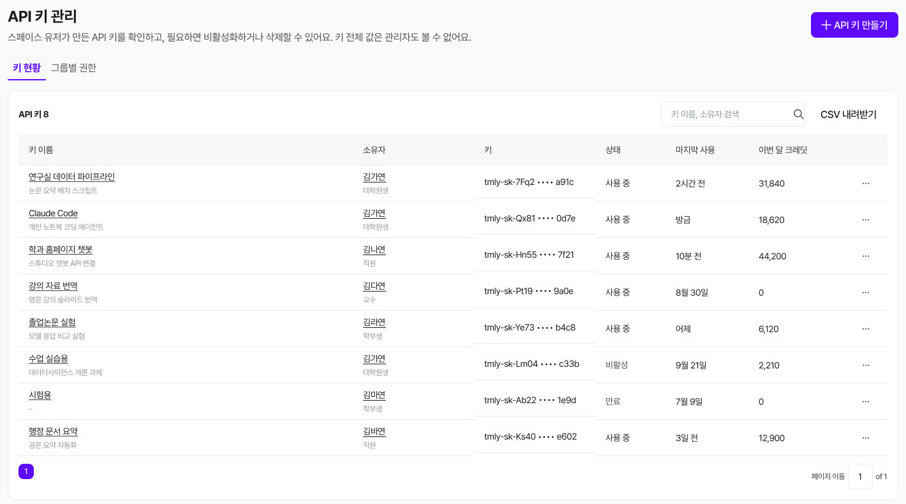
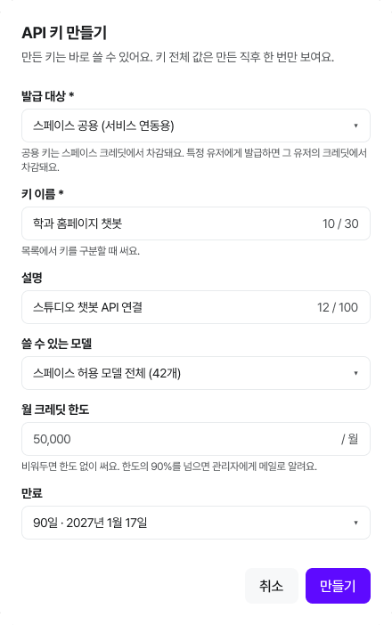
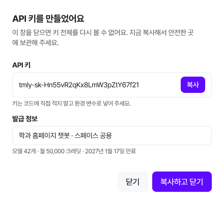

# API KEY 관리

**[어드민 설정] > [API KEY 관리]**에서 스페이스 유저가 만든 **API 키**를 확인하고 관리해요.

!!! note "API 키란?"
    타임리 AI를 다른 프로그램이나 서비스에 연결할 때 쓰는 **비밀번호 같은 값**이에요. 학과 홈페이지에 챗봇을 붙이거나, 연구실에서 논문 요약을 자동으로 돌릴 때 필요해요.

## 1. 키 현황 보기 { #list }

| 항목 | 뜻 |
|---|---|
| **키 이름** | 키를 구분하는 이름과 설명이에요 |
| **소유자** | 키를 만든 유저와 소속(대학원생·교수·직원 등)이에요 |
| **키** | 키 값의 앞·뒤 일부만 보여요 |
| **상태** | **사용 중** · **비활성**(잠시 꺼 둔 키) · **만료**(기간이 끝난 키) |
| **마지막 사용** | 키가 마지막으로 쓰인 때예요 |
| **이번 달 크레딧** | 이 키로 이번 달에 쓴 크레딧이에요 |

- 키 오른쪽 **⋯ 메뉴**에서 키를 **비활성화하거나 삭제**할 수 있어요.
- 키 이름이나 소유자로 검색하고, **[CSV 내려받기]**로 목록을 파일로 받을 수 있어요.

!!! warning "키 전체 값은 관리자도 볼 수 없어요"
    목록에는 키의 앞·뒤 일부만 보여요. 전체 값은 만든 직후 한 번만 확인할 수 있어요.

!!! tip "이럴 때 확인하세요"
    - **이번 달 크레딧**이 갑자기 큰 키 → 프로그램이 잘못 돌고 있거나 키가 새어 나갔을 수 있어요. 먼저 비활성화하고 소유자에게 확인해 주세요.
    - **마지막 사용**이 오래된 키 → 더 안 쓰는 키예요. 졸업·퇴사한 유저의 키와 함께 정리해 주세요.

## 2. API 키 만들기 { #create }

오른쪽 위 **[+ API 키 만들기]**를 눌러요. 만든 키는 바로 쓸 수 있어요.

{ width="440" }

| 항목 | 설명 |
|---|---|
| **발급 대상** (필수) | **스페이스 공용 (서비스 연동용)** — 스페이스 크레딧에서 차감돼요 / **특정 유저** — 그 유저의 크레딧에서 차감돼요 |
| **키 이름** (필수) | 최대 30자. 목록에서 키를 구분할 때 써요 |
| **설명** | 최대 100자. 어디에 쓰는 키인지 적어 두면 나중에 정리하기 쉬워요 |
| **쓸 수 있는 모델** | 기본은 스페이스에서 허용한 모델 전체예요 |
| **월 크레딧 한도** | 비워 두면 한도 없이 써요 |
| **만료** | 키를 쓸 수 있는 기간이에요 |

> 💡 **월 크레딧 한도의 90%를 넘으면 관리자에게 메일로 알려 줘요.** 서비스 연동용 키에는 한도를 꼭 정해 두세요.

## 3. 만든 키 보관하기 { #keep }

키를 만들면 **키 전체 값이 한 번만** 화면에 보여요.

{ width="440" }

- 창을 닫으면 키 전체를 다시 볼 수 없어요. **[복사하고 닫기]**로 바로 복사해서 안전한 곳에 보관해 주세요.
- 키를 잃어버렸다면 다시 볼 방법이 없어요. 그 키는 삭제하고 새로 만들어 주세요.
- 키는 프로그램 코드에 직접 적지 말고 환경 변수(프로그램 밖에 따로 저장해 두는 설정값)로 넣어 주세요.
