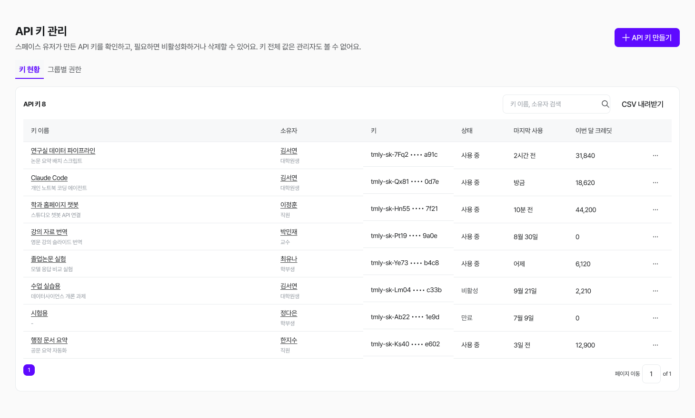

# API KEY 관리

**[어드민 설정] > [API KEY 관리]**에서 스페이스 유저가 만든 **API 키**를 확인하고 관리해요.
API 키는 타임리 AI를 다른 프로그램이나 서비스에 연결할 때 쓰는 비밀번호 같은 값이에요.

## 키 현황 보기

**[키 현황]** 탭에서 스페이스의 모든 API 키를 볼 수 있어요.

| 항목 | 설명 |
|---|---|
| 키 이름 | 키를 구분하는 이름과 설명 |
| 소유자 | 키를 만든 유저와 소속 그룹 |
| 키 | 키 값의 앞·뒤 일부만 표시 |
| 상태 | 사용 중 · 비활성 · 만료 |
| 마지막 사용 | 키가 마지막으로 쓰인 때 |
| 이번 달 크레딧 | 이 키로 이번 달에 쓴 크레딧 |

- 키 이름이나 소유자로 검색할 수 있어요.
- 필요하면 키를 **비활성화하거나 삭제**할 수 있어요.
- **[CSV 내려받기]**로 목록을 파일로 받을 수 있어요.

!!! warning "키 전체 값은 관리자도 볼 수 없어요"
    목록에는 키의 앞·뒤 일부만 보여요. 전체 값은 만든 직후 한 번만 확인할 수 있어요.

## API 키 만들기

오른쪽 위 **[+ API 키 만들기]**를 눌러요. 만든 키는 바로 쓸 수 있어요.

1. **발급 대상**을 골라요.
    - **스페이스 공용 (서비스 연동용)** : 스페이스 크레딧에서 차감돼요.
    - **특정 유저** : 그 유저의 크레딧에서 차감돼요.
2. **키 이름**을 입력해요. (최대 30자) 목록에서 키를 구분할 때 써요.
3. 필요하면 **설명**을 적어요. (최대 100자)
4. **쓸 수 있는 모델**을 골라요. 기본은 스페이스에서 허용한 모델 전체예요.
5. **월 크레딧 한도**를 정해요. 비워두면 한도 없이 써요.
6. **만료 기간**을 확인하고 키를 만들어요.

> 💡 **월 크레딧 한도의 90%를 넘으면 관리자에게 메일로 알려줘요.**

## 만든 키 보관하기

키를 만들면 **키 전체 값이 한 번만** 화면에 보여요.

- 창을 닫으면 키 전체를 다시 볼 수 없어요. **바로 복사해서 안전한 곳에 보관**해 주세요.
- 키는 프로그램 코드에 직접 적지 말고 환경 변수(프로그램 밖에 따로 저장해 두는 설정값)로 넣어 주세요.
