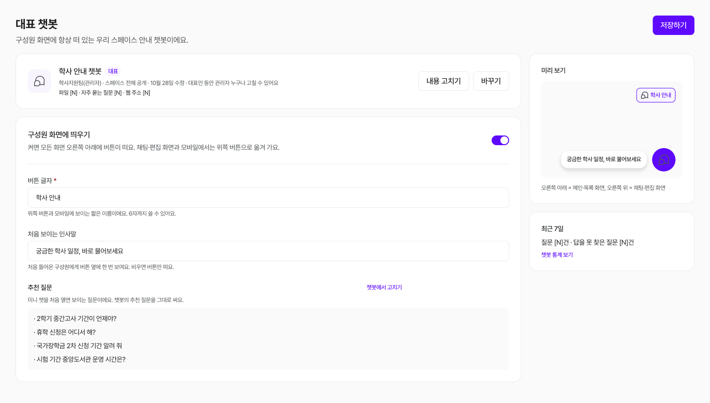
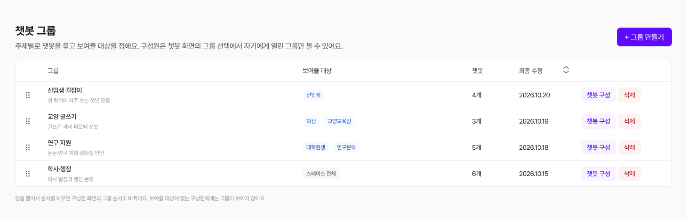
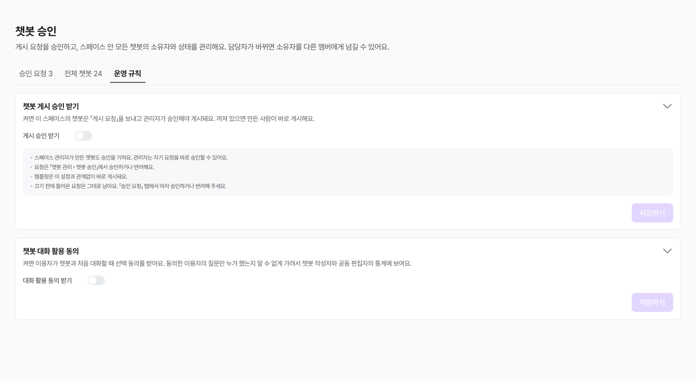

# 챗봇 관리

**[어드민 설정] > [챗봇 관리]**에서 우리 스페이스의 챗봇을 운영해요. 메뉴는 다섯 가지예요.

| 메뉴 | 하는 일 |
|---|---|
| [대표 챗봇](#_2) | 구성원 화면에 항상 떠 있는 안내 챗봇을 정해요 |
| [추천 챗봇 관리](#_3) | 챗봇 화면의 '추천'에 보일 챗봇을 골라요 |
| [챗봇 그룹 관리](#_4) | 챗봇을 주제별로 묶고 보여줄 대상을 정해요 |
| [챗봇 승인](#_5) | 게시 요청을 승인·반려하고 전체 챗봇을 관리해요 |
| [챗봇 기본 틀](#_9) | 새 챗봇을 만들 때 고를 수 있는 기본 틀을 관리해요 |

## 대표 챗봇

구성원 화면에 **항상 떠 있는 우리 스페이스 안내 챗봇**이에요. 자주 묻는 일정이나 안내를 자료로 넣어 두면, 구성원이 어느 화면에서든 버튼을 눌러 바로 물어볼 수 있어요.

**대표 챗봇 정하기**

- **[대표 챗봇 새로 만들기]** : 지시문을 다듬고 자료 파일, 자주 묻는 질문, 웹 주소를 넣어 새로 만들어요.
- **[기존 챗봇에서 고르기]** : 이미 있는 챗봇 중에서 골라요. 관리자가 만들고 스페이스 전체에 공개한 챗봇만 고를 수 있어요.
- 이미 대표 챗봇이 있으면 **[내용 고치기]**로 수정하고, **[바꾸기]**로 다른 챗봇으로 바꿀 수 있어요.

> 💡 **구성원이 만든 챗봇을 대표로 쓰려면** 먼저 소유자를 관리자로 바꿔 주세요. ([챗봇 승인](#_5)의 전체 챗봇에서 바꿀 수 있어요.)

**구성원 화면에 띄우기**

- **구성원 화면에 띄우기** : 켜면 모든 화면 오른쪽 아래에 버튼이 떠요. 채팅·편집 화면과 모바일에서는 위쪽 버튼으로 옮겨 가요.
- **버튼 글자** : 위쪽 버튼과 모바일에 보이는 짧은 이름이에요. 6자까지 쓸 수 있어요.
- **처음 보이는 인사말** : 처음 들어온 구성원에게 버튼 옆에 한 번 보여요. 비우면 버튼만 떠요.
- **추천 질문** : 챗봇 창을 처음 열면 보이는 질문이에요. 챗봇에 등록한 추천 질문을 그대로 써요.
- 오른쪽 **미리 보기**에서 버튼이 어떻게 보일지 확인하고, **[저장하기]**를 눌러요.

화면 오른쪽 아래에서는 최근 7일 동안의 질문 수와 답을 못 찾은 질문 수를 볼 수 있어요.

## 추천 챗봇 관리

구성원 챗봇 화면의 **'추천'**에 보일 챗봇을 골라요.

- 오른쪽 위 **[챗봇 가져오기]**로 우리 스페이스에 게시된 챗봇이나 기본 제공 챗봇을 가져와요.
- 목록에서 챗봇의 카테고리, 모델, 출처(기본 제공 / 우리 스페이스), 추가일을 볼 수 있어요.
- 행을 끌어서 순서를 바꿀 수 있어요.
- **[지정 해제]**를 누르면 추천에서 빠져요. 챗봇 자체는 지워지지 않아요.

> 💡 **새 챗봇은 챗봇 메뉴에서 만들어 게시한 뒤 여기서 가져와요.**

## 챗봇 그룹 관리

챗봇을 **주제별로 묶고, 누구에게 보여줄지** 정해요. 구성원은 챗봇 화면의 그룹 선택에서 자기에게 열린 그룹만 볼 수 있어요.

- 오른쪽 위 **[+ 그룹 만들기]**로 새 그룹을 만들어요.
- **보여줄 대상** : 그룹을 볼 수 있는 유저 그룹이에요. 대상에 없는 구성원에게는 그룹이 보이지 않아요.
- **[챗봇 구성]** : 그룹에 넣을 챗봇을 골라요.
- **[삭제]** : 그룹을 지워요.
- 행을 끌어서 순서를 바꾸면 구성원 화면의 그룹 순서도 바뀌어요.

## 챗봇 승인

구성원이 보낸 **게시 요청을 승인**하고, 스페이스 안 모든 챗봇의 소유자와 상태를 관리해요. **승인 요청 · 전체 챗봇 · 운영 규칙** 세 개 탭이 있어요.

### 승인 요청

- 요청마다 챗봇, 요청자, 공개 범위, 요청 일시, 구분(첫 게시 / 다시 게시)을 볼 수 있어요.
- **[내용 보기]**로 챗봇 내용을 먼저 확인한 뒤 **[승인]** 또는 **[반려]**를 눌러요.
- 승인하면 요청한 공개 범위의 챗봇 목록에 바로 보여요.
- 반려하면 요청자에게 이유와 함께 알림이 가요.

### 전체 챗봇

- 스페이스 안 모든 챗봇과 소유자, 상태(게시 중 · 승인 대기 · 게시 전)를 볼 수 있어요.
- 챗봇 오른쪽 **⋯ 메뉴**에서 게시 내리기, 공개 범위 보기, 삭제를 할 수 있어요.
- 담당자가 바뀌면 **소유자를 다른 구성원에게 넘길 수 있어요.**

> 💡 **소유자가 비활성 계정이면** 챗봇을 계속 관리할 수 있게 소유자를 넘겨 주세요. `비활성 소유자만` 필터로 찾을 수 있어요.

### 운영 규칙

**챗봇 게시 승인 받기**

- 켜면 이 스페이스의 챗봇은 '게시 요청'을 보내고 **관리자가 승인해야 게시**돼요.
- 꺼져 있으면 만든 사람이 바로 게시해요.
- 스페이스 관리자가 만든 챗봇도 승인을 거쳐요. 관리자는 자기 요청을 바로 승인할 수 있어요.
- 템플릿은 이 설정과 관계없이 바로 게시돼요.
- 끄기 전에 들어온 요청은 그대로 남아요. 승인 요청 탭에서 마저 승인하거나 반려해 주세요.

**챗봇 대화 활용 동의**

- 켜면 이용자가 챗봇과 처음 대화할 때 선택 동의를 받아요.
- 동의한 이용자의 질문만, 누가 했는지 알 수 없게 가려서 챗봇 작성자와 공동 편집자의 통계에 보여요.

## 챗봇 기본 틀

새 챗봇을 만들 때 **고를 수 있는 기본 틀**을 관리해요. 기본 틀로 만든 챗봇은 템플릿과 따로 저장돼요.

- **우리 스페이스** 탭 : 우리 스페이스에서 만든 기본 틀이에요. 오른쪽 위 **[기본 틀 추가]**로 새로 등록해요.
- **전체 공통** 탭 : 타임리가 기본으로 제공하는 틀이에요. 보기만 할 수 있어요.
- 목록에서 순서, 카테고리, 이름, 설명, 모델, 노출 여부, 최종 수정일을 볼 수 있어요.
- **노출 여부**를 끄면 구성원이 챗봇을 만들 때 그 틀이 보이지 않아요.
