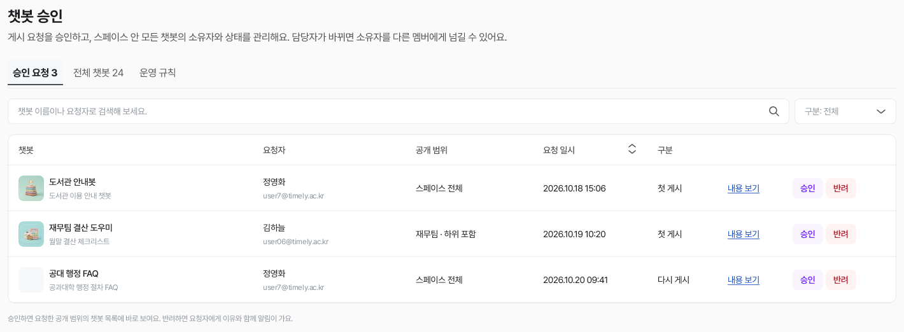
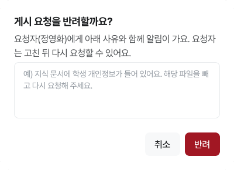
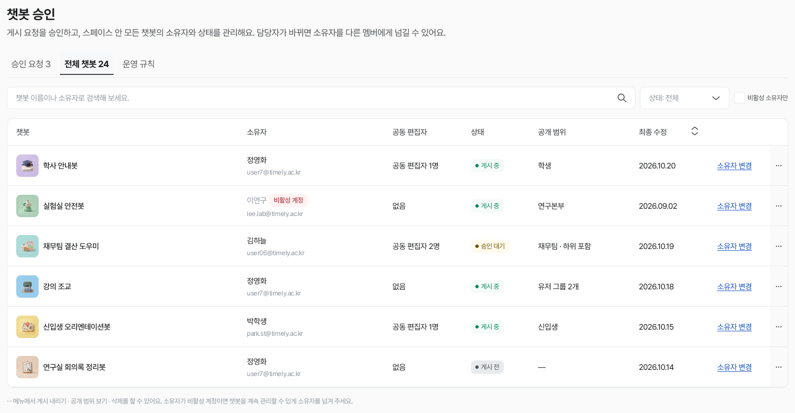
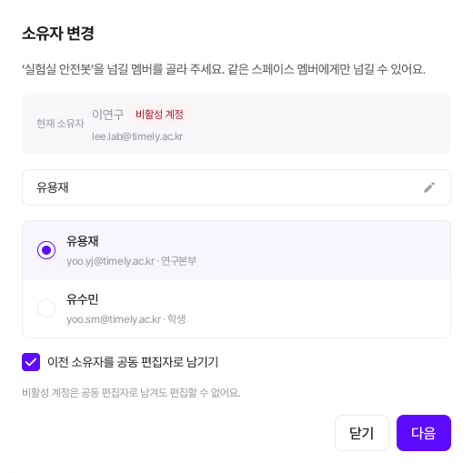
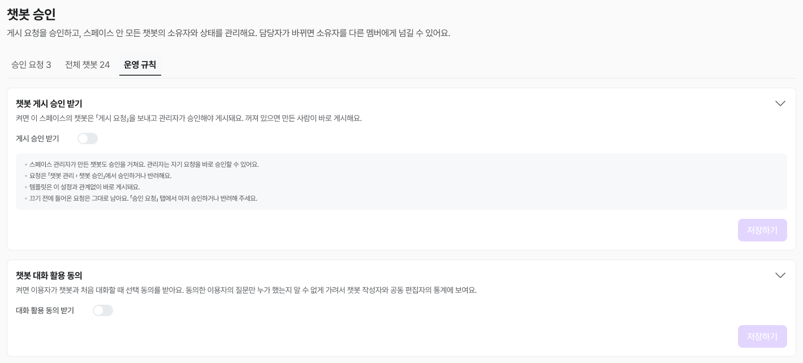

# 챗봇 승인

**[챗봇 관리] > [챗봇 승인]**에서 구성원이 보낸 **게시 요청을 승인**하고, 스페이스 안 모든 챗봇의 소유자와 상태를 관리해요. 탭 3개로 나뉘어 있어요.

| 탭 | 하는 일 |
|---|---|
| [1. 승인 요청](#requests) | 들어온 게시 요청을 확인하고 승인·반려해요 |
| [2. 전체 챗봇](#all) | 모든 챗봇의 상태를 보고, 소유자를 바꿔요 |
| [3. 운영 규칙](#rules) | 게시 전에 승인을 받게 할지, 대화 활용 동의를 받을지 정해요 |

## 1. 승인 요청 { #requests }

| 항목 | 뜻 |
|---|---|
| **공개 범위** | 요청자가 이 챗봇을 누구에게 공개하려는지예요 |
| **구분** | **첫 게시** — 처음 게시하는 챗봇 / **다시 게시** — 게시했던 챗봇을 고쳐서 다시 올린 것 |
| **[내용 보기]** | 승인 전에 챗봇 내용을 확인해요 |

**[내용 보기]**로 먼저 확인한 뒤 **[승인]** 또는 **[반려]**를 눌러요.

- **승인**하면 요청한 공개 범위의 챗봇 목록에 바로 보여요.
- **반려**하면 사유를 적는 창이 떠요. 요청자에게 사유와 함께 알림이 가고, 요청자는 고친 뒤 다시 요청할 수 있어요.

{ width="400" }

!!! tip "반려 사유는 구체적으로"
    "지식 문서에 학생 개인정보가 들어 있어요. 해당 파일을 빼고 다시 요청해 주세요."처럼 **무엇을 고치면 되는지** 적어 주면 다시 요청이 빨라져요.

## 2. 전체 챗봇 { #all }

| 상태 | 뜻 |
|---|---|
| **게시 중** | 구성원에게 공개돼 있어요 |
| **승인 대기** | 게시 요청이 들어와 승인을 기다리고 있어요 |
| **게시 전** | 아직 게시하지 않았어요 |

챗봇 오른쪽 **⋯ 메뉴**에서 **게시 내리기 · 공개 범위 보기 · 삭제**를 할 수 있어요.

### 2-1. 소유자 변경

담당자가 바뀌거나 졸업·퇴사했을 때, 챗봇을 다른 구성원에게 넘겨요. **[소유자 변경]**을 눌러요.

{ width="480" }

1. 넘겨받을 멤버를 검색해 골라요. 같은 스페이스 멤버에게만 넘길 수 있어요.
2. 필요하면 **이전 소유자를 공동 편집자로 남기기**를 체크해요.
3. **[다음]**을 눌러 확인하고 변경해요.

!!! warning "소유자가 비활성 계정이면 꼭 넘겨 주세요"
    소유자 옆에 **비활성 계정** 표시가 있으면 그 챗봇을 관리할 사람이 없는 상태예요. 위쪽 **비활성 소유자만**을 체크하면 한 번에 찾을 수 있어요. 비활성 계정은 공동 편집자로 남겨도 편집할 수 없어요.

## 3. 운영 규칙 { #rules }

### 3-1. 챗봇 게시 승인 받기

| 설정 | 동작 |
|---|---|
| **켬** | 챗봇을 게시하려면 '게시 요청'을 보내고 **관리자가 승인해야** 게시돼요 |
| **끔** | 만든 사람이 바로 게시해요 |

- 스페이스 관리자가 만든 챗봇도 승인을 거쳐요. 관리자는 자기 요청을 바로 승인할 수 있어요.
- 템플릿은 이 설정과 관계없이 바로 게시돼요.
- 끄기 전에 들어온 요청은 그대로 남아요. 승인 요청 탭에서 마저 승인하거나 반려해 주세요.

!!! tip "이럴 때 켜 두세요"
    구성원이 만든 챗봇이 전체에 공개되기 전에, 개인정보나 부정확한 자료가 들어 있지 않은지 확인하고 싶을 때 켜요.

### 3-2. 챗봇 대화 활용 동의

켜면 이용자가 챗봇과 처음 대화할 때 **선택 동의**를 받아요. 동의한 이용자의 질문만, 누가 했는지 알 수 없게 가려서 챗봇 작성자와 공동 편집자의 통계에 보여요.
