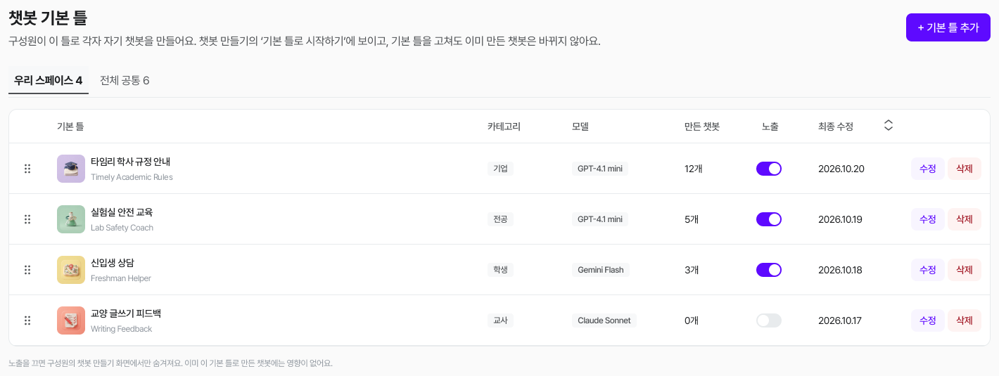
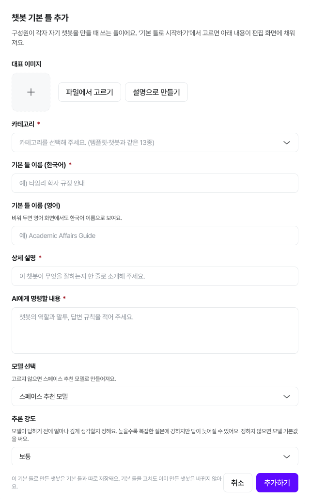
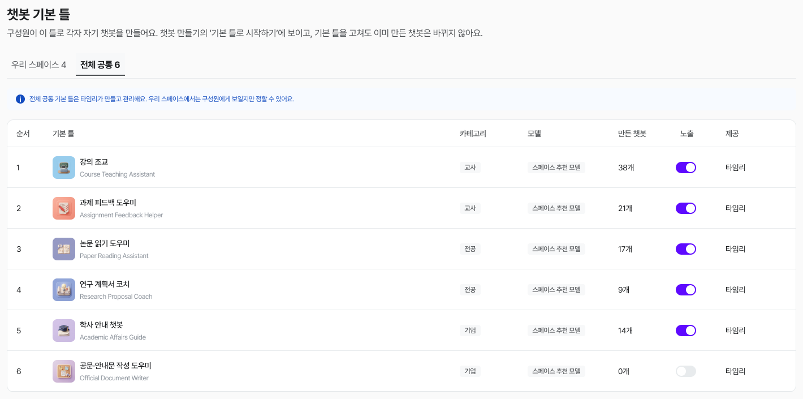

# 챗봇 기본 틀

**[챗봇 관리] > [챗봇 기본 틀]**에서 구성원이 새 챗봇을 만들 때 **고를 수 있는 기본 틀**을 관리해요. 구성원은 챗봇 만들기의 **'기본 틀로 시작하기'**에서 틀을 골라, 내용이 미리 채워진 상태로 자기 챗봇을 만들어요.

> 💡 기본 틀을 고쳐도 **이미 그 틀로 만든 챗봇은 바뀌지 않아요.** 기본 틀로 만든 챗봇은 틀과 따로 저장돼요.

## 1. 우리 스페이스 기본 틀 { #ours }

우리 스페이스에서 직접 만든 기본 틀이에요.

| 항목 | 뜻 |
|---|---|
| **만든 챗봇** | 구성원이 이 틀로 만든 챗봇 수예요. 어떤 틀이 잘 쓰이는지 알 수 있어요 |
| **노출** | 끄면 구성원의 챗봇 만들기 화면에서 숨겨져요. 이미 이 틀로 만든 챗봇에는 영향이 없어요 |
| **점 6개 아이콘** | 끌어서 구성원에게 보이는 순서를 바꿔요 |
| **[수정]** · **[삭제]** | 틀의 내용을 고치거나 지워요 |

## 2. 기본 틀 추가하기 { #add }

오른쪽 위 **[+ 기본 틀 추가]**를 눌러요.

{ width="560" }

| 항목 | 설명 |
|---|---|
| **대표 이미지** | 파일에서 고르거나, 설명을 적어 AI로 만들어요 |
| **카테고리** (필수) | 템플릿·챗봇과 같은 카테고리 중에서 골라요 |
| **기본 틀 이름 (한국어)** (필수) | 구성원에게 보이는 이름이에요 |
| **기본 틀 이름 (영어)** | 비워 두면 영어 화면에서도 한국어 이름으로 보여요 |
| **상세 설명** (필수) | 이 챗봇이 무엇을 잘하는지 한 줄로 적어요 |
| **AI에게 명령할 내용** (필수) | 챗봇의 역할, 말투, 답변 규칙을 적어요 |
| **모델 선택** | 고르지 않으면 스페이스 추천 모델로 만들어져요 |
| **추론 강도** | 모델이 답하기 전에 얼마나 깊게 생각할지예요. 높을수록 복잡한 질문에 강하지만 답이 늦어질 수 있어요 |

!!! tip "이런 틀을 만들어 두면 좋아요"
    `학사 규정 안내`, `실험실 안전 교육`, `신입생 상담`처럼 **학과·부서마다 비슷하게 필요한 챗봇**을 틀로 만들어 두면, 각 담당자가 자료만 바꿔 넣어 빠르게 자기 챗봇을 만들 수 있어요.

## 3. 전체 공통 기본 틀 { #common }

**전체 공통** 탭에는 타임리가 만들고 관리하는 기본 틀이 있어요.

내용은 고칠 수 없고, **노출** 토글로 **구성원에게 보일지만** 정할 수 있어요. 우리 기관에 맞지 않는 틀은 꺼 두세요.
