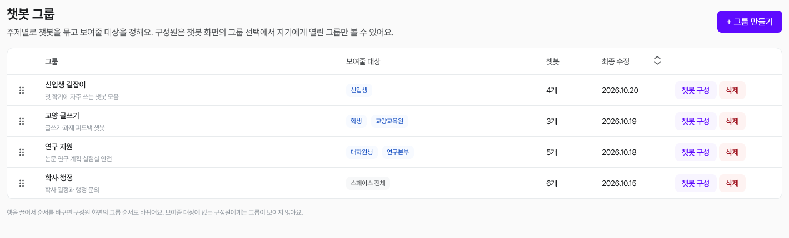
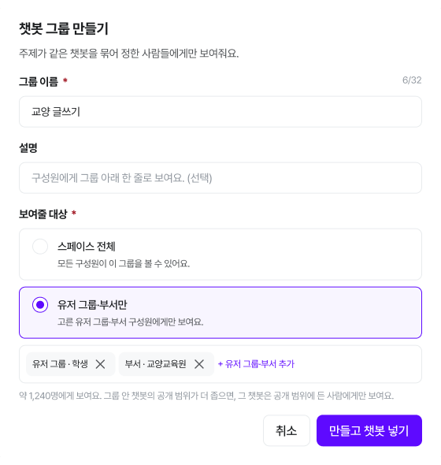
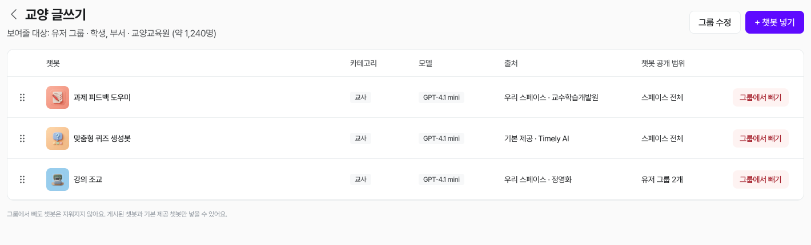
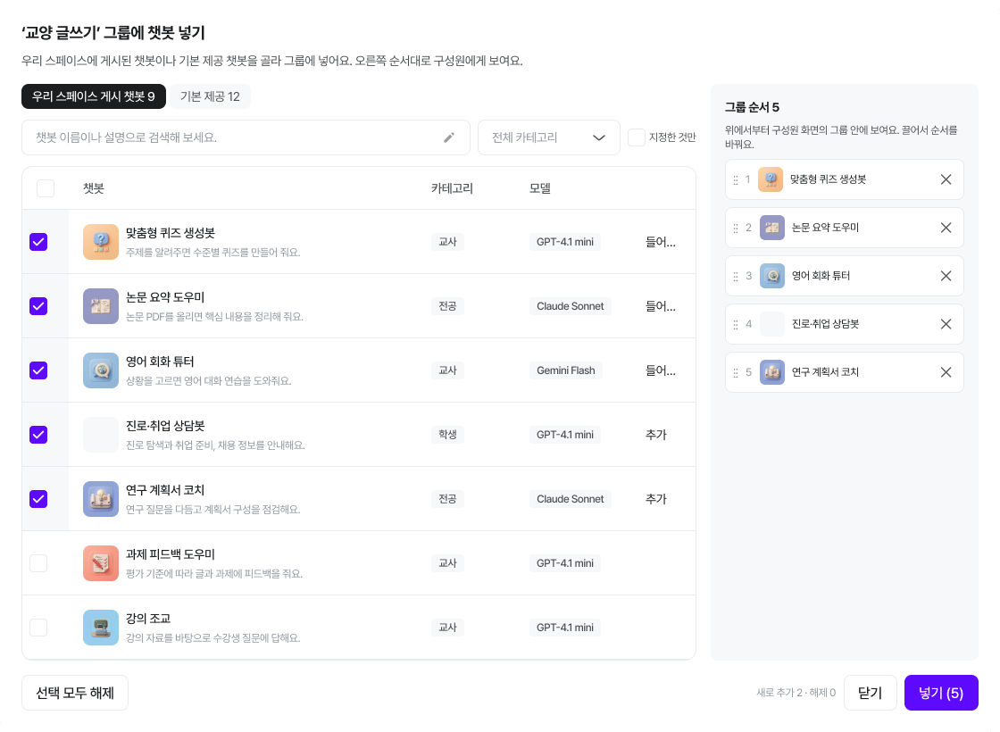

# 챗봇 그룹 관리

**[챗봇 관리] > [챗봇 그룹 관리]**에서 챗봇을 **주제별로 묶고, 누구에게 보여 줄지** 정해요. 구성원은 챗봇 화면의 그룹 선택에서 자기에게 열린 그룹만 볼 수 있어요.

## 1. 화면 구성 { #overview }

| 항목 | 뜻 |
|---|---|
| **보여줄 대상** | 이 그룹을 볼 수 있는 사람이에요. `스페이스 전체`거나, `신입생` `대학원생`처럼 고른 유저 그룹·부서예요. 대상에 없는 구성원에게는 그룹이 보이지 않아요 |
| **챗봇** | 그룹에 들어 있는 챗봇 수예요 |
| **점 6개 아이콘** | 끌어서 순서를 바꾸면 구성원 화면의 그룹 순서도 바뀌어요 |
| **[챗봇 구성]** | 그룹에 챗봇을 넣거나 빼요 |
| **[삭제]** | 그룹을 지워요. 그룹 안의 챗봇은 지워지지 않아요 |

## 2. 그룹 만들기 { #create }

오른쪽 위 **[+ 그룹 만들기]**를 눌러요.

{ width="520" }

| 항목 | 설명 |
|---|---|
| **그룹 이름** | 최대 32자. 이미 있는 이름은 쓸 수 없어요 |
| **설명** | 구성원 화면에서 그룹 이름 아래 한 줄로 보여요. 안 적어도 돼요 |
| **보여줄 대상** | **스페이스 전체** — 모든 구성원이 봐요 / **유저 그룹·부서만** — 고른 유저 그룹·부서의 구성원만 봐요 |

!!! warning "챗봇마다 공개 범위가 따로 있어요"
    그룹을 넓게 열어도, **그룹 안 챗봇의 공개 범위가 더 좁으면 그 챗봇은 공개 범위에 든 사람에게만** 보여요.

## 3. 그룹에 챗봇 넣기 · 빼기 { #compose }

그룹의 **[챗봇 구성]**을 누르면 그 그룹에 들어 있는 챗봇이 나와요.

| 항목 | 뜻 |
|---|---|
| **출처** | 기본 제공인지, 우리 스페이스의 누가 만들었는지 보여 줘요 |
| **챗봇 공개 범위** | 그 챗봇을 볼 수 있는 사람이에요 |
| **[그룹에서 빼기]** | 이 그룹에서만 빼요. 챗봇은 지워지지 않아요 |
| **[그룹 수정]** | 그룹 이름·설명·보여줄 대상을 바꿔요 |

챗봇을 넣으려면 **[+ 챗봇 넣기]**를 눌러요.

1. 넣을 챗봇을 체크해요.
2. 오른쪽 **그룹 순서**에서 끌어서 순서를 정해요.
3. **[넣기]**를 눌러요.

> 💡 그룹에는 **게시된 챗봇과 기본 제공 챗봇만** 넣을 수 있어요.
