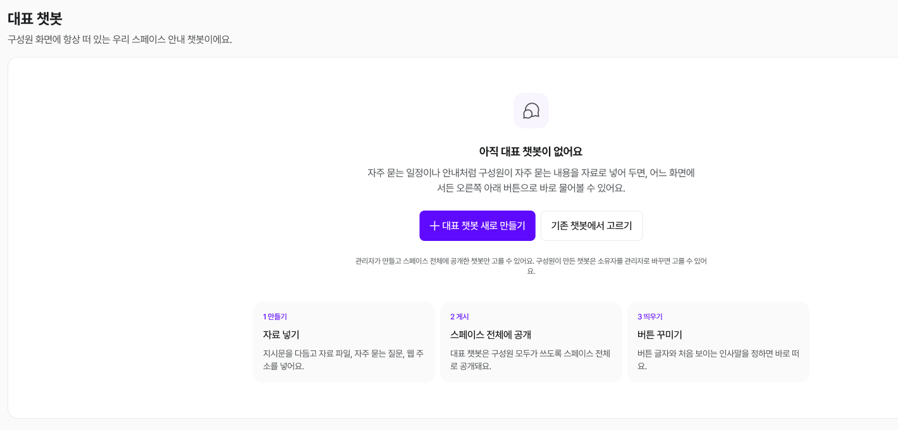
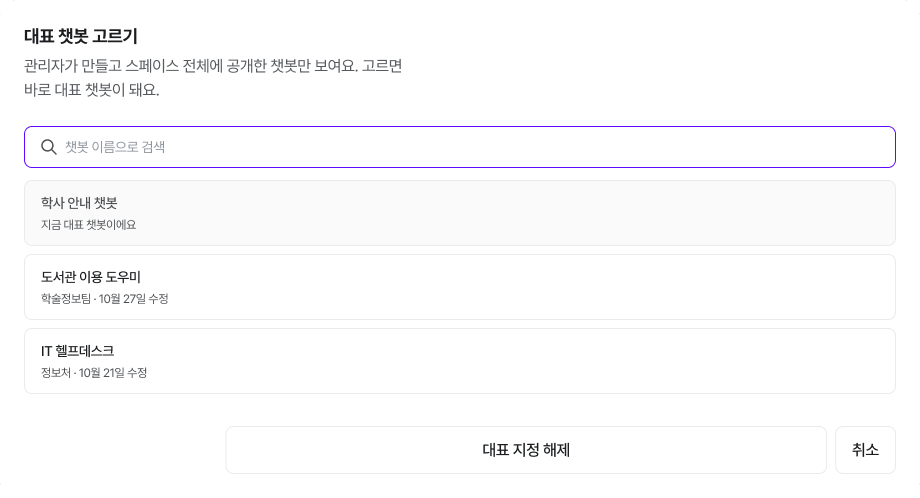
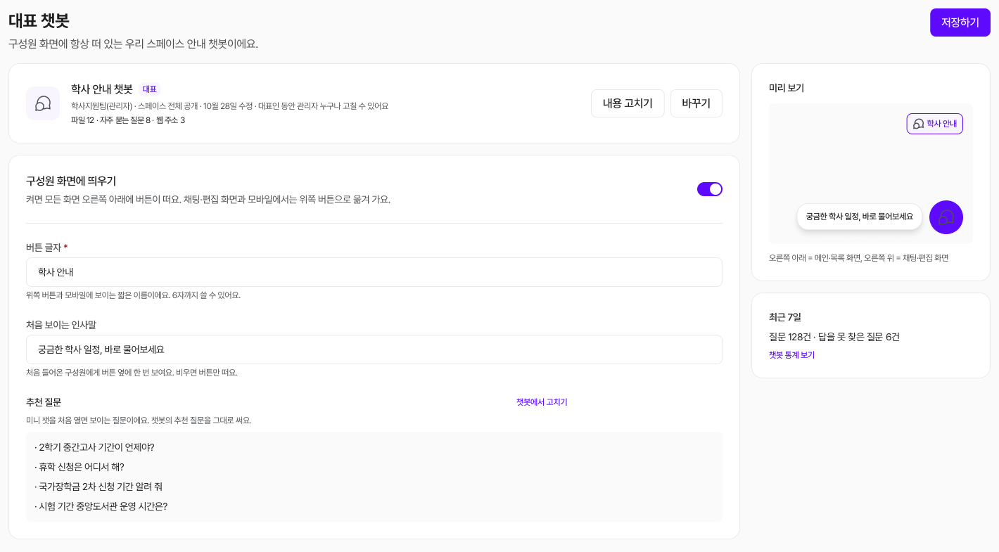

# 대표 챗봇

**[챗봇 관리] > [대표 챗봇]**에서 구성원 화면에 **항상 떠 있는 우리 스페이스 안내 챗봇**을 정해요. 학사 일정이나 자주 묻는 안내를 자료로 넣어 두면, 구성원이 어느 화면에서든 버튼을 눌러 바로 물어볼 수 있어요.

## 1. 대표 챗봇 정하기 { #pick }

처음에는 대표 챗봇이 없어요. 두 가지 방법 중 하나로 정해요.

| 방법 | 설명 |
|---|---|
| **[+ 대표 챗봇 새로 만들기]** | 지시문을 다듬고 자료 파일, 자주 묻는 질문, 웹 주소를 넣어 새로 만들어요 |
| **[기존 챗봇에서 고르기]** | 이미 있는 챗봇 중에서 골라요. 고르면 바로 대표 챗봇이 돼요 |

진행 순서는 **① 만들기(자료 넣기) → ② 게시(스페이스 전체에 공개) → ③ 띄우기(버튼 꾸미기)**예요. 대표 챗봇은 구성원 모두가 쓰도록 스페이스 전체로 공개돼요.

{ width="560" }

!!! warning "목록에 원하는 챗봇이 안 보일 때"
    **관리자가 만들고 스페이스 전체에 공개한 챗봇만** 고를 수 있어요. 구성원이 만든 챗봇을 대표로 쓰려면 먼저 [챗봇 승인 > 전체 챗봇](approval.md#all)에서 소유자를 관리자로 바꿔 주세요.

## 2. 구성원 화면에 띄우기 { #show }

대표 챗봇을 정하면 아래 화면이 나와요.

| 항목 | 설명 |
|---|---|
| **[내용 고치기]** | 챗봇의 지시문과 자료를 고쳐요. 대표인 동안에는 관리자 누구나 고칠 수 있어요 |
| **[바꾸기]** | 다른 챗봇으로 바꾸거나 대표 지정을 해제해요 |
| **구성원 화면에 띄우기** | 켜면 모든 화면 오른쪽 아래에 버튼이 떠요. 채팅·편집 화면과 모바일에서는 위쪽 버튼으로 옮겨 가요 |
| **버튼 글자** | 위쪽 버튼과 모바일에 보이는 짧은 이름이에요. 6자까지 쓸 수 있어요 |
| **처음 보이는 인사말** | 처음 들어온 구성원에게 버튼 옆에 한 번 보여요. 비우면 버튼만 떠요 |
| **추천 질문** | 챗봇 창을 처음 열면 보이는 질문이에요. 챗봇에 등록한 추천 질문을 그대로 쓰고, **[챗봇에서 고치기]**로 바꿔요 |

바꾼 뒤에는 오른쪽 **미리 보기**로 확인하고 **[저장하기]**를 눌러요.

## 3. 잘 쓰이고 있는지 보기 { #stats }

화면 오른쪽 아래 **최근 7일**에서 **질문 수**와 **답을 못 찾은 질문 수**를 볼 수 있어요.

!!! tip "답을 못 찾은 질문이 많다면"
    챗봇에 넣은 자료가 부족하다는 신호예요. **[챗봇 통계 보기]**에서 어떤 질문이었는지 확인하고, **[내용 고치기]**로 자료나 자주 묻는 질문을 보충해 주세요.
