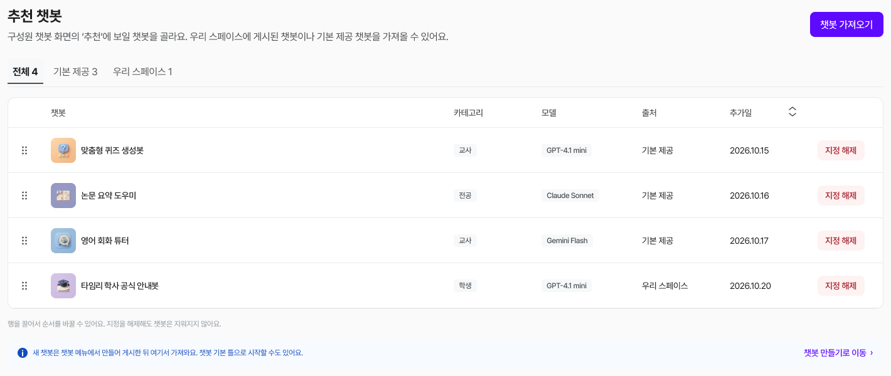
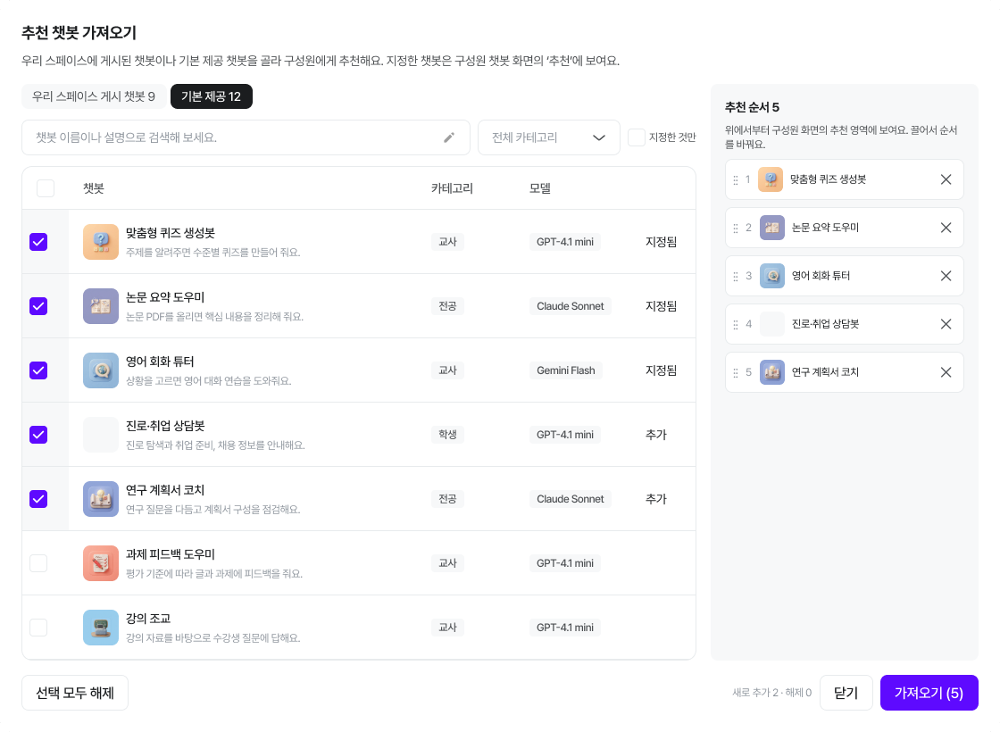

# 추천 챗봇 관리

**[챗봇 관리] > [추천 챗봇 관리]**에서 구성원 챗봇 화면의 **'추천'**에 보일 챗봇을 골라요.

## 1. 화면 구성 { #overview }

| 항목 | 뜻 |
|---|---|
| **전체 · 기본 제공 · 우리 스페이스** | 출처별로 골라 보는 탭이에요 |
| **출처** | **기본 제공** — 타임리가 만들어 둔 챗봇 / **우리 스페이스** — 우리 구성원이 만들어 게시한 챗봇 |
| **점 6개 아이콘** | 끌어서 추천 순서를 바꿔요. 위에 있을수록 구성원 화면에서 먼저 보여요 |
| **[지정 해제]** | 추천에서 빼요. 챗봇 자체는 지워지지 않아요 |

## 2. 추천 챗봇 가져오기 { #import }

오른쪽 위 **[챗봇 가져오기]**를 눌러요.

1. 위쪽 탭에서 **우리 스페이스에 게시된 챗봇**이나 **기본 제공** 챗봇을 골라요.
2. 추천할 챗봇을 체크해요.
3. 오른쪽 **추천 순서**에서 끌어서 순서를 정해요.
4. **[가져오기]**를 눌러요.

!!! tip "우리 기관만의 챗봇을 추천하고 싶다면"
    새 챗봇은 여기서 만들 수 없어요. **챗봇 메뉴에서 만들어 게시한 뒤** 여기서 가져와요. 화면 아래 **[챗봇 만들기로 이동]**을 누르면 바로 갈 수 있고, [챗봇 기본 틀](base.md)로 시작할 수도 있어요.

> 💡 추천 챗봇이 구성원 메인 화면에 보이려면 [스페이스 설정 > 기본 설정](../space/settings.md#basic)의 **추천 챗봇**도 켜져 있어야 해요.
