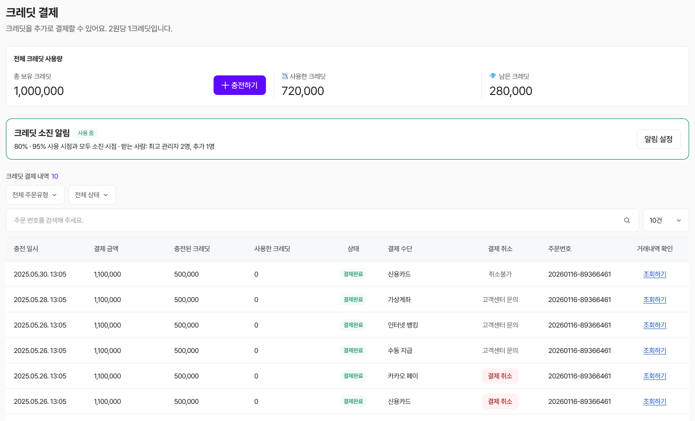
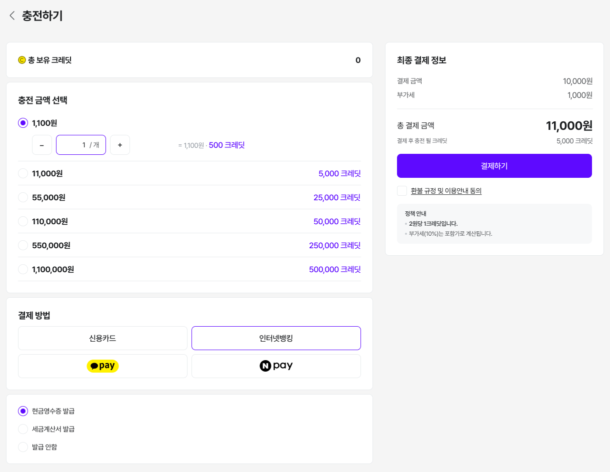
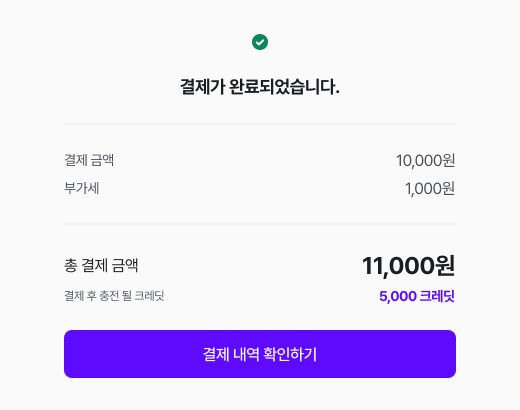
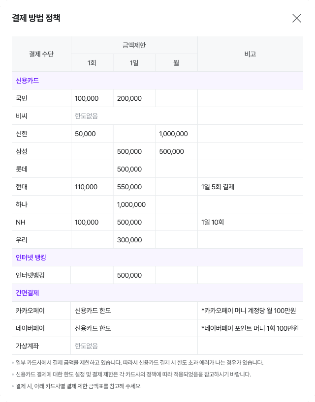
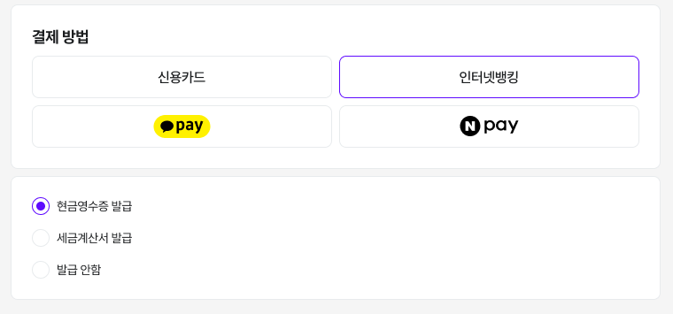
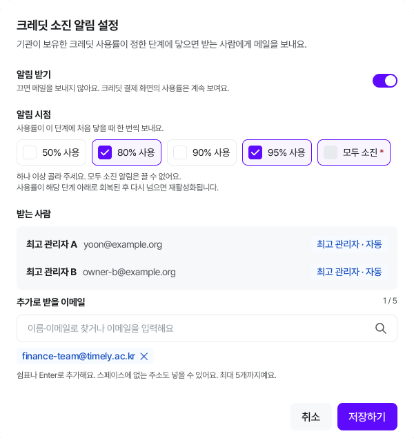
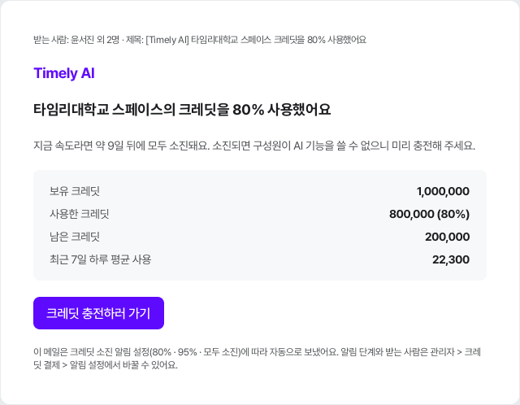
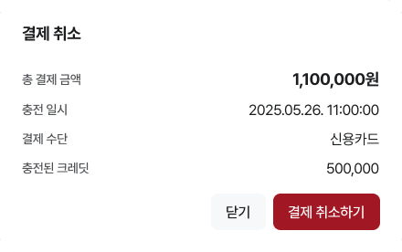

# 크레딧 현황

**[어드민 설정] > [크레딧 현황]**에서 스페이스가 가진 크레딧을 확인하고, 충전하고, 다 떨어지기 전에 알림을 받도록 설정해요.

!!! note "크레딧이란?"
    AI 서비스를 이용할 때 차감되는 단위예요. 질문, 답변 생성, 이미지 처리 같은 작업마다 일정량이 차감돼요. 글 길이, 이미지 처리, 모델 종류에 따라 소모량이 달라요.

## 1. 크레딧 한눈에 보기 { #overview }

| 항목 | 뜻 |
|---|---|
| **총 보유 크레딧** | 지금까지 충전한 크레딧 전체예요 |
| **사용한 크레딧** | 구성원들이 지금까지 쓴 크레딧이에요 |
| **남은 크레딧** | 앞으로 쓸 수 있는 크레딧이에요. **0이 되면 구성원이 AI 기능을 쓸 수 없어요** |

> 💡 누가, 어떤 모델에 크레딧을 많이 썼는지는 [통계 대시보드](stats.md)에서 볼 수 있어요.

## 2. 크레딧 충전하기 { #charge }

**[+ 충전하기]**를 누르면 충전 화면으로 넘어가요.

1. **충전 금액**을 골라요.
2. **결제 방법**을 골라요.
3. **환불 규정 및 이용안내 동의**에 체크하고 **[결제하기]**를 눌러요.
4. 결제가 끝나면 완료 화면이 나와요. **[결제 내역 확인하기]**를 누르면 결제 내역으로 돌아가요.

{ width="420" }

### 2-1. 충전 금액

**2원당 1크레딧**이고, 결제 금액에는 **부가세(10%)가 포함**돼요.

| 결제 금액 (부가세 포함) | 충전되는 크레딧 |
|---|---|
| 1,100원 × 개수 | 개수 × 500 크레딧 |
| 11,000원 | 5,000 크레딧 |
| 55,000원 | 25,000 크레딧 |
| 110,000원 | 50,000 크레딧 |
| 550,000원 | 250,000 크레딧 |
| 1,100,000원 | 500,000 크레딧 |

> 💡 **조금만 충전하고 싶을 때**는 맨 위 **1,100원**을 고르고 **− / +**로 개수를 정해요. 1개에 500 크레딧이에요.

### 2-2. 결제 방법

**신용카드 · 인터넷뱅킹 · 카카오페이 · 네이버페이** 중에서 골라요.

!!! tip "카드 결제가 한도 초과로 안 될 때"
    카드사마다 1회·1일 결제 한도가 달라요. 결제 방법 아래 **[결제 방법 정책 보기]**를 누르면 카드사별 한도를 볼 수 있어요. 금액이 크면 인터넷뱅킹을 쓰거나 나눠서 결제해 주세요.

    { width="520" }

### 2-3. 현금영수증 · 세금계산서

**인터넷뱅킹**을 고르면 아래에 증빙 서류 선택이 나와요.

{ width="520" }

| 선택 | 이럴 때 |
|---|---|
| **현금영수증 발급** | 현금영수증이 필요할 때 |
| **세금계산서 발급** | 기관 회계 처리에 세금계산서가 필요할 때. 필요한 서류와 이메일·전화번호를 입력해요 |
| **발급 안함** | 증빙이 필요 없을 때 |

## 3. 크레딧 소진 알림 { #alert }

크레딧이 정한 만큼 쓰이면 **메일로 미리 알려 주는 기능**이에요. 학기 중에 갑자기 크레딧이 떨어져 수업이나 업무가 멈추는 일을 막을 수 있어요.

**[알림 설정]**을 눌러요.

{ width="520" }

| 항목 | 설명 |
|---|---|
| **알림 받기** | 끄면 메일을 보내지 않아요. 화면의 사용률은 계속 보여요 |
| **알림 시점** | 사용률 50% · 80% · 90% · 95% 중에서 하나 이상 골라요. **모두 소진** 알림은 끌 수 없어요 |
| **받는 사람** | 최고 관리자는 자동으로 받아요 |
| **추가로 받을 이메일** | 회계·구매 담당자처럼 함께 받아야 할 사람을 넣어요. 스페이스에 없는 주소도 되고, 최대 5개까지예요 |

- 알림은 사용률이 그 단계에 **처음 닿을 때 한 번만** 보내요.
- 충전해서 사용률이 그 단계 아래로 내려갔다가 다시 넘으면, 그때 다시 보내요.

알림 메일은 이렇게 와요. 지금 속도라면 며칠 뒤에 다 떨어지는지도 함께 알려 줘요.

{ width="520" }

!!! tip "이렇게 설정해 두면 좋아요"
    **80%**와 **95%**를 켜 두면, 80%에서 충전을 준비하고 95%에서 마지막으로 확인할 수 있어요. 결제 품의에 시간이 걸리는 기관이라면 **50%**도 켜 두세요.

## 4. 결제 내역과 결제 취소 { #history }

화면 아래 **크레딧 결제 내역**에서 지금까지의 결제를 확인해요. **주문유형 · 상태**로 골라 보거나 주문 번호로 검색할 수 있어요.

### 4-1. 거래내역 확인

**거래내역 확인**의 **[조회하기]**를 누르면 거래내역확인서가 새 창으로 열려요. 인쇄하거나 이메일로 보낼 수 있어요.

### 4-2. 결제 취소

결제 취소는 **결제일로부터 14일 이내**이고 **충전한 크레딧을 하나도 쓰지 않았을 때만** 가능해요. 일부만 쓴 경우에도 환불되지 않고, 부분 취소도 지원하지 않아요.

**결제 취소** 칸에 보이는 표시에 따라 방법이 달라요.

| 표시 | 뜻 | 이렇게 하세요 |
|---|---|---|
| **[결제 취소]** 버튼 | 바로 취소할 수 있어요 (신용카드·간편결제) | 버튼을 누르고 내용을 확인한 뒤 **[결제 취소하기]** |
| **고객센터 문의** | 직접 취소할 수 없는 결제 수단이에요 (가상계좌·인터넷뱅킹·수동 지급) | [문의하기](../contact.md)로 요청해 주세요. 영업일 3~5일 걸려요 |
| **취소불가** | 14일이 지났거나 크레딧을 이미 썼어요 | 취소할 수 없어요 |
| **–** | 이미 환불 처리가 끝났어요 (상태: 환불처리완료) | — |

{ width="420" }

**환불까지 걸리는 기간**

| 결제 수단 | 입금 예상 기간 |
|---|---|
| 신용카드 / 체크카드 | 카드사에 따라 3~7영업일 이내 |
| 인터넷뱅킹 | 은행 처리에 따라 3~5영업일 이내 |
| 간편결제 (카카오페이, 네이버페이 등) | 서비스사 정책에 따라 2~5영업일 이내 |
