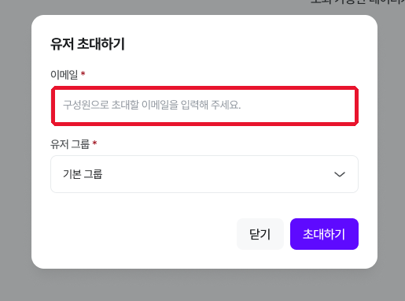
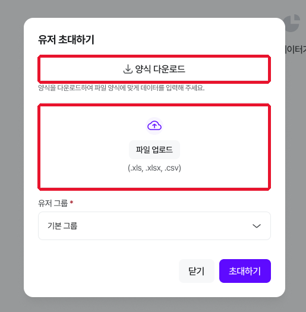
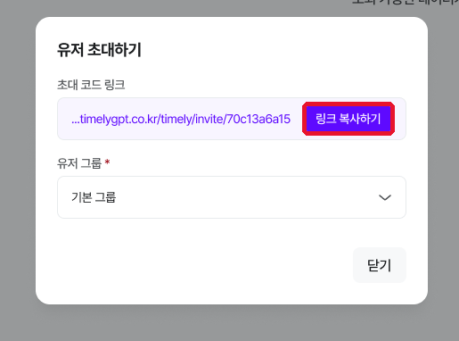
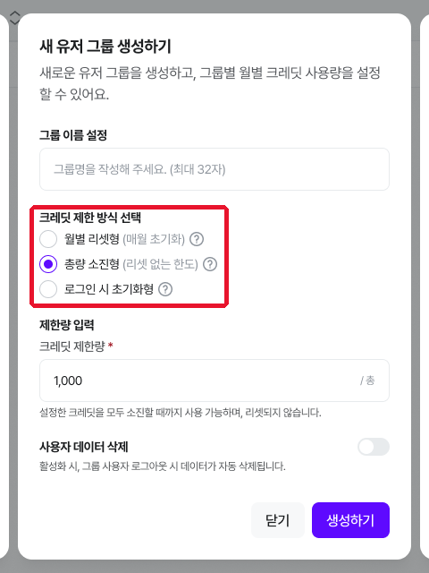
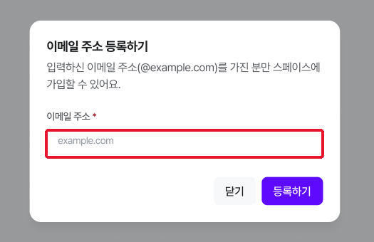
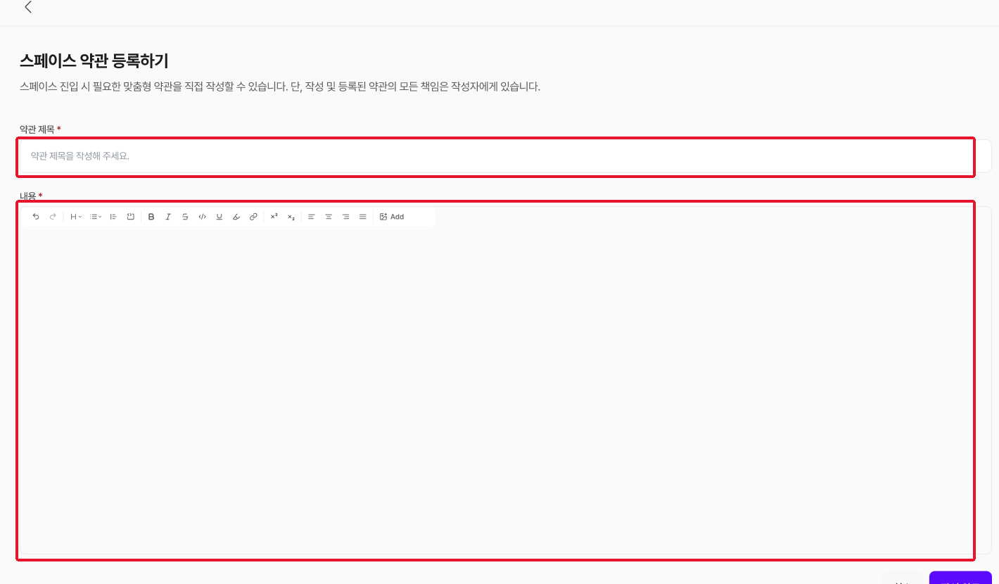

# 유저 초대/관리

## 1. 스페이스 유저 초대하기

**[관리자 설정] > [유저 관리] > [유저 설정]**에 들어가면 스페이스 멤버를 초대·관리할 수 있어요. 화면 **오른쪽 위의 [+ 유저 초대하기]**(빨간 표시)를 눌러 시작해요.

![유저 설정 화면 — 오른쪽 위 [+ 유저 초대하기] 버튼](../../assets/images/admin-invite-users/v3-user-list.png)

초대 방법은 **이메일 초대 · 일괄 초대 · 초대 코드** 3가지 중에서 골라요.

### 1-1. 이메일 초대 (개별 입력)

1. **이메일**을 입력하고(빨간 표시), **유저 그룹**을 선택해요.
2. **[초대하기]**를 누르면 초대 메일이 발송돼요.

### 1-2. 일괄 초대 (여러 명 한 번에)

1. **[양식 다운로드]**로 받은 엑셀 양식에 초대할 이메일을 입력해요.
2. 작성한 파일을 **[파일 업로드]**(빨간 표시)하고, **유저 그룹**을 선택한 뒤 **[초대하기]**를 눌러요.

### 1-3. 초대 코드 (링크 공유)

특정 **유저 그룹**을 선택하면 초대 링크가 만들어져요. **[링크 복사하기]**(빨간 표시)로 복사해 공유하면, 링크로 들어온 사람이 해당 그룹으로 가입해요.

## 2. 유저 그룹 설정

유저를 **그룹**으로 묶으면, 그룹마다 크레딧 사용량을 다르게 정하고 필요한 프롬프트·템플릿을 따로 설정할 수 있어요. **[유저 관리] > [유저 그룹 관리]**에서 관리해요.

![유저 그룹 관리 화면 — 오른쪽 위 [+ 그룹 생성하기] 버튼](../../assets/images/admin-invite-users/v3-group-list.png)

### 2-1. 유저 그룹 추가

화면 **오른쪽 위 [+ 그룹 생성하기]**(빨간 표시)를 누르면 그룹을 만들 수 있어요.

1. **그룹 이름**을 입력해요. (최대 32자)
2. **크레딧 제한 방식**(빨간 표시)을 고르고, **제한량**을 입력해요.
3. 필요하면 **사용자 데이터 삭제**를 켠 뒤 **[생성하기]**를 눌러요.

{ width="420" }

**크레딧 제한 방식 3가지**

| 방식 | 설명 |
| --- | --- |
| **월별 리셋형** | 매월 1일 0시에 사용 가능한 크레딧이 설정한 제한량으로 초기화돼요. |
| **총량 소진형** | 설정한 제한량을 다 쓸 때까지 누적돼요. 초기화되지 않아요. |
| **로그인 시 초기화형** | 로그인할 때마다 크레딧이 설정한 제한량으로 초기화돼요. |

> 💡 **사용자 데이터 삭제**를 켜면, 그 그룹 사용자가 로그아웃할 때 이용했던 데이터(채팅 내역 등)가 자동으로 삭제돼요. 다음 로그인 때는 깨끗한 상태로 시작해요.

### 2-2. 그룹에 유저 추가·관리

그룹 목록에서 **그룹 이름을 누르면 상세 화면**이 열려요. 여기서 그룹에 속한 유저를 확인하고 관리해요.

- 오른쪽 위 **[+ 유저 초대하기]**(빨간 표시)로 이 그룹에 바로 유저를 초대할 수 있어요. (초대 방법은 위 **1번**과 같아요.)
- 그룹 이름 옆 **[편집]**(빨간 표시)으로 그룹 이름·크레딧 제한을 언제든 바꿀 수 있어요.
- 각 유저 줄의 **휴지통 아이콘**으로 해당 유저를 그룹에서 빼요.

![유저 그룹 상세 화면 — [+ 유저 초대하기]와 [편집]](../../assets/images/admin-invite-users/v3-group-detail.png)

> 💡 **기존 유저를 다른 그룹으로 옮기려면** [유저 관리] > [유저 설정]에서 해당 유저를 선택해 **유저 그룹**을 변경하면 돼요. 여러 명을 한 번에 옮길 때는 유저를 체크한 뒤 **[일괄 변경] > [유저 그룹 변경]**을 사용해요.

## 3. 가입 제한 설정

**[유저 관리] > [가입 제한 설정]**에서 어드민이 정한 조건에 맞는 사람만 가입하도록 설정할 수 있어요. **이메일 주소 제한**과 **약관 동의 관리** 두 가지 탭이 있어요.

### 3-1. 이메일 주소 제한

**[이메일 주소 제한]** 탭(빨간 표시)에서 가입 가능한 이메일을 제한해요. 아무것도 등록하지 않으면 **모든 이메일 주소로 가입할 수 있어요.** 화면 오른쪽 위 **[+ 등록하기]**(빨간 표시)를 눌러 허용할 주소를 추가해요.

![가입 제한 설정 — 이메일 주소 제한 탭과 [+ 등록하기]](../../assets/images/admin-invite-users/v3-signup-email.png)

**이메일 주소**(빨간 표시)에 허용할 주소를 입력하고 **[등록하기]**를 눌러요. **‘@’ 뒷부분(도메인)만** 입력하면 돼요.

> 💡 예를 들어 `timely.kr`을 등록하면, 메일 주소가 `@timely.kr`로 끝나는 사람만 이 스페이스에 가입할 수 있어요.

### 3-2. 약관 동의 관리

**[약관 동의 관리]** 탭(빨간 표시)에서는 서비스 이용 약관을 직접 등록할 수 있어요. 화면 오른쪽 위 **[+ 등록하기]**(빨간 표시)를 눌러요.

![가입 제한 설정 — 약관 동의 관리 탭과 [+ 등록하기]](../../assets/images/admin-invite-users/v3-signup-terms.png)

**약관 제목**과 **내용**(빨간 표시)을 작성하고 **[작성 완료]**를 눌러요.

- 등록한 약관은 **회원가입 시 유저에게 표시**되고, 유저가 동의해야 서비스를 이용할 수 있어요.
- 새로 등록한 약관은 **기존 유저가 다음에 로그인할 때** 동의 절차가 진행돼요.

## 자주 묻는 질문

??? question "유저가 '권한이 없다'고 떠요"

    **[로그인 링크]**로 바로 들어온 경우 생길 수 있어요. **[유저 초대] > [이메일 초대]**로 해당 유저를 한 번 더 초대해 주세요. (위 **1-1** 참고)

??? question "유저가 크레딧을 다 썼어요 (월 사용 제한량 늘리기)"

    **[유저 관리] > [유저 설정]**에서 해당 계정을 검색해 선택하고, **유저 그룹**을 사용량이 더 큰 그룹으로 바꿔 주세요.

    제한량을 바꾸면 **그만큼 더** 쓸 수 있어요. (예: 제한량 10,000 → 15,000으로 바꾸면 5,000만큼 더 사용 가능)
