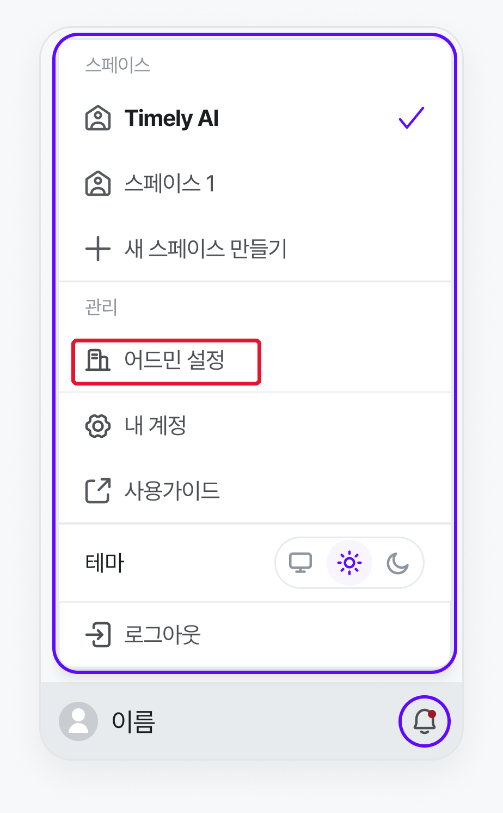
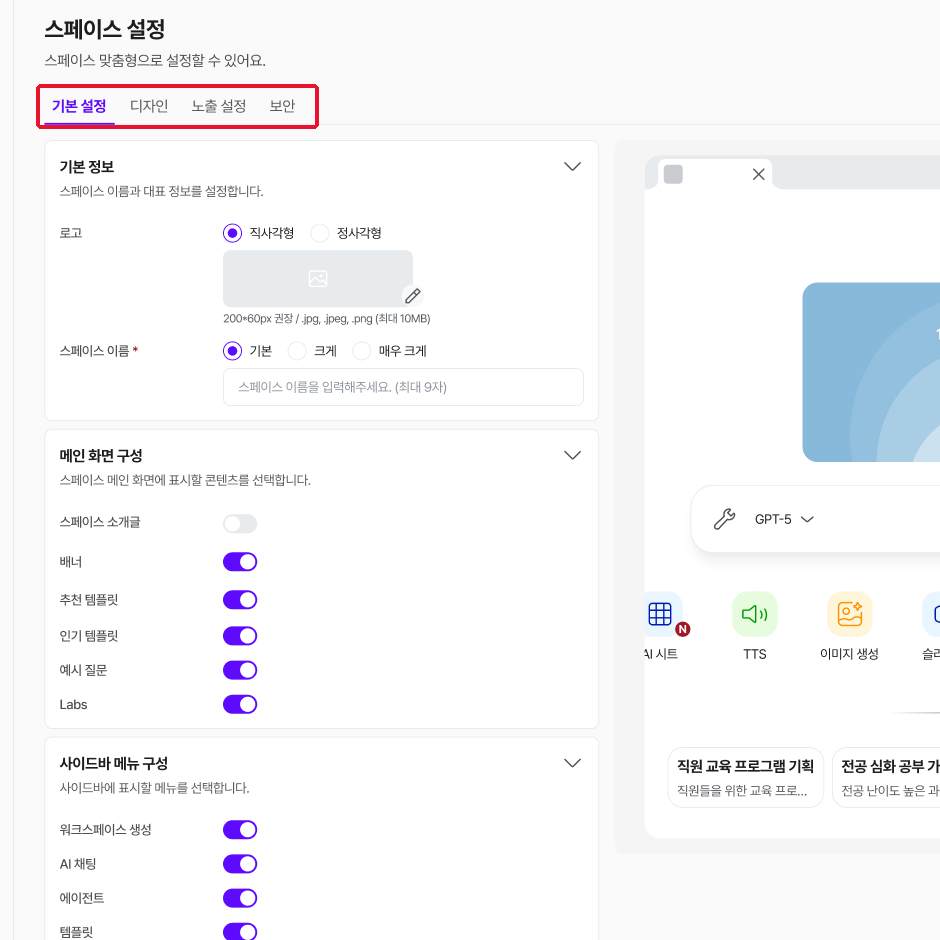
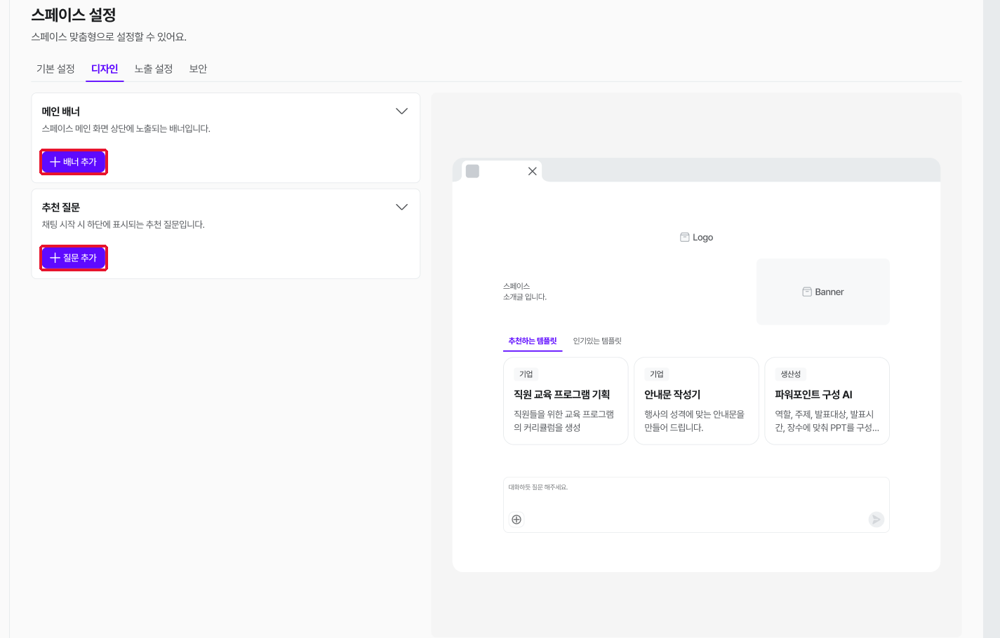
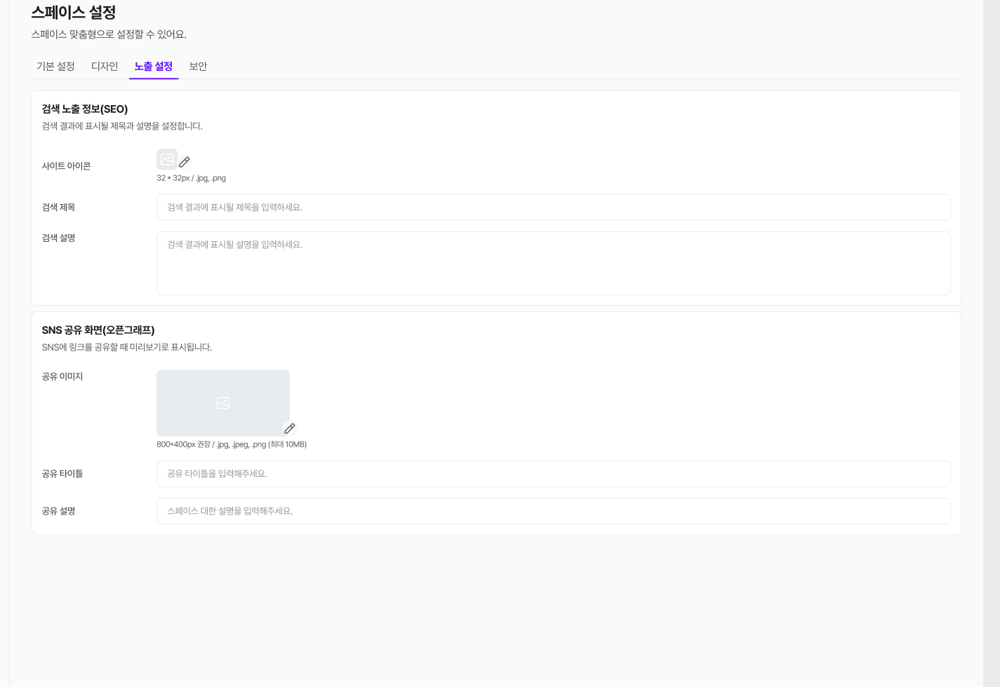
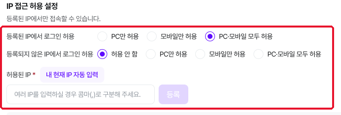
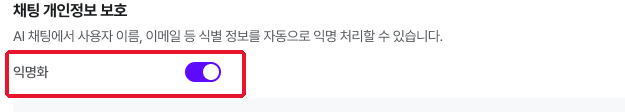
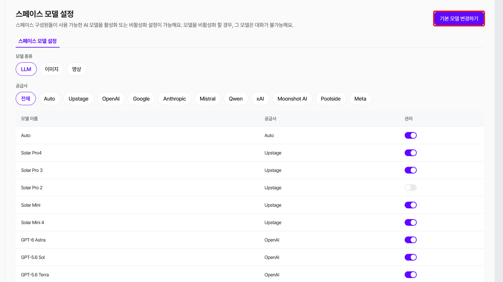
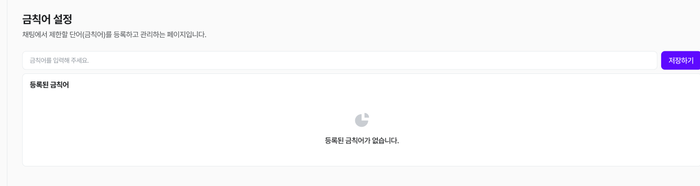

# 스페이스 설정

어드민으로 로그인한 뒤 **[어드민 설정] > [스페이스 관리]**에서 우리 기관에 맞게 스페이스를 꾸밀 수 있어요. 크게 **① 스페이스 설정 · ② 스페이스 모델 설정 · ③ 금칙어 설정** 세 가지예요.

왼쪽 아래 **프로필(이름)**을 누르면 뜨는 메뉴에서 **[어드민 설정]**(빨간 표시)으로 들어가요.

{ width="340" }

## 1. 스페이스 설정

왼쪽 메뉴에서 **[스페이스 관리] > [스페이스 설정]**을 눌러요. **기본 설정 · 디자인 · 노출 설정 · 보안** 4개 탭(빨간 표시)으로 나뉘어 있어요.

### 1-1. 기본 설정

**[기본 설정]** 탭에서 스페이스의 로고·이름과 메인 화면에 보일 내용을 정해요.

- **기본 정보** — 로고(직사각형/정사각형, 200×60px 권장)와 **스페이스 이름**(크기: 기본/크게/매우 크게, 최대 9자)을 설정해요.
- **메인 화면 구성** — 스페이스 첫 화면에 보일 항목을 켜고 꺼요. (스페이스 소개글 · 배너 · 추천/인기 템플릿 · 예시 질문 · Labs)
- **사이드바 메뉴 구성** — 왼쪽 사이드바에 보일 메뉴를 켜고 꺼요. (워크스페이스 생성 · AI 채팅 · 에이전트 · 템플릿 등)

> 💡 오른쪽 **미리보기**에서 바뀐 모습을 바로 확인할 수 있어요.

### 1-2. 디자인

**[디자인]** 탭에서 메인 화면을 더 꾸며요.

- **메인 배너** — **[+ 배너 추가]**(빨간 표시)로 상단에 노출할 배너(이미지·링크)를 등록해요.
- **추천 질문** — **[+ 질문 추가]**(빨간 표시)로 채팅 시작 화면 하단에 보일 추천 질문을 등록해요.

### 1-3. 노출 설정

**[노출 설정]** 탭에서 검색·공유될 때 보이는 정보를 설정해요.

- **검색 노출 정보(SEO)** — 사이트 아이콘, 검색 제목, 검색 설명. (구글 등 검색 결과에 표시돼요.)
- **SNS 공유 화면(오픈그래프)** — 공유 이미지(800×400px 권장), 공유 타이틀, 공유 설명. (카카오톡 등에 링크를 공유할 때 미리보기로 보여요.)

### 1-4. 보안

**[보안]** 탭에서 접근 제한과 개인정보 보호를 설정해요.

**IP 접근 허용 설정**(빨간 표시) — 등록한 IP에서만 접속하도록 제한할 수 있어요. 로그인 허용 범위(PC/모바일)를 고르고, **[내 현재 IP 자동 입력]**으로 손쉽게 추가한 뒤 **[등록]**을 눌러요. 단일 IP·범위·CIDR 형식을 지원해요.

**채팅 개인정보 보호**(빨간 표시) — **익명화**를 켜면 AI 채팅에서 이름·이메일 같은 식별 정보를 자동으로 가명 처리해요. (단, 답변이 일부 달라지거나 크레딧·응답 속도에 영향이 있을 수 있어요.)

## 2. 스페이스 모델 설정

**[스페이스 관리] > [스페이스 모델 설정]**에서 구성원이 사용할 수 있는 AI 모델을 켜고 끌 수 있어요.

- **모델 종류**(LLM·이미지·영상)와 **공급사**로 걸러서 볼 수 있어요.
- 각 모델의 **관리** 토글로 사용 여부를 정해요. (끄면 그 모델로는 대화할 수 없어요.)
- 오른쪽 위 **[기본 모델 변경하기]**(빨간 표시)로 기본 모델을 바꿀 수 있어요.

## 3. 금칙어 설정

**[스페이스 관리] > [금칙어 설정]**에서 채팅에 쓰지 못하게 할 단어를 등록해요. 금칙어를 입력하고 **[저장하기]**(빨간 표시)를 누르면 목록에 추가돼요.

