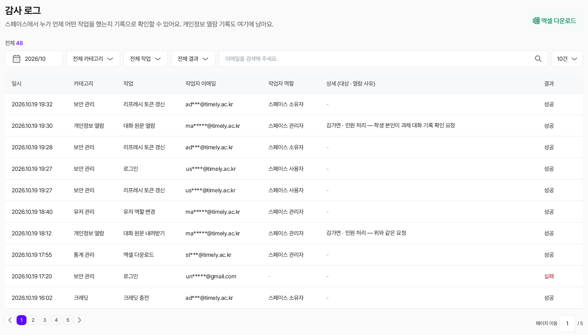

# 감사 로그

**[운영 로그] > [감사 로그]**에서 스페이스에서 **누가, 언제, 어떤 작업을 했는지** 기록으로 확인해요. 관리자가 구성원의 대화를 열람한 기록도 여기에 남아요.

## 1. 기록 읽는 법 { #read }

| 항목 | 뜻 |
|---|---|
| **일시** | 작업이 일어난 날짜와 시간이에요 |
| **카테고리** | 작업 종류예요. 보안 관리 · 개인정보 열람 · 유저 관리 · 통계 관리 · 크레딧 등 |
| **작업** | 실제로 한 일이에요. 로그인, 유저 역할 변경, 대화 원문 열람, 엑셀 다운로드 등 |
| **작업자 이메일** | 작업한 사람이에요 |
| **작업자 역할** | 스페이스 소유자 · 스페이스 관리자 · 스페이스 사용자 |
| **상세 (대상 · 열람 사유)** | 대화 원문을 열람했을 때, 누구의 대화를 어떤 사유로 봤는지 남아요 |
| **결과** | 성공 · 실패 |

## 2. 원하는 기록 찾기 { #find }

- **월**을 골라 해당 기간의 기록을 봐요.
- **카테고리 · 작업 · 결과**로 골라 보거나, 작업자 **이메일**로 검색해요.
- 오른쪽 위 **[엑셀 다운로드]**로 기록을 파일로 받아요. 감사나 보고에 제출할 때 써요.

!!! tip "이럴 때 확인하세요"
    - **결과가 '실패'인 로그인**이 같은 이메일로 여러 번 → 누군가 계정에 접속을 시도하고 있을 수 있어요.
    - **개인정보 열람** 카테고리 → 대화 원문을 누가, 어떤 사유로 봤는지 주기적으로 점검해 주세요.
    - **유저 역할 변경** → 의도하지 않은 권한 변경이 없었는지 확인해요.
