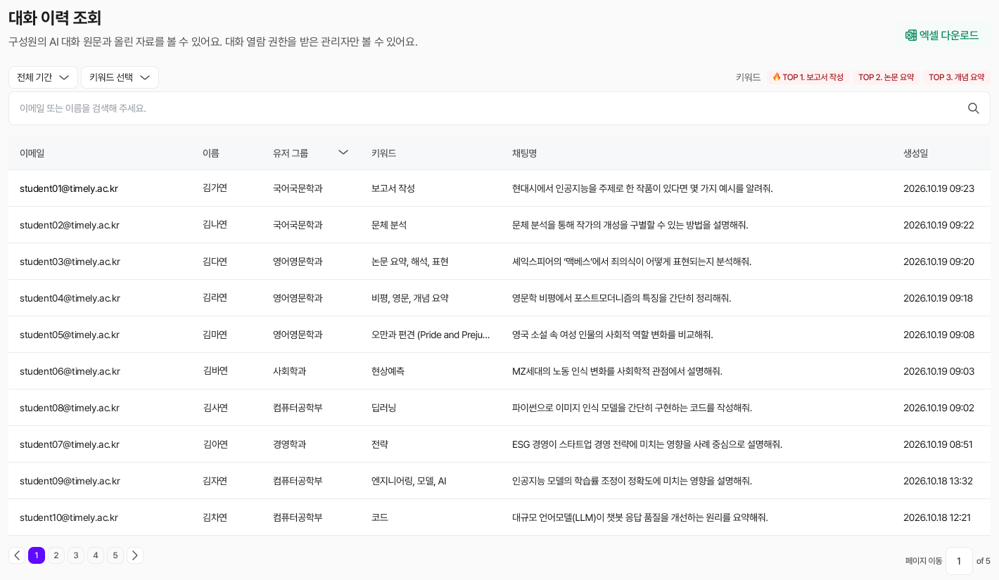
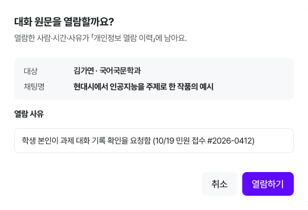
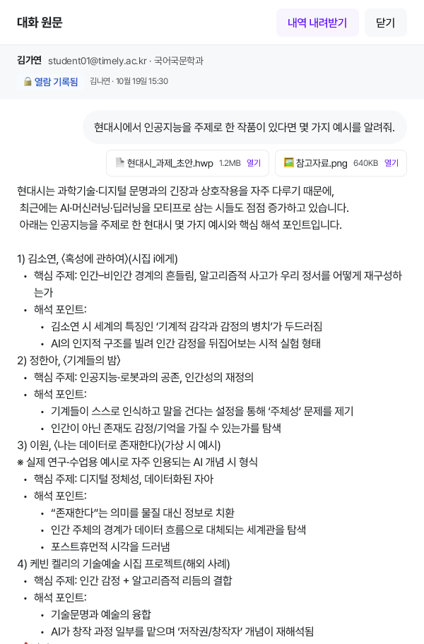

# 대화 이력 조회

**[운영 로그] > [대화 이력 조회]**에서 구성원의 **AI 대화 원문과 올린 자료**를 볼 수 있어요.

!!! warning "신청한 스페이스에서만 쓸 수 있는 기능이에요"
    대화 이력 조회는 **스페이스를 이용하는 유저 전체의 동의를 받고, 이용을 요청한 스페이스에서만** 사용할 수 있어요. 요청하지 않은 스페이스에는 이 메뉴가 보이지 않아요. 이용을 원하시면 [문의하기](../../contact.md)로 요청해 주세요.

스페이스 안에서도 **대화 열람 권한을 받은 관리자만** 볼 수 있어요. 현재는 열람 권한을 어드민 화면에서 직접 줄 수 없고, **타임리에 요청**해야 해요. 권한이 필요한 관리자가 있으면 [문의하기](../../contact.md)로 알려 주세요.

## 1. 대화 목록 보기 { #list }

| 항목 | 뜻 |
|---|---|
| **키워드** | 대화에서 뽑아낸 주제어예요 |
| **채팅명** | 대화의 제목이에요 |
| **TOP 1 · 2 · 3** | 스페이스에서 가장 많이 나온 키워드예요. 구성원들이 AI를 주로 어디에 쓰는지 알 수 있어요 |

- **기간**과 **키워드**로 골라 보거나, **이메일 또는 이름**으로 검색해요.
- 오른쪽 위 **[엑셀 다운로드]**로 목록을 파일로 받아요.

## 2. 대화 원문 열람하기 { #open }

목록에서 볼 대화를 누르면 **열람 사유**를 묻는 창이 떠요.

{ width="480" }

1. **대상**과 **채팅명**이 맞는지 확인해요.
2. **열람 사유**를 적어요. 사유를 적어야 열 수 있어요.
3. **[열람하기]**를 누르면 화면 오른쪽에 대화 원문이 열려요.

{ width="520" }

| 항목 | 뜻 |
|---|---|
| **열람 기록됨** | 누가 언제 이 대화를 열었는지 표시돼요 |
| **첨부 자료** | 구성원이 대화에 올린 파일이에요. **[열기]**로 볼 수 있어요 |
| **[내역 내려받기]** | 대화 원문을 파일로 받아요. 내려받은 것도 기록으로 남아요 |

!!! warning "열람하면 기록이 남아요"
    **열람한 사람 · 시간 · 사유**는 [감사 로그](audit.md)의 **개인정보 열람** 카테고리에 남아요. 민원 처리나 본인 요청처럼 꼭 필요한 경우에만 열람하고, 사유는 "학생 본인이 과제 대화 기록 확인을 요청함 (민원 접수 번호)"처럼 **나중에 봐도 알 수 있게** 적어 주세요.
