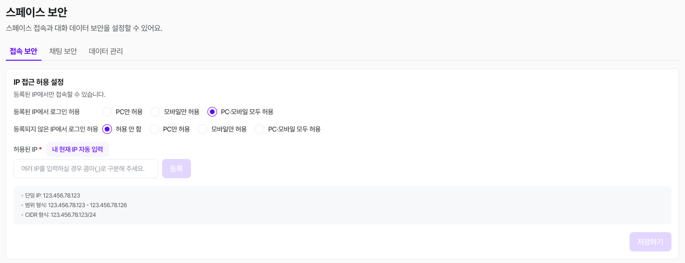
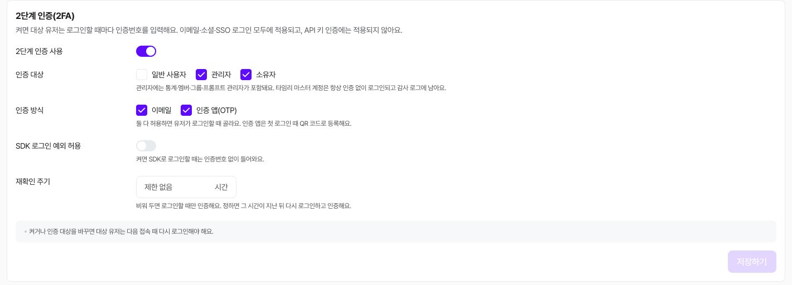
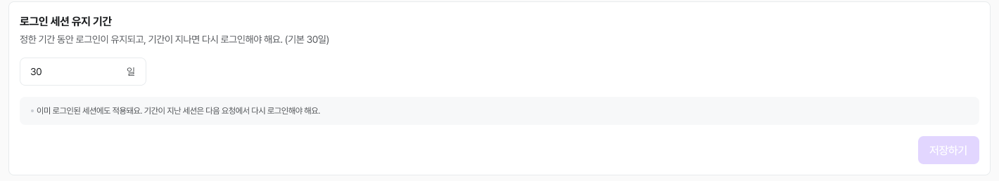
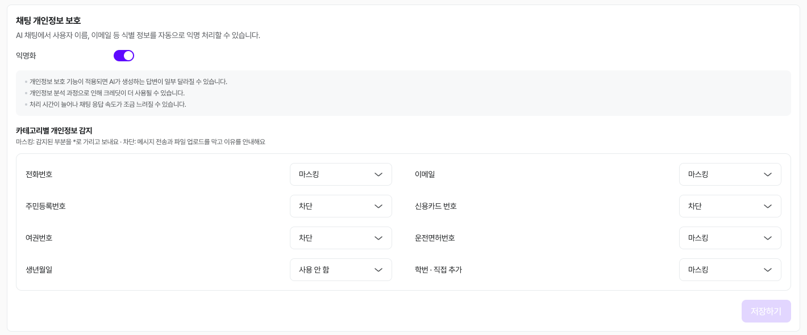
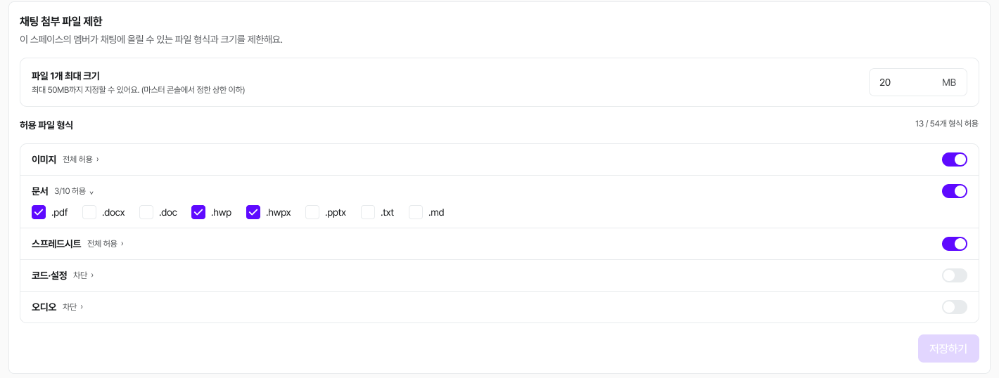
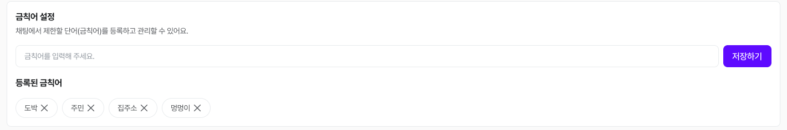
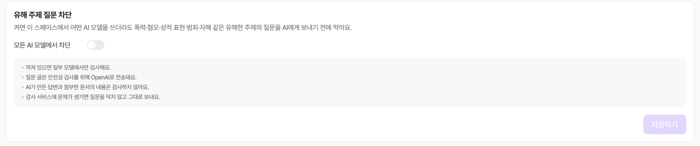
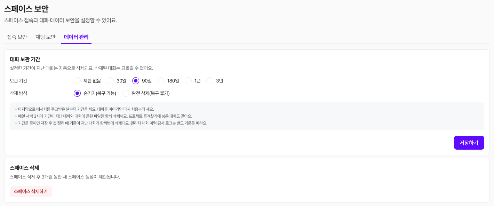
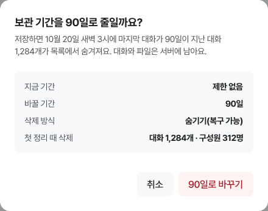

# 스페이스 보안

**[스페이스 관리] > [스페이스 보안]**에서 스페이스 접속과 대화 데이터의 보안을 설정해요. 탭 3개로 나뉘어 있어요.

| 탭 | 이런 걸 정해요 |
|---|---|
| [1. 접속 보안](#access) | 접속할 수 있는 IP, 2단계 인증, 로그인 유지 기간 |
| [2. 채팅 보안](#chat) | 개인정보 보호, 첨부 파일 제한, 금칙어, 유해 주제 차단 |
| [3. 데이터 관리](#data) | 대화 보관 기간, 스페이스 삭제 |

> 💡 묶음마다 **[저장하기]**가 따로 있어요. 바꾼 묶음의 [저장하기]를 눌러야 적용돼요.

## 1. 접속 보안 { #access }

### 1-1. IP 접근 허용 설정

교내·사내 네트워크에서만 접속하게 하고 싶을 때 써요.

| 항목 | 설명 |
|---|---|
| **등록된 IP에서 로그인 허용** | 등록한 IP에서 PC · 모바일 중 어디까지 로그인을 허용할지 골라요 |
| **등록되지 않은 IP에서 로그인 허용** | 그 밖의 IP는 기본이 **허용 안 함**이에요. 모바일만 열어 두는 식으로 고를 수도 있어요 |
| **허용된 IP** | 여러 개는 콤마(,)로 구분해요. **[내 현재 IP 자동 입력]**을 누르면 지금 쓰는 IP가 들어가요 |

IP는 세 가지 형식으로 적을 수 있어요: 단일 IP(`123.456.78.123`), 범위(`123.456.78.123 - 123.456.78.126`), CIDR(`123.456.78.123/24`).

!!! warning "내 IP를 먼저 등록하세요"
    등록되지 않은 IP를 '허용 안 함'으로 두고 저장하면, 등록 안 된 곳에서는 어드민도 접속할 수 없어요. **[내 현재 IP 자동 입력]**으로 지금 IP를 먼저 넣어 두세요.

### 1-2. 2단계 인증(2FA)

켜면 대상 유저는 로그인할 때마다 인증번호를 입력해요. 이메일·소셜·SSO 로그인 모두에 적용되고, API 키 인증에는 적용되지 않아요.

| 항목 | 설명 |
|---|---|
| **인증 대상** | 일반 사용자 · 관리자 · 소유자 중에서 골라요. 관리자에는 통계·멤버·그룹·프롬프트 관리자가 포함돼요 |
| **인증 방식** | 이메일 · 인증 앱(OTP). 둘 다 허용하면 유저가 로그인할 때 골라요. 인증 앱은 첫 로그인 때 QR 코드로 등록해요 |
| **SDK 로그인 예외 허용** | 켜면 SDK로 로그인할 때는 인증번호 없이 들어와요 |
| **재확인 주기** | 비워 두면 로그인할 때만 인증해요. 시간을 정하면 그 시간이 지난 뒤 다시 로그인하고 인증해요 |

> 💡 2단계 인증을 켜거나 인증 대상을 바꾸면, 대상 유저는 **다음 접속 때 다시 로그인**해야 해요.

### 1-3. 로그인 세션 유지 기간

정한 기간 동안 로그인이 유지되고, 기간이 지나면 다시 로그인해야 해요. 기본은 **30일**이에요.

> 💡 **이미 로그인된 유저에게도 적용**돼요. 기간을 줄이면 그 기간이 지난 유저는 바로 다시 로그인해야 해요.

## 2. 채팅 보안 { #chat }

### 2-1. 채팅 개인정보 보호

구성원이 채팅에 개인정보를 넣었을 때 **AI에게 보내기 전에** 가리거나 막아요.

**익명화**를 켜면 이름·이메일 같은 식별 정보를 자동으로 익명 처리해요. 아래 **카테고리별 개인정보 감지**에서는 종류마다 처리 방법을 따로 골라요.

| 처리 방법 | 동작 |
|---|---|
| **마스킹** | 감지된 부분을 `*`로 가리고 보내요 |
| **차단** | 메시지 전송과 파일 업로드를 막고 이유를 안내해요 |
| **사용 안 함** | 감지하지 않아요 |

감지할 수 있는 종류는 **전화번호 · 이메일 · 주민등록번호 · 신용카드 번호 · 여권번호 · 운전면허번호 · 생년월일**이고, **학번**처럼 기관에서 쓰는 번호를 직접 추가할 수도 있어요.

!!! warning "켜기 전에 알아두세요"
    - AI가 만드는 답변이 일부 달라질 수 있어요.
    - 개인정보 분석 과정 때문에 크레딧이 더 쓰일 수 있어요.
    - 채팅 응답 속도가 조금 느려질 수 있어요.

### 2-2. 채팅 첨부 파일 제한

구성원이 채팅에 올릴 수 있는 파일 형식과 크기를 제한해요.

| 항목 | 설명 |
|---|---|
| **파일 1개 최대 크기** | 최대 50MB까지 정할 수 있어요 |
| **허용 파일 형식** | 이미지 · 문서 · 스프레드시트 · 코드·설정 · 오디오 묶음별로 켜고 꺼요. 묶음을 펼치면 `.pdf`, `.hwp`처럼 **확장자 하나씩** 고를 수도 있어요 |

### 2-3. 금칙어 설정

채팅에서 쓰지 못하게 할 단어를 등록해요. 단어를 입력하고 **[저장하기]**를 누르면 **등록된 금칙어**에 추가되고, 단어 옆 **X**로 지워요.

### 2-4. 유해 주제 질문 차단

켜면 어떤 AI 모델을 쓰더라도 폭력·혐오·성적 표현·범죄·자해 같은 유해한 주제의 질문을 **AI에게 보내기 전에** 막아요.

- 꺼져 있으면 일부 모델에서만 검사해요.
- 질문 글은 안전성 검사를 위해 OpenAI로 전송돼요.
- AI가 만든 답변과 첨부한 문서의 내용은 검사하지 않아요.
- 검사 서비스에 문제가 생기면 질문을 막지 않고 그대로 보내요.

## 3. 데이터 관리 { #data }

### 3-1. 대화 보관 기간

설정한 기간이 지난 대화는 자동으로 삭제돼요.

| 항목 | 설명 |
|---|---|
| **보관 기간** | 제한 없음 · 30일 · 90일 · 180일 · 1년 · 3년 |
| **삭제 방식** | **숨기기(복구 가능)** — 목록에서만 숨기고 서버에는 남겨요 / **완전 삭제(복구 불가)** — 되돌릴 수 없어요 |

- 기간은 **마지막으로 메시지를 주고받은 날**부터 세요. 대화를 이어가면 다시 처음부터 세요.
- 매일 새벽 3시에 기간이 지난 대화와, 그 대화에 올린 파일을 함께 정리해요.
- 프로젝트나 즐겨찾기에 넣은 대화도 똑같이 적용돼요.
- 관리자 대화 이력과 감사 로그는 별도 기준을 따라요.

!!! warning "기간을 줄이면 오래된 대화가 한꺼번에 정리돼요"
    기간을 줄여 저장하면 확인 창이 떠요. **첫 정리 때 삭제되는 대화 수와 구성원 수**가 나오니 꼭 확인하고 바꿔 주세요.

    { width="420" }

### 3-2. 스페이스 삭제

**[스페이스 삭제하기]**로 스페이스를 삭제하면, 이후 **3개월 동안 새 스페이스를 만들 수 없어요.**
