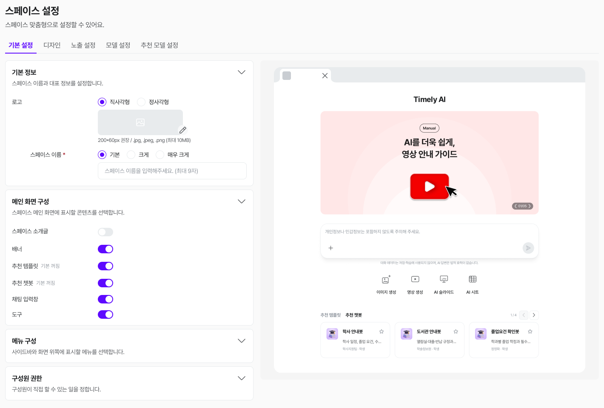
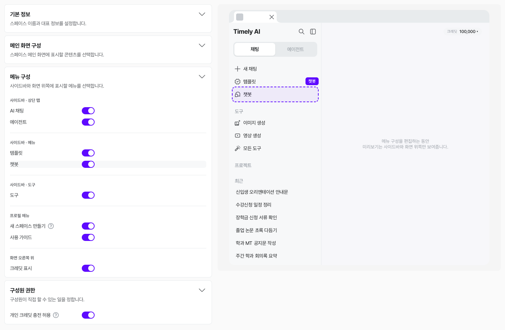
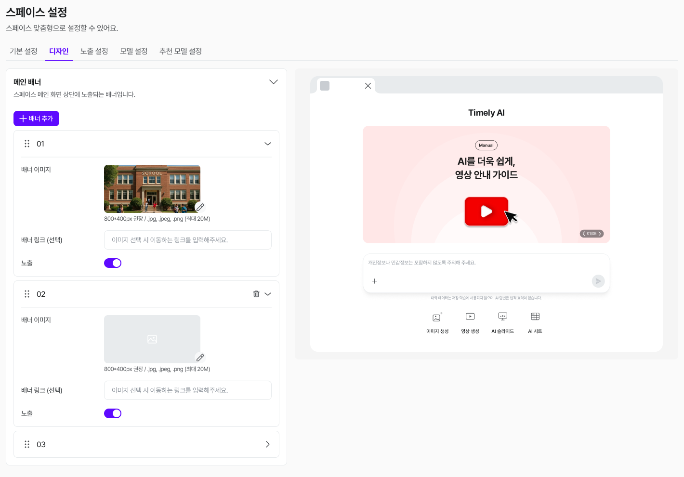
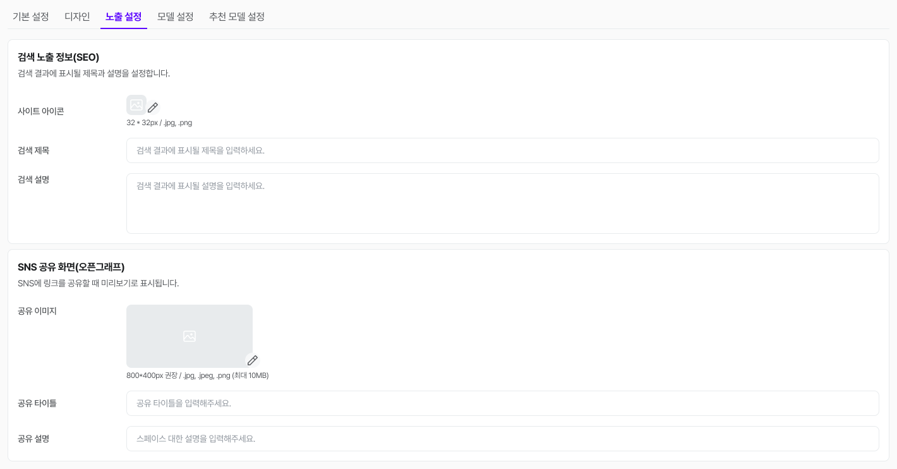
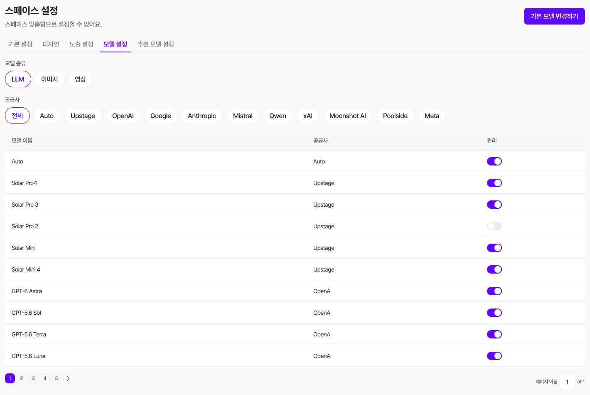
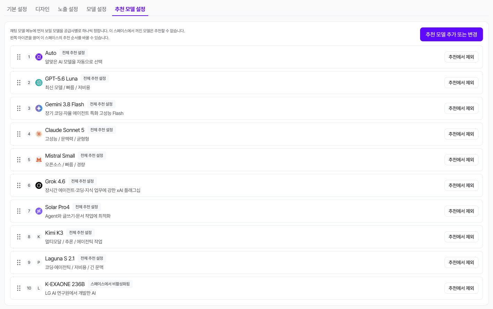

# 스페이스 설정

<a class="notice-box" href="../../notice/">
공지
<strong>11월 25일 어드민 설정 개편 공지사항</strong>통계 대시보드·사이드바 개편과 대표 챗봇 기능이 추가돼요.
자세히 보기 →
</a>

**[스페이스 관리] > [스페이스 설정]**에서 우리 기관에 맞게 스페이스의 겉모습과 사용할 AI 모델을 정해요. 탭 5개로 나뉘어 있어요.

| 탭 | 이런 걸 정해요 |
|---|---|
| [1. 기본 설정](#basic) | 로고·이름, 메인 화면에 보일 것, 메뉴에 보일 것, 구성원 권한 |
| [2. 디자인](#design) | 메인 화면 맨 위의 배너 |
| [3. 노출 설정](#expose) | 검색 결과와 SNS 공유 때 보이는 제목·이미지 |
| [4. 모델 설정](#model) | 구성원이 쓸 수 있는 AI 모델 |
| [5. 추천 모델 설정](#recommend) | 채팅 모델 메뉴에 먼저 보일 모델 |

## 1. 기본 설정 { #basic }

왼쪽에서 설정을 바꾸면 **오른쪽 미리보기에 바로 반영**돼요. 토글에 마우스를 올리면 미리보기에서 그 항목의 위치를 점선으로 알려 줘요.

### 1-1. 기본 정보

| 항목 | 설명 |
|---|---|
| **로고** | 직사각형 또는 정사각형. 200×60px 권장, jpg·jpeg·png (최대 10MB) |
| **스페이스 이름** | 최대 9자. 크기는 기본 · 크게 · 매우 크게 중에서 골라요 |

### 1-2. 메인 화면 구성

구성원이 처음 들어왔을 때 보는 화면에 무엇을 보여 줄지 켜고 꺼요.

| 항목 | 켜면 메인 화면에 |
|---|---|
| **스페이스 소개글** | 스페이스 소개 문구가 보여요 |
| **배너** | [디자인](#design) 탭에서 등록한 배너가 맨 위에 보여요 |
| **추천 템플릿** · **추천 챗봇** | 화면 아래에 추천 영역이 생겨요. **처음에는 둘 다 꺼져 있어요** |
| **채팅 입력창** | 바로 질문할 수 있는 입력창이 보여요 |
| **도구** | 이미지 생성·영상 생성 같은 도구 바로가기가 보여요 |

!!! tip "추천을 켰는데 메인 화면에 안 보일 때"
    추천으로 고른 항목이 하나도 없으면 구성원 화면에서는 그 영역이 숨겨져요. [템플릿 관리](../templates.md)나 [챗봇 관리](../chatbots.md)에서 추천할 항목을 먼저 골라 주세요. 추천 템플릿과 추천 챗봇을 둘 다 켜면 탭으로 나뉘어 보여요.

### 1-3. 메뉴 구성

구성원 화면의 **사이드바와 화면 위쪽**에 어떤 메뉴를 보여 줄지 정해요. 이 묶음을 펼치면 오른쪽 미리보기가 사이드바 모양으로 바뀌어요.

| 묶음 | 켜고 끄는 메뉴 |
|---|---|
| **사이드바 · 상단 탭** | AI 채팅, 에이전트 |
| **사이드바 · 메뉴** | 템플릿, 챗봇 |
| **사이드바 · 도구** | 도구 |
| **프로필 메뉴** | 새 스페이스 만들기, 사용 가이드 |
| **화면 오른쪽 위** | 크레딧 표시 |

!!! warning "메인 화면과 사이드바에서 둘 다 끄면 아예 못 써요"
    - 메인 화면의 **도구**와 사이드바의 **도구**를 둘 다 끄면 구성원이 도구 페이지에 들어갈 수 없어요.
    - 메인 화면의 **채팅 입력창**과 사이드바의 **AI 채팅**을 둘 다 끄면 채팅을 시작할 수 없어요.

    둘 다 껐을 때는 토글 아래에 안내 문구가 나와요.

### 1-4. 구성원 권한

**개인 크레딧 충전 허용** — 켜면 구성원이 자기 크레딧을 직접 충전할 수 있어요.

## 2. 디자인 { #design }

**[+ 배너 추가]**를 누르면 배너가 하나씩 추가돼요. 공지나 이용 안내를 걸어 두기 좋아요.

| 항목 | 설명 |
|---|---|
| **배너 이미지** | 800×400px 권장, jpg·jpeg·png (최대 20MB) |
| **배너 링크 (선택)** | 배너를 눌렀을 때 이동할 주소예요. 비워 두면 눌러도 이동하지 않아요 |
| **노출** | 끄면 지우지 않고 잠시 숨겨 둘 수 있어요 |

- 배너 번호 왼쪽 **점 6개 아이콘**을 끌어 순서를 바꾸고, **휴지통**으로 지워요.
- 여러 개를 등록하면 메인 화면에서 넘겨 가며 보여요.
- 등록한 배너는 [기본 설정](#basic)의 **배너**가 켜져 있어야 보여요.

## 3. 노출 설정 { #expose }

| 묶음 | 어디에 보이나요 | 넣는 것 |
|---|---|---|
| **검색 노출 정보(SEO)** | 구글·네이버 같은 검색 결과 | 사이트 아이콘(32×32px), 검색 제목, 검색 설명 |
| **SNS 공유 화면(오픈그래프)** | 카카오톡 등에 링크를 붙였을 때 뜨는 미리보기 | 공유 이미지(800×400px 권장), 공유 타이틀, 공유 설명 |

## 4. 모델 설정 { #model }

- **관리** 토글을 끄면 구성원은 그 모델을 쓸 수 없어요.
- **모델 종류**(LLM · 이미지 · 영상)와 **공급사**로 골라 볼 수 있어요.
- 오른쪽 위 **[기본 모델 변경하기]**로 새 채팅을 열었을 때 처음 선택돼 있는 모델을 바꿔요.

> 💡 모델마다 크레딧 소모량이 달라요. 어떤 모델을 열어 둘지는 [AI 모델별 특징 안내](../../ai-models.md)를 참고해 주세요.

## 5. 추천 모델 설정 { #recommend }

구성원이 채팅에서 모델을 고를 때 **먼저 보일 모델**을 정해요.

- 추천 모델은 **공급사별로 하나씩** 정해요.
- 왼쪽 **점 6개 아이콘**을 끌어 추천 순서를 바꿔요.
- **[추천 모델 추가 또는 변경]**으로 모델을 넣거나 바꾸고, **[추천에서 제외]**로 빼요.
- [모델 설정](#model)에서 꺼 둔 모델은 추천할 수 없어요.
