# 통계 대시보드

**[어드민 설정] > [통계 대시보드]**에서 우리 스페이스가 타임리 AI를 얼마나, 어떻게 쓰고 있는지 확인해요.
화면 위쪽의 탭 5개로 보는 기준을 바꿀 수 있어요.

| 탭 | 이런 게 궁금할 때 봐요 |
|---|---|
| **1. 전체** | 크레딧이 얼마나 남았는지, 사용량이 지난 기간보다 늘었는지 **한눈에** 보고 싶을 때 |
| **2. 유저** | **누가** 많이 쓰는지, 안 쓰는 유저는 몇 명인지 알고 싶을 때 |
| **3. 모델** | **어떤 AI 모델**에 크레딧이 많이 쓰이는지 알고 싶을 때 |
| **4. 그룹** | **부서·팀별** 사용량을 비교하고 싶을 때 |
| **5. 상세** | 조건을 **직접 골라** 필요한 수치만 뽑아보고 싶을 때 |

## 먼저 알아두기 · 기간 선택과 다운로드 { #common }

모든 탭의 오른쪽 위에 같은 버튼이 있어요. 여기서 고른 기간이 화면 전체에 적용돼요.

| 버튼 | 설명 |
|---|---|
| **7일 · 30일 · 90일 · 이번 달** | 자주 쓰는 기간을 한 번에 골라요. |
| **달력 (10/1 ~ 10/30)** | 보고 싶은 날짜를 직접 정해요. |
| **이전 기간과 비교** | 체크하면 바로 앞 기간과 비교해서 늘었는지(▲) 줄었는지(▼) 보여줘요. |
| **엑셀 다운로드** | 지금 보고 있는 탭의 내용을 엑셀 파일로 받아요. |

> 💡 **'이전 기간'은 같은 길이의 바로 앞 기간이에요.** 예를 들어 10/1~10/30을 보고 있으면 9/1~9/30과 비교해요.

---

## 1. 전체 탭 · 스페이스 전체 현황 { #all }

통계 대시보드에 들어오면 처음 보이는 화면이에요. **스페이스 전체가 잘 쓰이고 있는지**를 빠르게 확인할 수 있어요.

### 1-1. 스페이스 크레딧

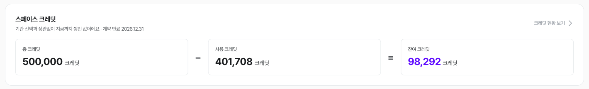

계약한 크레딧 중 **얼마를 쓰고 얼마가 남았는지** 보여줘요.

- **총 크레딧 − 사용 크레딧 = 잔여 크레딧**으로 계산돼요.
- 기간 선택과 상관없이 **지금까지 쌓인 값**이에요. 계약 만료일도 함께 보여요.
- 오른쪽 위 `크레딧 현황 보기`를 누르면 크레딧 현황 화면으로 이동해요.

!!! tip "이럴 때 확인하세요"
    잔여 크레딧이 계약 만료일까지 충분한지 확인하고, 부족할 것 같으면 미리 충전을 준비해요.

### 1-2. 기간별 사용 현황

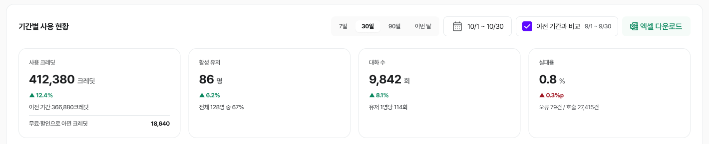

선택한 기간의 **핵심 수치 4가지**예요.

| 항목 | 뜻 | 이렇게 읽어요 |
|---|---|---|
| **사용 크레딧** | 기간 동안 쓴 크레딧 | 이전 기간보다 얼마나 늘었는지 확인해요. 아래에 무료·할인으로 아낀 크레딧도 보여요. |
| **활성 유저** | 기간 동안 한 번이라도 쓴 유저 수 | 전체 유저 중 몇 %가 쓰고 있는지 알 수 있어요. |
| **대화 수** | 전체 대화 횟수 | 유저 1명당 평균 대화 수도 함께 보여요. |
| **실패율** | 전체 호출 중 오류가 난 비율 | 평소보다 높아졌다면 문의가 늘 수 있어요. |

### 1-3. 사용량 추이

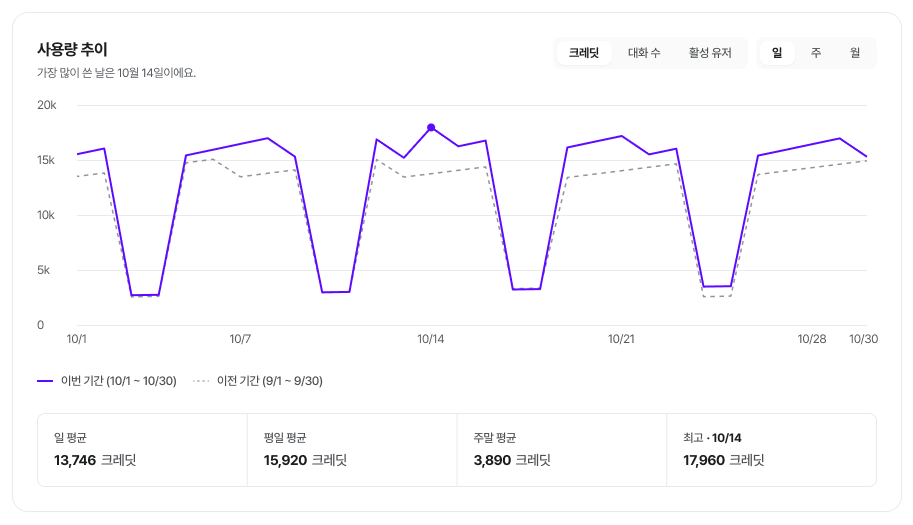

**날짜별로 사용량이 어떻게 변했는지** 그래프로 보여줘요.

- 오른쪽 위에서 `크레딧` · `대화 수` · `활성 유저` 중 볼 항목을 골라요.
- `일` · `주` · `월` 단위로 바꿔 볼 수 있어요.
- 보라색 선은 이번 기간, 회색 점선은 이전 기간이에요.
- 그래프 아래에 **일 평균 · 평일 평균 · 주말 평균 · 가장 많이 쓴 날**이 정리돼 있어요.

!!! tip "이럴 때 확인하세요"
    특정 날짜에 사용량이 갑자기 튀었는지, 평일과 주말 사용 차이가 얼마나 나는지 볼 수 있어요.

### 1-4. 기능별 크레딧

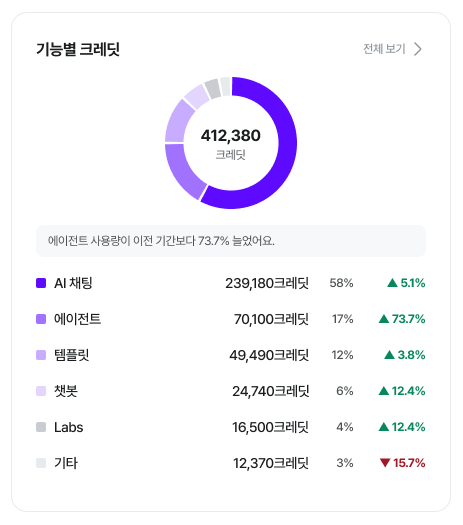{ width="420" }

크레딧이 **어떤 기능에 쓰였는지** 비중으로 보여줘요.

- AI 채팅 · 에이전트 · 템플릿 · 챗봇 · 도구 등 기능별 사용 크레딧과 비율이에요.
- 오른쪽 숫자(▲▼)는 이전 기간보다 얼마나 늘거나 줄었는지예요.
- 가장 크게 변한 기능은 그래프 아래 한 줄 요약으로 알려줘요.

!!! tip "이럴 때 확인하세요"
    구성원이 주로 어떤 기능을 쓰는지, 새로 안내한 기능의 사용이 늘었는지 확인해요.

### 1-5. 많이 쓴 순위

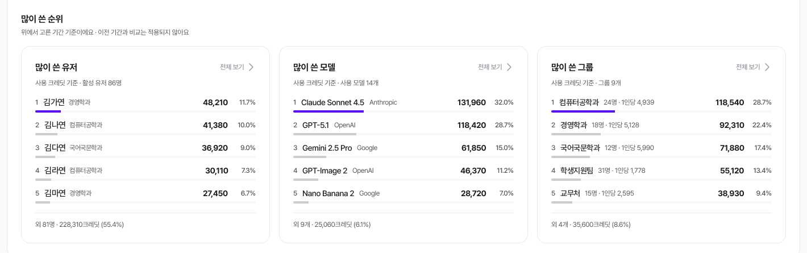

선택한 기간에 **가장 많이 쓴 유저 · 모델 · 그룹 상위 5개**를 보여줘요.

- 각 항목의 사용 크레딧과 전체에서 차지하는 비율이 나와요.
- `전체 보기`를 누르면 해당 탭(유저 · 모델 · 그룹)으로 이동해 전체 목록을 볼 수 있어요.
- 이 순위에는 '이전 기간과 비교'가 적용되지 않아요.

---

## 2. 유저 탭 · 유저별 사용량 { #user }

**누가 얼마나 쓰는지** 유저 한 명 한 명 단위로 확인하는 화면이에요.

### 2-1. 유저 요약

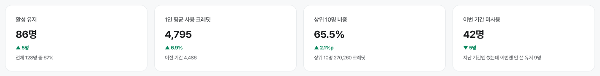

| 항목 | 뜻 | 이렇게 읽어요 |
|---|---|---|
| **활성 유저** | 기간 동안 사용한 유저 수 | 전체 유저 대비 비율로 이용률을 알 수 있어요. |
| **1인 평균 사용 크레딧** | 활성 유저 1명이 평균적으로 쓴 크레딧 | 그룹별 크레딧 한도를 정할 때 기준으로 삼기 좋아요. |
| **상위 10명 비중** | 많이 쓴 10명이 전체에서 차지하는 비율 | 높을수록 소수의 유저에게 사용이 몰려 있다는 뜻이에요. |
| **이번 기간 미사용** | 기간 동안 한 번도 쓰지 않은 유저 수 | 지난 기간엔 썼는데 이번엔 안 쓴 유저 수도 함께 보여요. |

!!! tip "이럴 때 확인하세요"
    미사용 유저가 많다면 사용 안내나 교육이 필요한지 살펴보세요.

### 2-2. 상위 5명 사용 추이

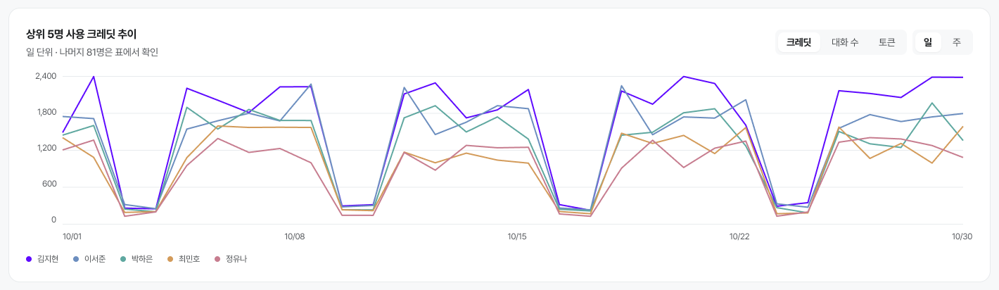

**가장 많이 쓴 5명의 날짜별 사용량**을 선 그래프로 비교해요.

- 오른쪽 위에서 `크레딧` · `대화 수` · `토큰` 중 볼 항목을 골라요.
- `일` · `주` 단위로 바꿔 볼 수 있어요.
- 나머지 유저는 아래 유저 목록에서 확인해요.

### 2-3. 유저 목록

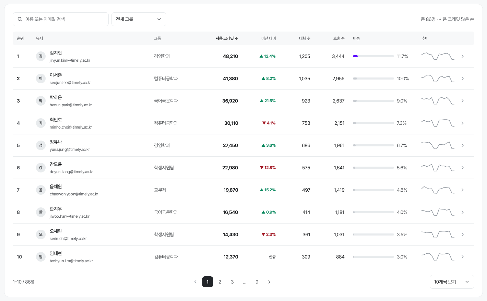

스페이스 유저를 **사용 크레딧이 많은 순**으로 보여주는 표예요.

- **검색** : 이름 또는 이메일로 찾아요.
- **그룹 필터** : 특정 그룹의 유저만 볼 수 있어요.

| 열 | 설명 |
|---|---|
| 그룹 | 유저가 속한 그룹 |
| 사용 크레딧 | 기간 동안 쓴 크레딧 |
| 이전 대비 | 이전 기간보다 늘었는지(▲) 줄었는지(▼). 이번에 처음 쓴 유저는 `신규` |
| 대화 수 · 호출 수 | 대화한 횟수와 AI를 호출한 횟수 |
| 비중 | 전체 사용량에서 차지하는 비율 |
| 추이 | 기간 동안의 사용 흐름을 작은 그래프로 표시 |

!!! tip "이럴 때 확인하세요"
    크레딧을 유독 많이 쓰는 유저가 있는지, 사용량이 갑자기 늘어난 유저가 있는지 확인해요.

---

## 3. 모델 탭 · AI 모델별 사용량 { #model }

**어떤 AI 모델에 크레딧이 쓰이는지** 확인하는 화면이에요. 모델마다 크레딧 차감량이 달라서, 비용 관리에 도움이 돼요.

### 3-1. 모델 요약

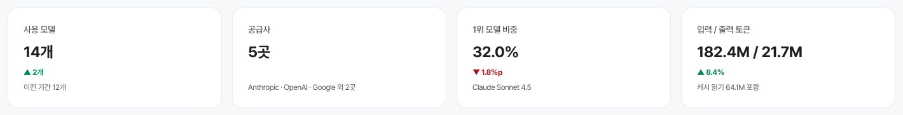

| 항목 | 뜻 | 이렇게 읽어요 |
|---|---|---|
| **사용 모델** | 기간 동안 쓰인 모델 개수 | 이전 기간보다 몇 개 늘었는지 보여요. |
| **공급사** | 모델을 만든 회사 수 | Anthropic, OpenAI, Google 등이에요. |
| **1위 모델 비중** | 가장 많이 쓴 모델이 전체에서 차지하는 비율 | 한 모델에 사용이 몰려 있는지 알 수 있어요. |
| **입력 / 출력 토큰** | AI에 보낸 글과 AI가 답한 글의 양 | 토큰은 AI가 글을 세는 단위예요. |

### 3-2. 상위 5개 모델 사용 추이

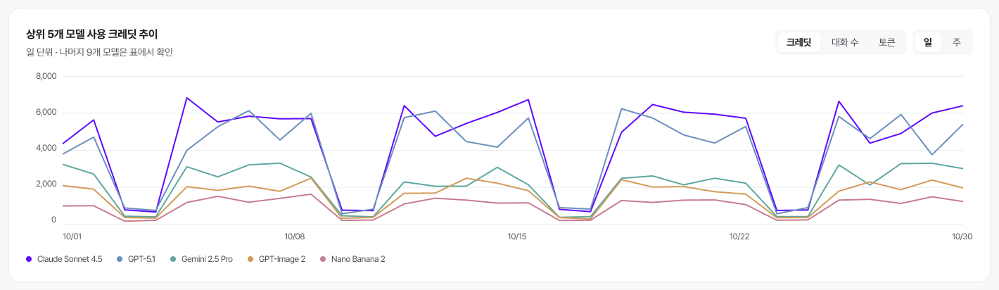

**많이 쓴 모델 5개의 날짜별 사용량**을 비교해요.

- `크레딧` · `대화 수` · `토큰` 중 볼 항목을, `일` · `주` 중 단위를 골라요.
- 나머지 모델은 아래 모델 목록에서 확인해요.

### 3-3. 모델 목록

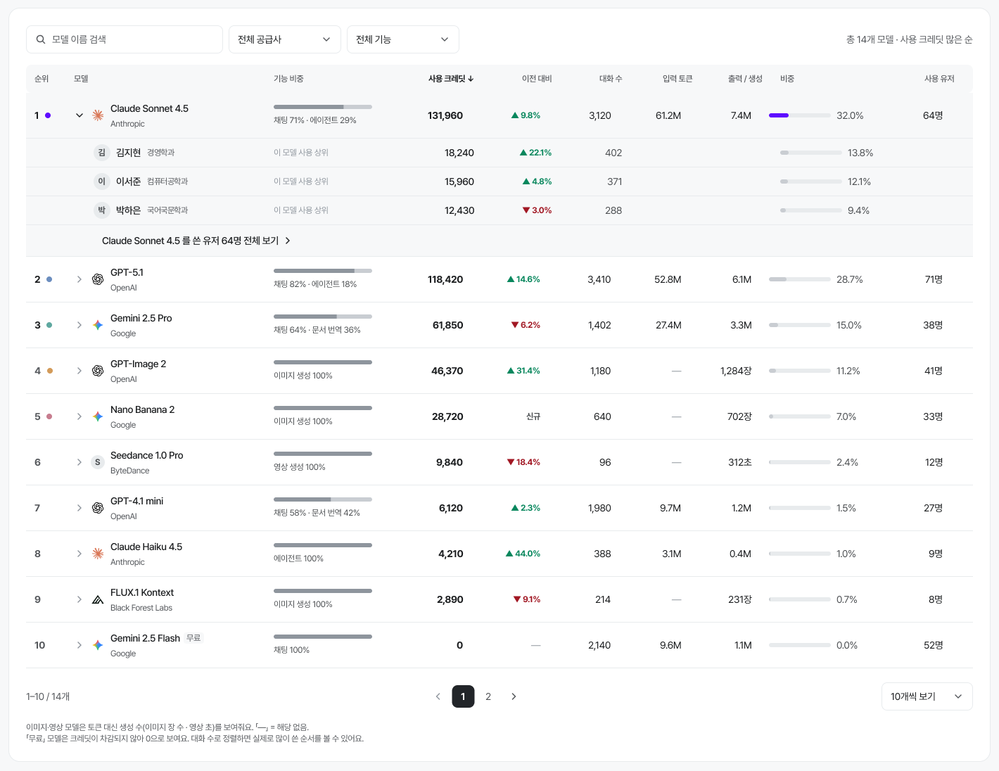

모델을 **사용 크레딧이 많은 순**으로 보여주는 표예요.

- **검색** : 모델 이름으로 찾아요.
- **공급사 · 기능 필터** : 특정 회사 모델이나 특정 기능에 쓰인 모델만 볼 수 있어요.
- **펼쳐 보기** : 모델 왼쪽의 `>`를 누르면 **그 모델을 많이 쓴 유저**가 나와요.

| 열 | 설명 |
|---|---|
| 기능 비중 | 이 모델이 어떤 기능에 쓰였는지 (예: 채팅 71% · 에이전트 29%) |
| 사용 크레딧 · 이전 대비 | 쓴 크레딧과 이전 기간 대비 증감 |
| 대화 수 | 이 모델로 대화한 횟수 |
| 입력 토큰 · 출력/생성 | AI에 보낸 양과 AI가 만들어낸 양 |
| 비중 | 전체 사용량에서 차지하는 비율 |
| 사용 유저 | 이 모델을 쓴 유저 수 |

> 💡 **이미지·영상 모델은 토큰 대신 생성 수(이미지 장 수, 영상 초)로 보여줘요.**

> 💡 **`무료` 모델은 크레딧이 차감되지 않아 0으로 보여요.** 대화 수로 정렬하면 실제로 많이 쓴 순서를 볼 수 있어요.

!!! tip "이럴 때 확인하세요"
    크레딧이 많이 드는 고성능 모델에 사용이 몰려 있다면, 스페이스 설정에서 사용할 모델을 조정하는 것도 방법이에요.

---

## 4. 그룹 탭 · 그룹별 사용량 { #group }

**부서·팀(유저 그룹)별로 얼마나 쓰는지** 비교하는 화면이에요.

### 4-1. 그룹 요약

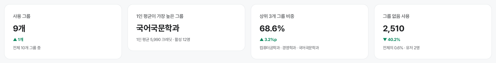

| 항목 | 뜻 | 이렇게 읽어요 |
|---|---|---|
| **사용 그룹** | 기간 동안 사용 기록이 있는 그룹 수 | 전체 그룹 중 몇 개가 쓰고 있는지 보여요. |
| **1인 평균이 가장 높은 그룹** | 구성원 1명당 사용량이 가장 많은 그룹 | 인원이 적어도 활발하게 쓰는 그룹을 찾을 수 있어요. |
| **상위 3개 그룹 비중** | 많이 쓴 그룹 3개가 전체에서 차지하는 비율 | 사용이 특정 그룹에 몰려 있는지 알 수 있어요. |
| **그룹 없음 사용** | 어느 그룹에도 속하지 않은 유저가 쓴 크레딧 | 그룹 배정이 안 된 유저가 있는지 확인해요. |

### 4-2. 상위 5개 그룹 사용 추이

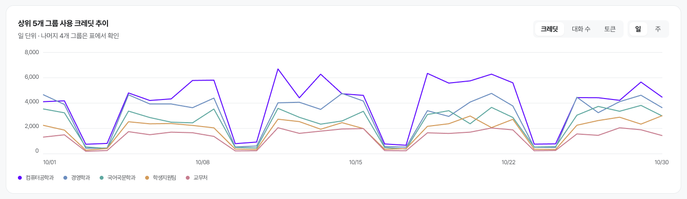

**많이 쓴 그룹 5개의 날짜별 사용량**을 비교해요.

- `크레딧` · `대화 수` · `토큰` 중 볼 항목을, `일` · `주` 중 단위를 골라요.

### 4-3. 그룹 목록

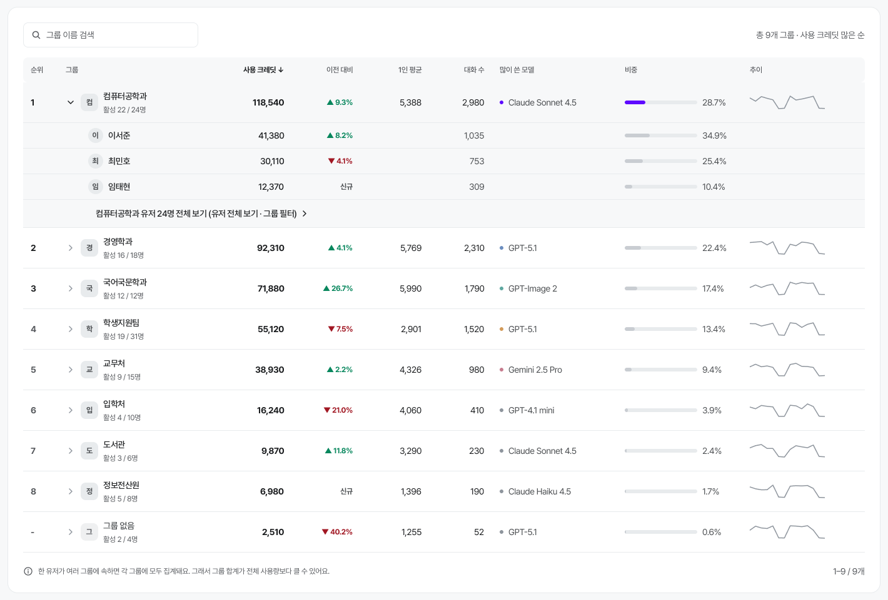

그룹을 **사용 크레딧이 많은 순**으로 보여주는 표예요.

- **검색** : 그룹 이름으로 찾아요.
- **펼쳐 보기** : 그룹 왼쪽의 `>`를 누르면 **그 그룹에서 많이 쓴 유저**가 나와요.

| 열 | 설명 |
|---|---|
| 활성 | 그룹 인원 중 실제로 쓴 사람 수 (예: 활성 22 / 24명) |
| 사용 크레딧 · 이전 대비 | 쓴 크레딧과 이전 기간 대비 증감 |
| 1인 평균 | 구성원 1명당 평균 사용 크레딧 |
| 대화 수 | 그룹 전체 대화 횟수 |
| 많이 쓴 모델 | 그 그룹이 가장 많이 쓴 AI 모델 |
| 비중 · 추이 | 전체에서 차지하는 비율과 사용 흐름 |

!!! warning "그룹 합계가 전체 사용량보다 클 수 있어요"
    한 유저가 여러 그룹에 속해 있으면 각 그룹에 모두 집계돼요.

!!! tip "이럴 때 확인하세요"
    그룹별 크레딧 한도가 실제 사용량에 맞는지 확인하고, 필요하면 유저 그룹 관리에서 한도를 조정해요.

---

## 5. 상세 탭 · 조건별 상세 조회 { #detail }

**원하는 조건을 직접 골라 필요한 데이터만 뽑아보는 화면**이에요.
예를 들어 *"개발팀과 기획팀이 채팅·에이전트에 쓴 크레딧을 모델별로"* 같은 식으로 볼 수 있어요.

### 5-1. 요약 수치

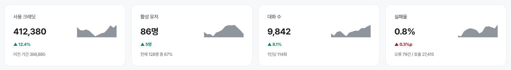

**사용 크레딧 · 활성 유저 · 대화 수 · 실패율**을 보여줘요. 아래에서 필터를 바꾸면 이 숫자도 함께 바뀌어요.

### 5-2. 필터로 범위 좁히기

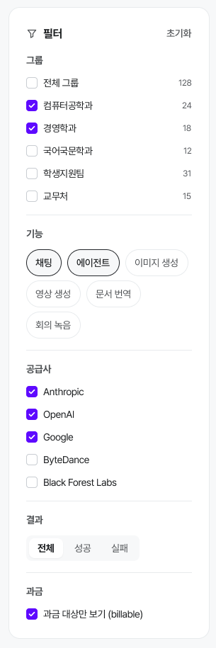{ width="280" }

화면 왼쪽의 필터에서 **보고 싶은 범위**를 골라요.

| 필터 | 설명 |
|---|---|
| **그룹** | 볼 유저 그룹을 체크해요. |
| **기능** | 채팅 · 에이전트 · 이미지 생성 · 영상 생성 · 문서 번역 · 회의 녹음 |
| **공급사** | Anthropic · OpenAI · Google 등 모델을 만든 회사 |
| **결과** | 전체 · 성공 · 실패 |
| **과금** | 체크하면 크레딧이 차감된 사용만 보여줘요. |

오른쪽 위 `초기화`를 누르면 필터가 모두 풀려요.

### 5-3. 보는 기준 정하기

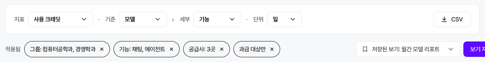

필터 오른쪽 위에서 **표와 그래프를 어떤 기준으로 나눠 볼지** 정해요.

| 선택 | 설명 |
|---|---|
| **지표** | 무엇을 볼지 골라요. (예: 사용 크레딧) |
| **기준 › 세부** | 어떤 단위로 묶을지 골라요. (예: 모델별로 묶고, 그 안에서 기능별로 나누기) |
| **단위** | 일 · 주 등 기간 단위 |

- 지금 걸려 있는 조건은 아래에 **칩**으로 표시돼요. `×`를 눌러 하나씩 뺄 수 있어요.
- 자주 쓰는 조건은 `보기 저장`으로 저장해 두고, **저장된 보기**에서 다시 불러올 수 있어요.

!!! tip "이럴 때 확인하세요"
    매달 같은 조건으로 보고서를 만든다면, 한 번 저장해 두고 다음 달에 바로 불러오세요.

### 5-4. 그래프로 보기

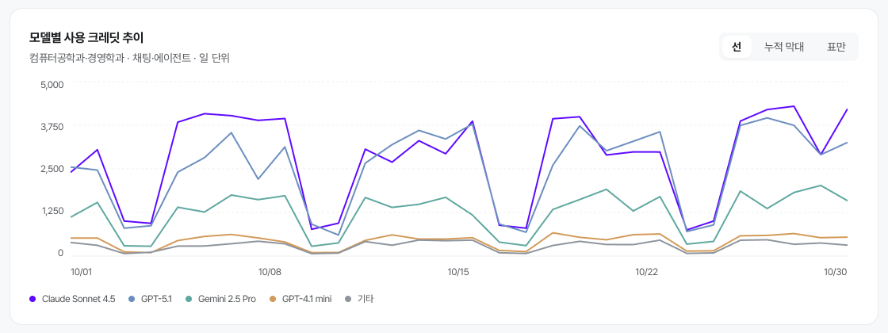

고른 조건에 맞는 사용량을 그래프로 보여줘요. 오른쪽 위에서 `선` · `누적 막대` · `표만` 중 보기 방식을 골라요.

### 5-5. 표로 보고 내려받기

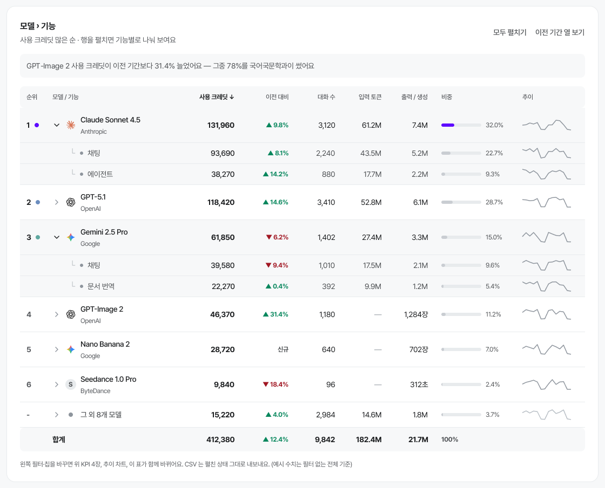

고른 기준대로 정리된 표예요.

- 행 왼쪽의 `>`를 누르면 **세부 기준**(예: 모델 안의 기능별)으로 나눠 보여줘요.
- `모두 펼치기`로 한 번에 펼칠 수 있어요.
- `이전 기간 열 보기`를 누르면 이전 기간 수치를 나란히 볼 수 있어요.
- 표 위의 한 줄 요약에서 눈에 띄는 변화를 알려줘요.
- 맨 아래 **합계** 행에서 전체 수치를 확인해요.

보기 기준 줄 오른쪽의 `CSV`를 누르면 **표를 펼친 상태 그대로** 파일로 받을 수 있어요.
