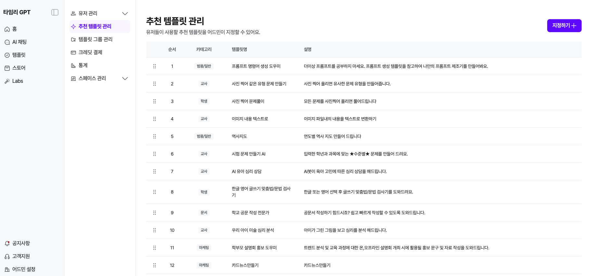
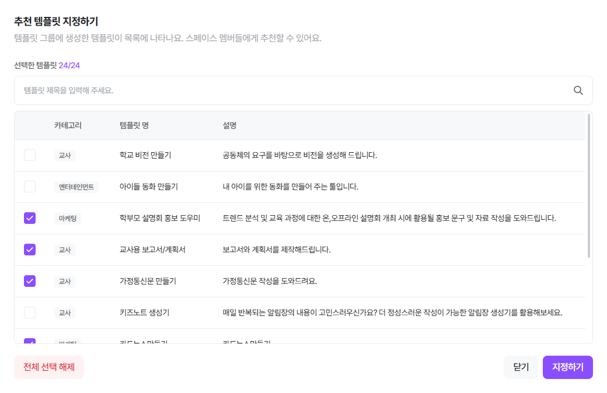
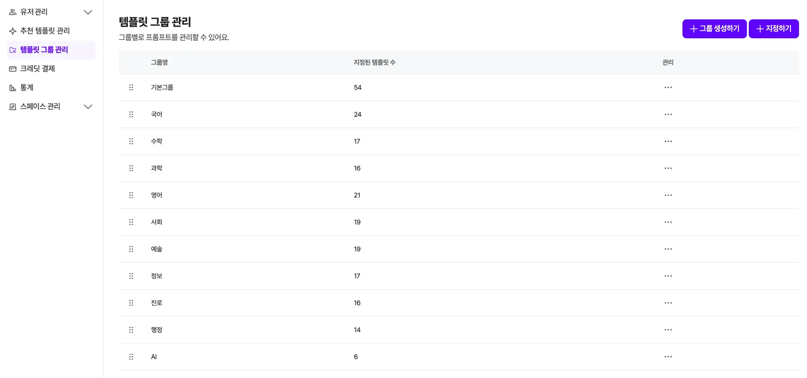

# 템플릿 관리

**[어드민 설정] > [템플릿 관리]**에서 구성원에게 보여줄 템플릿을 관리해요. **추천 템플릿 관리**와 **템플릿 그룹 관리** 두 가지 메뉴가 있어요.

!!! note
    ***템플릿*** 이란? 타임리가 제공하는 AI 도구입니다. 주어진 빈 칸이나 목록에 원하는 [프롬프트]를 입력하면 더 편리하게 결과를 얻을 수 있어요!

    ✅ AI와 친하지 않다면, ***만들어져있는 템플릿*** 이용해 효율적으로 사용

    ✅ AI와 친숙한데 특정 프롬프트를 자주 사용한다면, ***직접 템플릿을 만들어*** 시간 단축 가능

## 추천 템플릿 관리

구성원 템플릿 화면의 **'추천'**에 보일 템플릿을 골라요.

- 추천 템플릿은 [어드민 설정] > [템플릿 관리] > [추천 템플릿 관리] > [지정하기]로 설정 가능해요

- ‘템플릿 그룹’에 있는 템플릿 중 선택 가능해요.

## 템플릿 그룹 관리

템플릿을 **주제별로 묶고, 누구에게 보여줄지** 정해요. 구성원은 자기에게 열린 그룹만 볼 수 있어요.

- 스토어에 있는 템플릿을 그룹에 보이게 하고 싶다면 [템플릿 그룹 관리]-[지정하기] 클릭

![그룹명 선택 후, [다음으로] 클릭](../assets/images/admin-templates/img04.png)

그룹명 선택 후, [다음으로] 클릭

![프롬프트 클릭 후, [지정하기] 클릭](../assets/images/admin-templates/img05.png)

프롬프트 클릭 후, [지정하기] 클릭

