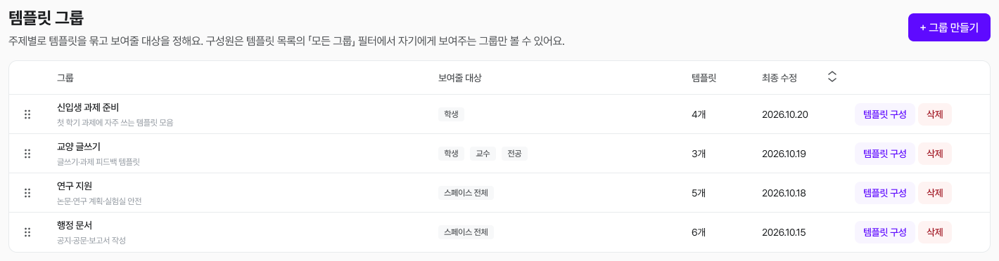
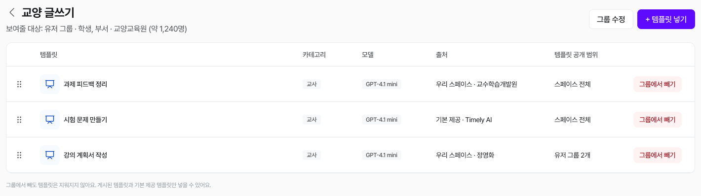
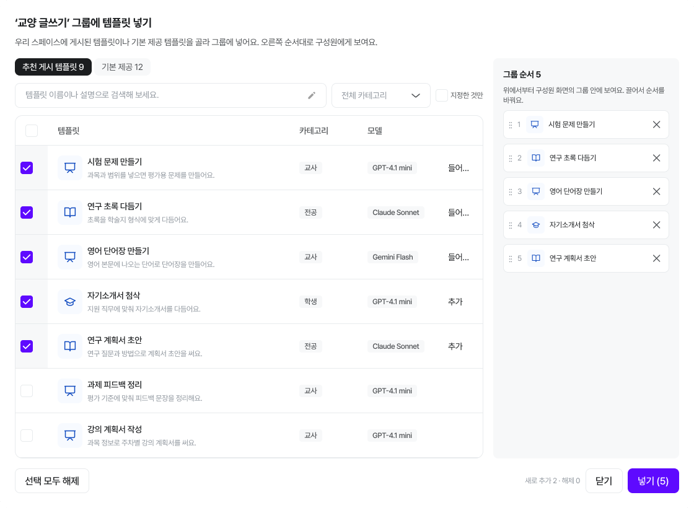

# 템플릿 그룹 관리

**[템플릿 관리] > [템플릿 그룹 관리]**에서 템플릿을 **주제별로 묶고, 누구에게 보여 줄지** 정해요. 구성원은 템플릿 목록의 **「모든 그룹」** 필터에서 자기에게 열린 그룹만 볼 수 있어요.

## 1. 화면 구성 { #overview }

| 항목 | 뜻 |
|---|---|
| **보여줄 대상** | 이 그룹을 볼 수 있는 사람이에요. `스페이스 전체`거나, `학생` `교수`처럼 고른 유저 그룹·부서예요 |
| **템플릿** | 그룹에 들어 있는 템플릿 수예요 |
| **점 6개 아이콘** | 끌어서 그룹 순서를 바꿔요 |
| **[템플릿 구성]** | 그룹에 템플릿을 넣거나 빼요 |
| **[삭제]** | 그룹을 지워요. 그룹 안의 템플릿은 지워지지 않아요 |

## 2. 그룹 만들기 { #create }

오른쪽 위 **[+ 그룹 만들기]**를 눌러요.

{ width="520" }

| 항목 | 설명 |
|---|---|
| **그룹 이름** | 최대 32자. 이미 있는 이름은 쓸 수 없어요 |
| **설명** | 구성원 화면에서 그룹 이름 아래 한 줄로 보여요. 안 적어도 돼요 |
| **보여줄 대상** | **스페이스 전체** — 모든 구성원이 봐요 / **유저 그룹·부서만** — 고른 유저 그룹·부서의 구성원만 봐요 |

'유저 그룹·부서만'을 고르면 **[+ 유저 그룹·부서 추가]**로 대상을 넣어요. 아래에 몇 명에게 보이는지 알려 줘요.

!!! warning "템플릿마다 공개 범위가 따로 있어요"
    그룹을 넓게 열어도, **그룹 안 템플릿의 공개 범위가 더 좁으면 그 템플릿은 공개 범위에 든 사람에게만** 보여요. "그룹은 보이는데 템플릿이 안 보여요"라는 문의가 오면 그 템플릿의 공개 범위를 확인해 주세요.

## 3. 그룹에 템플릿 넣기 · 빼기 { #compose }

그룹의 **[템플릿 구성]**을 누르면 그 그룹에 들어 있는 템플릿이 나와요.

| 항목 | 뜻 |
|---|---|
| **출처** | 기본 제공인지, 우리 스페이스의 누가 만들었는지 보여 줘요 |
| **템플릿 공개 범위** | 그 템플릿을 볼 수 있는 사람이에요. `스페이스 전체` 또는 `유저 그룹 2개`처럼 나와요 |
| **[그룹에서 빼기]** | 이 그룹에서만 빼요. 템플릿은 지워지지 않아요 |
| **[그룹 수정]** | 그룹 이름·설명·보여줄 대상을 바꿔요 |

템플릿을 넣으려면 **[+ 템플릿 넣기]**를 눌러요.

1. 넣을 템플릿을 체크해요. 이미 들어 있는 템플릿은 표시돼 있어요.
2. 오른쪽 **그룹 순서**에서 끌어서 순서를 정해요.
3. **[넣기]**를 눌러요.

> 💡 그룹에는 **게시된 템플릿과 기본 제공 템플릿만** 넣을 수 있어요. 아직 게시하지 않은 템플릿은 목록에 나오지 않아요.

!!! tip "이렇게 묶으면 편해요"
    `신입생 과제 준비`, `연구 지원`, `행정 문서`처럼 **쓰는 사람과 상황**으로 묶어 보세요. 학생용 그룹은 학생에게만, 교직원용 그룹은 교직원에게만 보이게 하면 템플릿 목록이 훨씬 깔끔해져요.
