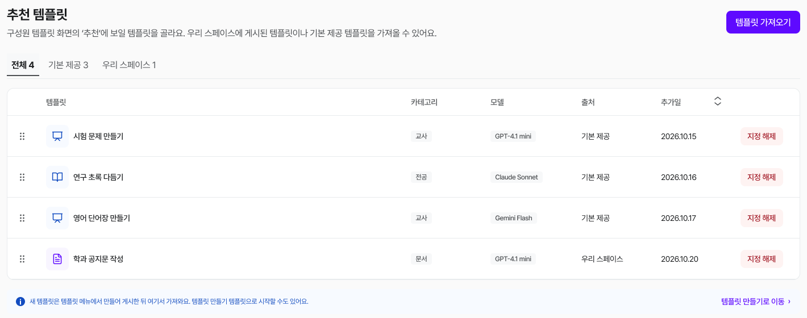
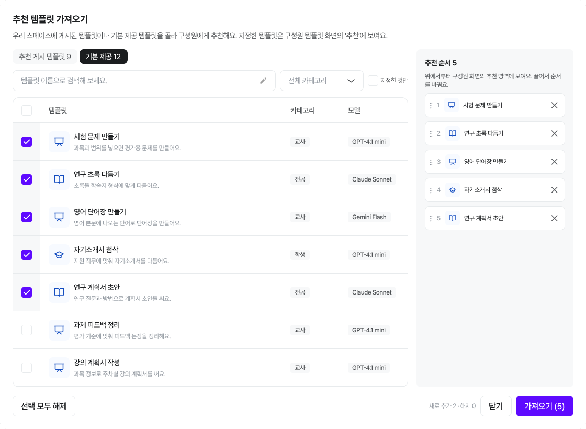
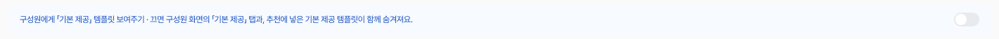

# 추천 템플릿 관리

**[템플릿 관리] > [추천 템플릿 관리]**에서 구성원 템플릿 화면의 **'추천'**에 보일 템플릿을 골라요. 신입생·신규 구성원이 무엇부터 써야 할지 모를 때 가장 먼저 보게 되는 자리예요.

!!! note "템플릿이란?"
    빈칸만 채우면 원하는 결과를 얻을 수 있게 미리 만들어 둔 AI 도구예요. 프롬프트를 직접 쓰기 어려운 구성원도 쉽게 쓸 수 있어요.

## 1. 화면 구성 { #overview }

| 항목 | 뜻 |
|---|---|
| **전체 · 기본 제공 · 우리 스페이스** | 출처별로 골라 보는 탭이에요 |
| **출처** | **기본 제공** — 타임리가 만들어 둔 템플릿 / **우리 스페이스** — 우리 구성원이 만들어 게시한 템플릿 |
| **점 6개 아이콘** | 끌어서 추천 순서를 바꿔요. 위에 있을수록 구성원 화면에서 먼저 보여요 |
| **[지정 해제]** | 추천에서 빼요. 템플릿 자체는 지워지지 않아요 |

## 2. 추천 템플릿 가져오기 { #import }

오른쪽 위 **[템플릿 가져오기]**를 눌러요.

1. 위쪽 탭에서 **우리 스페이스에 게시된 템플릿**이나 **기본 제공** 템플릿을 골라요.
2. 추천할 템플릿을 체크해요. 이름으로 검색하거나 카테고리로 골라 볼 수 있어요.
3. 오른쪽 **추천 순서**에서 끌어서 순서를 정해요. 위에서부터 구성원 화면에 보여요.
4. **[가져오기]**를 눌러요.

!!! tip "우리 기관만의 템플릿을 추천하고 싶다면"
    새 템플릿은 여기서 만들 수 없어요. **템플릿 메뉴에서 만들어 게시한 뒤** 여기서 가져와요. 화면 아래 **[템플릿 만들기로 이동]**을 누르면 바로 갈 수 있어요. 만드는 방법은 [템플릿 만들기](../../user/reference/templates-build.md)를 참고해 주세요.

## 3. 기본 제공 템플릿 숨기기 { #builtin }

타임리가 기본으로 제공하는 템플릿을 구성원에게 아예 보여 주지 않을 수도 있어요.

**구성원에게 「기본 제공」 템플릿 보여주기**를 끄면, 구성원 화면의 **「기본 제공」 탭**과 **추천에 넣어 둔 기본 제공 템플릿**이 함께 숨겨져요. 우리 기관이 만든 템플릿만 쓰게 하고 싶을 때 써요.

> 💡 추천 템플릿이 구성원 메인 화면에 보이려면 [스페이스 설정 > 기본 설정](../space/settings.md#basic)의 **추천 템플릿**도 켜져 있어야 해요.
