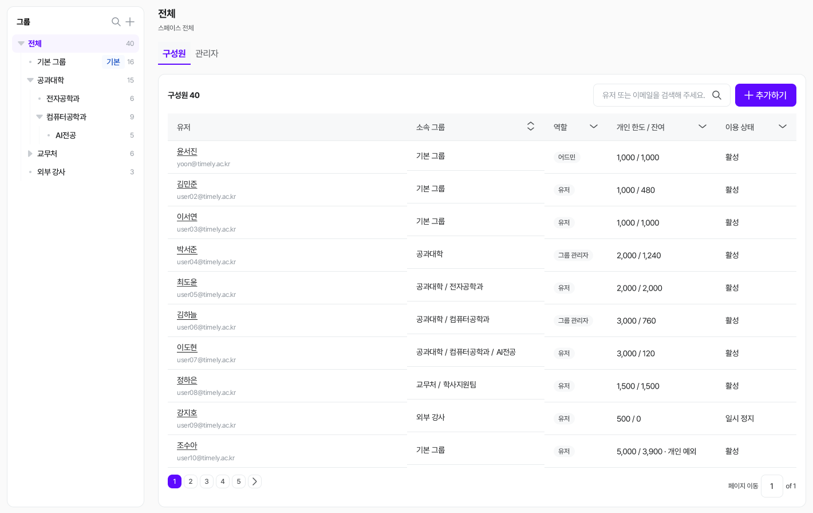
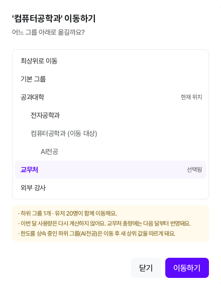
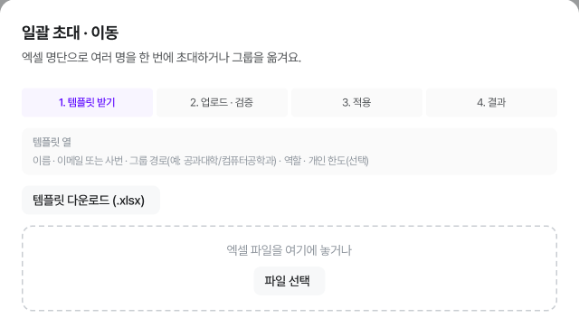
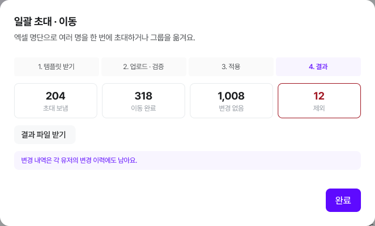

# 유저 그룹 관리

**[유저 관리] > 유저 정보 > [유저 그룹 관리]**에서 유저를 **단과대학 > 학과 > 전공**, **본부 > 부서 > 팀**처럼 그룹으로 묶어요. 그룹마다 한도와 관리자를 따로 정할 수 있어요.

## 1. 화면 구성 { #overview }

왼쪽에서 그룹을 고르면 오른쪽에 그 그룹의 구성원이 나와요.

| 보이는 것 | 뜻 |
|---|---|
| **기본 그룹** (`기본` 표시) | 그룹을 따로 정하지 않은 유저가 들어가는 그룹이에요. 삭제할 수 없어요 |
| **그룹 옆 숫자** | 하위 그룹까지 포함한 유저 수예요 |
| **개인 한도 / 잔여** | `3,000 / 760`이면 한도 3,000 중 760이 남았다는 뜻이에요. 잔여가 0이면 크레딧을 다 쓴 유저예요 |
| **[직속] / [하위 포함]** | 하위 그룹이 있는 그룹에서만 나와요. 그 그룹에 바로 속한 유저만 볼지, 하위 그룹 유저까지 볼지 골라요 |

## 2. 그룹 만들기 { #create }

그룹 목록 위의 **+**를 눌러요.

{ width="420" }

| 항목 | 설명 |
|---|---|
| **상위 그룹** | 고른 그룹 아래에 하위 그룹으로 만들어져요. 비워 두면 최상위 그룹이 돼요. **최대 5단계**까지 만들 수 있어요 |
| **그룹 이름** | 최대 32자. 같은 상위 그룹 안에서만 겹치지 않으면 돼요. `/`는 쓸 수 없어요 |
| **구성원 1인 한도 · 상위 그룹 설정 따름** | 켜 두면 상위 그룹의 한도 설정을 그대로 따라요. 끄면 이 그룹만의 리셋 방식과 한도를 직접 정해요 |
| **그룹 월 총량** | 그룹 전체(하위 그룹 포함)가 한 달에 쓸 수 있는 크레딧이에요. 비워 두면 제한이 없어요. 매월 1일에 초기화돼요 |
| **사용자 데이터 삭제** | 켜면 이 그룹 유저가 로그아웃할 때 데이터가 자동으로 삭제돼요. 삭제된 데이터는 되돌릴 수 없어요 |

**1인 한도의 리셋 방식 3가지** — '상위 그룹 설정 따름'을 껐을 때 골라요.

| 방식 | 설명 | 이런 그룹에 좋아요 |
|---|---|---|
| **월별 리셋형** | 매월 1일 0시에 한도가 다시 채워져요 | 재학생·교직원처럼 계속 쓰는 그룹 |
| **총량 소진형** | 처음 준 한도만 써요. 다 쓰면 관리자가 다시 채워 줄 때까지 못 써요 | 단기 특강·외부 강사처럼 기간이 정해진 그룹 |
| **로그인 시 초기화형** | 로그인할 때마다 한도가 다시 채워져요 | 실습실 공용 계정 |

!!! warning "한도를 정할 때 알아두세요"
    - 상위 그룹에 월 총량이 있으면 **상위 그룹 총량도 함께 적용**돼요. 하위 그룹 총량을 상위보다 크게 적어도, 실제로는 상위 총량 안에서만 쓸 수 있어요.
    - 한도를 높여도 스페이스가 가진 크레딧이 늘어나는 건 아니에요. 크레딧 자체는 [크레딧 현황](../credits.md)에서 확인해요.

## 3. 그룹 수정 · 이동 · 삭제 { #manage }

수정은 만들 때와 같은 창에서 해요. 이동과 삭제는 아래 내용만 알아 두면 돼요.

| 작업 | 알아둘 점 |
|---|---|
| **이동** | **하위 그룹과 소속 유저가 함께** 옮겨져요. 이번 달 사용량은 다시 계산하지 않고, 새 상위 그룹의 총량에는 **다음 달부터** 반영돼요 |
| **삭제** | 소속 유저는 **바로 위 상위 그룹으로** 옮겨져요. 그 그룹으로 만든 **초대 코드는 더 이상 쓸 수 없어요** |
| **삭제할 수 없는 그룹** | **하위 그룹이 있는 그룹**과 **기본 그룹**이에요. 하위 그룹을 먼저 옮기거나 삭제해 주세요 |

**이동 창** — 옮길 위치를 고르고 **[이동하기]**를 눌러요. **최상위로 이동**도 고를 수 있어요.

{ width="420" }

**삭제 확인 창**

{ width="420" }

## 4. 그룹에 구성원 추가하기 { #add }

구성원 표 위의 **[+ 추가하기]**를 누르고 방법을 골라요.

{ width="360" }

### 4-1. 이메일 초대하기

{ width="420" }

이메일을 쉼표나 줄바꿈으로 여러 개 적을 수 있어요. 형식이 맞지 않는 주소는 빼고 보내고, 몇 명에게 보내는지 미리 알려 줘요.

### 4-2. 일괄 초대하기

엑셀 명단 하나로 **새 유저 초대와 기존 유저의 그룹 이동을 한 번에** 처리해요.

{ width="560" }

| 단계 | 하는 일 |
|---|---|
| **1. 템플릿 받기** | 양식을 받아 채워요. 그룹은 `공과대학/컴퓨터공학과`처럼 **경로**로 적어요 |
| **2. 업로드 · 검증** | 파일을 올리면 **신규 초대 · 그룹 이동 · 변경 없음 · 오류**가 각각 몇 명인지 보여 줘요 |
| **3. 적용** | 오류 줄은 빼고 나머지만 적용돼요 |
| **4. 결과** | **[결과 파일 받기]**로 처리 결과를 내려받아요 |

{ width="560" }

!!! tip "오류가 나왔을 때"
    자주 나오는 이유는 **이메일 형식이 맞지 않음 · 없는 그룹 경로 · 같은 이메일이 두 번 있음**이에요. 결과 파일에서 오류 줄만 고쳐 다시 올리면 돼요.

## 5. 그룹 관리자 지정하기 { #admins }

**그룹 관리자**는 맡은 그룹과 그 아래 모든 하위 그룹을 관리하는 사람이에요. 학과 조교나 부서 담당자에게 맡기면 어드민이 일일이 챙기지 않아도 돼요. 그룹을 고르고 **[관리자]** 탭에서 **[+ 관리자 지정]**을 눌러요.

| 구분 | 뜻 |
|---|---|
| **직접 지정** | 이 그룹에 직접 지정한 관리자예요. **[해제]**로 뺄 수 있어요 |
| **상위 그룹에서 상속** | 상위 그룹의 관리자라서 이 그룹도 함께 관리하는 사람이에요. 해제는 상위 그룹에서 해요 |

**[+ 관리자 지정]**을 누르면 유저를 검색해 고를 수 있어요. 고른 뒤 **[지정하기]**를 누르면 그 유저의 역할이 **그룹 관리자**로 표시돼요.

{ width="420" }

- 그룹 관리자 지정은 **스페이스 관리자(어드민)만** 할 수 있어요.
- 나중에 하위 그룹을 새로 만들어도 **자동으로 관리 범위에 포함**돼요.
- 그룹 관리자가 이 화면에 들어오면 **자기가 맡은 그룹과 하위 그룹만** 보여요.

## 자주 묻는 질문

??? question "여러 명의 그룹을 한꺼번에 옮기고 싶어요"

    - 몇 명이면: [유저 설정](settings.md#bulk)에서 체크한 뒤 **[일괄 변경하기] > [유저 그룹 변경]**
    - 많으면: [유저 설정의 엑셀로 그룹 변경](settings.md#excel) 또는 이 화면의 **[+ 추가하기] > [일괄 초대하기]**
