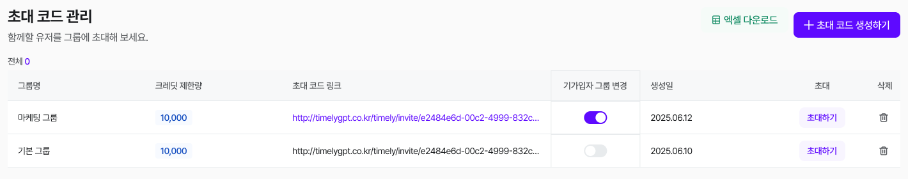

# 초대 코드 관리

**[유저 관리] > 초대·가입 관리 > [초대 코드 관리]**에서 그룹별 가입 링크(**초대 코드**)를 만들어요. 링크로 가입한 사람은 자동으로 그 그룹에 들어가요.

**[+ 초대 코드 생성하기]**를 누르고 유저 그룹을 고르면 그 그룹용 링크가 만들어져요.

| 항목 | 알아둘 점 |
|---|---|
| **기가입자 그룹 변경** | 켜 두면, 이미 가입한 유저가 이 링크로 들어왔을 때 이 그룹으로 옮겨져요 |
| **[초대하기]** | 이 코드로 **이메일 초대 · 일괄 초대 · 초대 코드 복사**를 할 수 있어요 |
| **휴지통** | 삭제한 링크로는 더 이상 가입할 수 없어요 |

!!! tip "이렇게 쓰면 편해요"
    학과·부서별로 초대 코드를 하나씩 만들어 각 담당자에게 전달하면, 가입과 동시에 그룹 배정까지 끝나요.
