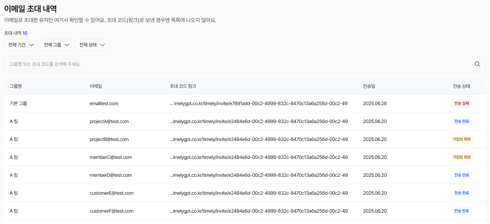

# 이메일 초대 내역

**[유저 관리] > 초대·가입 관리 > [이메일 초대 내역]**에서 이메일로 보낸 초대가 잘 전달됐는지 확인해요.

> 💡 **초대 코드(링크)를 직접 공유한 경우는 여기에 나오지 않아요.** 이메일로 초대한 내역만 나와요.

| 전송 상태 | 뜻 | 이렇게 하세요 |
|---|---|---|
| **전송 완료** | 초대 메일이 발송됐어요 | 상대가 메일을 못 찾으면 스팸함을 확인하도록 안내해요 |
| **전송 실패** | 메일을 보내지 못했어요 | 이메일 주소에 오타가 없는지 확인하고 다시 초대해요 |
| **가입된 회원** | 이미 가입한 사람이에요 | 다시 초대할 필요가 없어요 |
