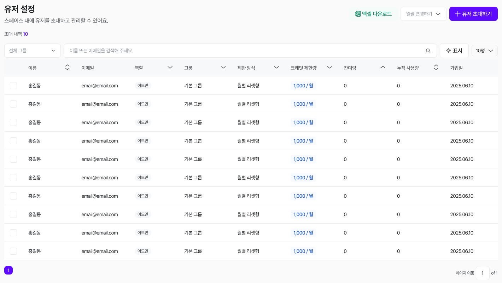
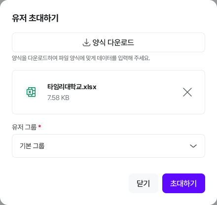
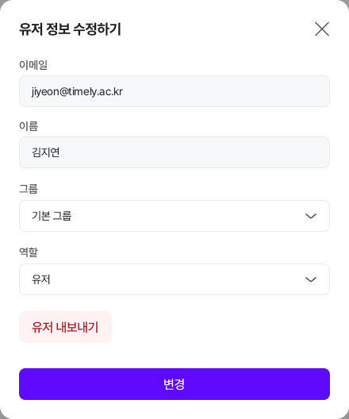
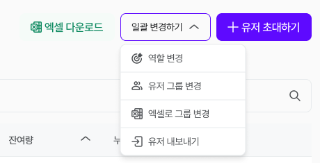
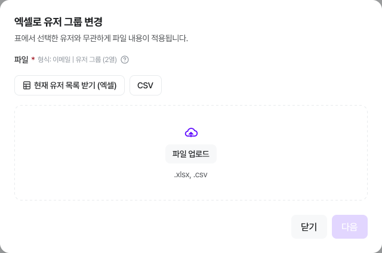

# 유저 설정

**[유저 관리] > 유저 정보 > [유저 설정]**에서 유저를 초대하고, 그룹·역할을 바꾸거나 내보내요.

## 1. 유저 초대하기 { #invite }

오른쪽 위 **[+ 유저 초대하기]**를 누르고 방법을 골라요. 어떤 방법이든 **유저 그룹**을 함께 고르고, 가입한 사람은 그 그룹으로 들어와요.

| 방법 | 이럴 때 좋아요 |
|---|---|
| **이메일 초대** | 한두 명을 바로 초대할 때 |
| **일괄 초대** | 신입생·신규 입사자처럼 여러 명을 한 번에 초대할 때 |
| **초대 코드** | 링크 하나를 공지에 올려 각자 가입하게 할 때 |

### 1-1. 이메일 초대

{ width="420" }

초대할 사람의 **이메일**을 입력하고 **유저 그룹**을 고른 뒤 **[초대하기]**를 누르면 초대 메일이 발송돼요.

### 1-2. 일괄 초대

{ width="420" }

1. **[양식 다운로드]**로 엑셀 양식을 받아, 초대할 사람들의 이메일을 입력해요.
2. 작성한 파일을 올리고 **유저 그룹**을 골라요.
3. **[초대하기]**를 눌러요.

### 1-3. 초대 코드

{ width="420" }

**유저 그룹**을 고르면 그 그룹용 링크가 나와요. **[링크 복사하기]**로 복사해 메일·메신저·공지에 붙여 넣어요.

## 2. 유저 한 명의 정보 바꾸기 { #edit }

목록에서 유저를 선택하면 **유저 정보 수정하기** 창이 열려요. **그룹**과 **역할**을 바꾸고 **[변경]**을 눌러요. 이메일과 이름은 여기서 바꿀 수 없어요.

{ width="420" }

- 그룹을 바꾸면 그 그룹의 크레딧 한도를 따라요.
- 마스터를 다른 사람으로 바꾸면, 지금 마스터는 관리자로 바뀌어요.

!!! warning "유저 내보내기는 되돌릴 수 없어요"
    **[유저 내보내기]**를 하면 **그 유저가 만든 프롬프트가 함께 삭제**돼요. 졸업·퇴사처럼 확실할 때만 사용하세요.

## 3. 여러 명을 한 번에 바꾸기 { #bulk }

표 왼쪽 체크 상자로 유저를 고른 뒤 **[일괄 변경하기]**를 눌러요.

{ width="420" }

| 메뉴 | 하는 일 |
|---|---|
| **역할 변경** · **유저 그룹 변경** | 체크한 유저들의 역할이나 그룹을 한 번에 바꿔요 |
| **엑셀로 그룹 변경** | 엑셀 명단에 적힌 대로 그룹을 옮겨요. 인원이 많을 때 편해요 |
| **유저 내보내기** | 체크한 유저들을 한 번에 내보내요 |

## 4. 엑셀로 그룹 변경하기 { #excel }

학기 초 학과 배정이나 조직 개편처럼 **수십~수백 명의 그룹을 한 번에 바꿀 때** 써요.

{ width="560" }

1. **[현재 유저 목록 받기 (엑셀)]** 또는 **[CSV]**로 지금 명단을 받아요.
2. 파일을 **이메일 | 유저 그룹** 2열로 정리하고, 유저 그룹 칸을 옮길 그룹 이름으로 고쳐요.
3. 파일을 올리고(.xlsx, .csv) **[다음]**을 눌러 적용해요.

> 💡 이 기능은 **표에서 체크한 유저와 상관없이, 파일에 적힌 내용대로** 적용돼요.

## 자주 묻는 질문

??? question "유저가 '권한이 없다'고 떠요"

    **[로그인 링크]**로 바로 들어온 경우 생길 수 있어요. **[+ 유저 초대하기]**에서 해당 유저를 이메일로 한 번 더 초대해 주세요.

??? question "유저가 크레딧을 다 썼어요"

    해당 유저를 선택해 **그룹**을 한도가 더 큰 그룹으로 바꿔 주세요. 그룹 전체의 한도를 올리려면 [유저 그룹 관리](groups.md)에서 그 그룹을 수정해요.

    한도를 바꾸면 **그만큼 더** 쓸 수 있어요. (예: 한도 10,000 → 15,000으로 바꾸면 5,000만큼 더 사용 가능)
