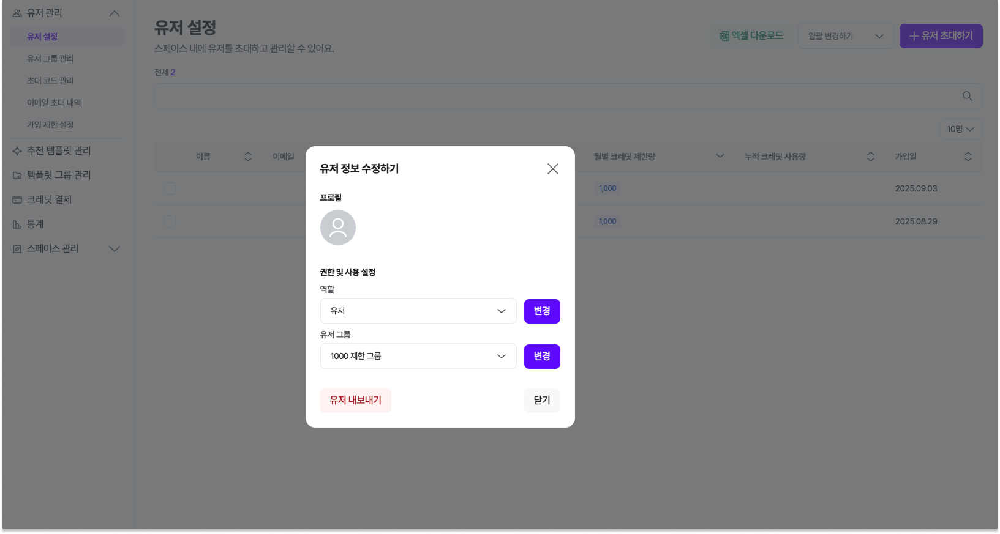
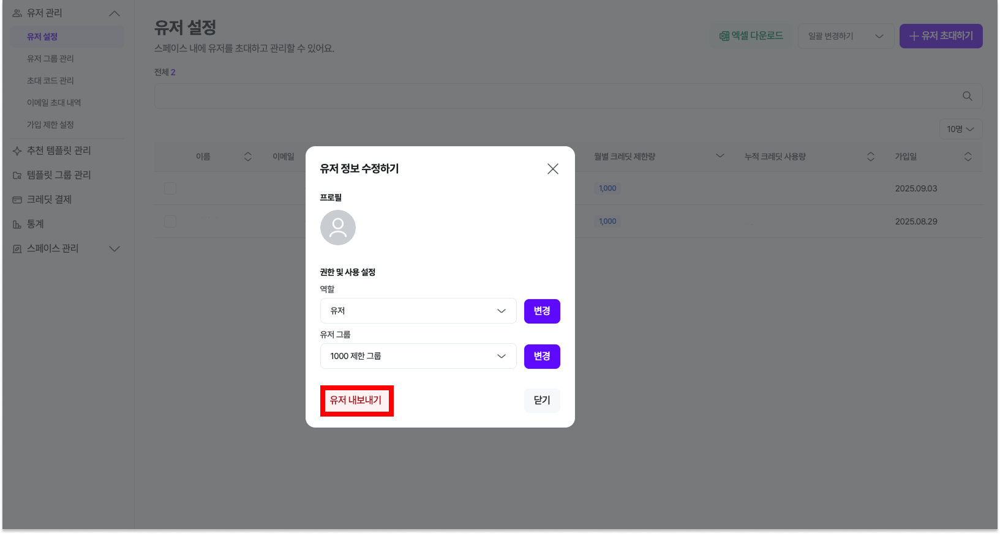
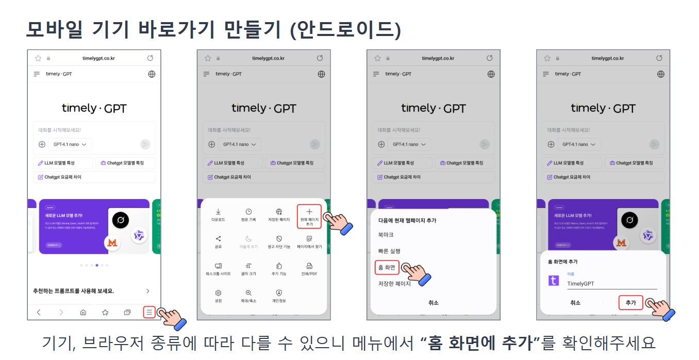
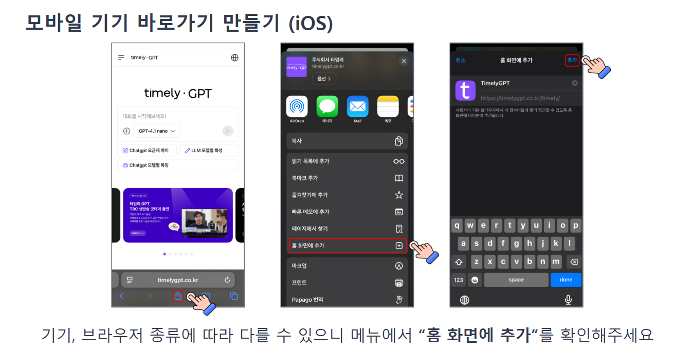

# 자주 묻는 질문

---

??? question "프롬프트는 무엇인가요?"

    **프롬프트(prompt)**는 사용자가 컴퓨터나 프로그램에 입력하는 명령이나 질문을 의미해요.
    
    쉽게 말해, 우리가 어떤 정보를 얻거나 작업을 수행하기 위해 시스템에 요청하는 내용을 말하죠.
    
    예를 들어, 검색 엔진에 "날씨"라고 입력하면, "날씨"가 프롬프트가 되는 거예요.
    
    이 프롬프트를 통해 시스템은 사용자가 원하는 정보를 찾아서 보여줍니다.
    
    프롬프트는 대화형 AI와의 대화에서도 중요한 역할을 해요.
    
    우리가 AI에게 질문을 하거나 요청할 때 사용하는 문장이 바로 프롬프트입니다.
    
    AI는 이 프롬프트를 바탕으로 적절한 답변이나 정보를 제공하게 됩니다.
    
    즉, **프롬프트는 우리가 원하는 결과를 얻기 위해 시스템에 전달하는 요청이나 질문**이라고 생각하면 됩니다!

    
??? question "LLM 모델별 사용 특징"

    타임리 AI에서는 여러 AI사의 모델을 골라 쓸 수 있어요. 모델군별 특징을 한눈에 정리하면 이래요. *(2026.11 기준)*

    | 모델군 | 대표 모델 | 이럴 때 추천 |
    | --- | --- | --- |
    | **Upstage** (Solar) | Solar Pro 4 · Solar Mini 4 | 한국어 문서·보고서·요약 등 국내 실무 |
    | **OpenAI** (GPT) | GPT 6 Astra · GPT 6.1 Sol · GPT 6.1 Terra · GPT 6 Luna · GPT 5.3 Codex | 문서·분석·추론·코딩 등 폭넓은 업무 |
    | **Anthropic** (Claude) | Claude Fable 5.1 · Claude Opus 5.5 · Claude Sonnet 5.5 · Claude Haiku 5.5 | 보고서·기획서 등 장문 작성과 문서 분석 |
    | **Google** (Gemini) | Gemini 4 Argon · Gemini 3.1 Pro · Gemini 3.8 Flash | 긴 문서·이미지 등 멀티모달 자료 분석 |
    | **X AI** (Grok) | Grok 4.7 · Grok 4.20 Fast Reasoning · Grok Build | 빠른 응답, 추론, 개발 작업 |
    | **Mistral AI** | Mistral Large 4 · Mistral Small · Codestral | 효율적인 처리와 개발 업무 자동화 |
    | **Perplexity** (Sonar) | Sonar | 웹 검색 기반 최신 정보·출처 확인 (Labs 메뉴) |
    | **기타** | Qwen3.8 Max · Llama 4 Maverick · Kimi K3 · Laguna S 2.1 | 다국어·장문·코딩 등 목적별 특화 작업 |

    > 💡 모델별 자세한 특징은 [AI 모델별 특징 안내](ai-models.md), 모델별 크레딧은 [모델별 요금 안내](ai-pricing.md)에서 확인할 수 있어요.

??? question "모델별로 크레딧 소진량에 차이가 있나요?"

    - 네, 모델마다 크레딧 소진량이 달라요. 같은 분량의 질문이라도 **고성능·심층 추론 모델일수록 더 많은 크레딧**이 사용돼요.
    - 예를 들어 간단한 질문 1회(질문·답변 합쳐 약 1,700토큰)를 기준으로 하면 이 정도예요.
        - GPT 6 Luna: 약 **0.41크레딧**
        - Claude Sonnet 5.5: 약 **8.1크레딧**
        - GPT 6 Astra: 약 **40.5크레딧**
    - 이미지 첨부·이미지 생성·파일 업로드·검색 등 추가 기능을 쓰면 소진량이 더 늘어날 수 있어요.
    - 모델별 단가와 작업별 예상 사용량은 [모델별 요금 안내](ai-pricing.md)에서 확인해 보세요.

??? question "AI Chat 개인정보 유출 방지법"

    - 민감한 개인정보 입력 금지
    - 업로드 파일에 개인정보 없는지 확인
    - 로그인 상태 & 히스토리 관리
    - 기업, 연구 기밀 공유 금지
    - AI 툴의 데이터 처리 정책 확인

??? question "오류가 발생한 것 같아요"

    불편을 드려서 죄송합니다.
    
    사용자 **이메일 계정,** **오류가 발생한 화면**, **사용하신 기기** 등을 함께 말씀해 주시면 
    
    더 빠르게 문제를 해결해 드립니다.
    
    편하신 방법을 통해 연락해 주세요.

    
??? question "관리자가 일반 유저의 권한을 변경하고 싶어요."

    - [오른쪽 상단 프로필 아이콘] 선택 > [관리자 설정] 선택 > [유저 관리 > 유저] 선택 > 권한 설정 **[설정하기]** 버튼 선택
        
        

        
??? question "초대된 유저를 내보내고 싶어요."

    - 내보내고 싶은 유저를 선택하신 후 **[내보내기]** 버튼을 선택하여 주세요.
        
        

    
??? question "유저를 초대하고 싶어요."

    - 관리자(Admin)만 멤버를 초대할 수 있어요. 편한 방법으로 유저를 초대해 주세요.
    (→ 유저 관리 설정하기)

??? question "Open AI GPT 랑 다른점이 뭔가요?"

    - 다양한 LLM 모델이 탑재되어 있어 특정한 응답에 대해 더 구체적인 답변이 가능해요.
    - 사용자별 크레딧 관리가 가능하여 스페이스 관리자는 소속된 사용자 크레딧을 관리할 수 있어요.
    - 스페이스별 로고, 예시 질문, 배너 등이 직접 설정이 가능하여 소속감을 줄 수 있어요.
    - 교육이면 교육, 기업이면 기업 맞춤형 프롬프트 템플릿이 사용 가능해요.

??? question "로그인이 안돼요."

    소셜 로그인으로 회원가입을 하셨나요?
    
    - 소셜 로그인(구글, 카카오톡)으로 간편 회원가입을 하신 회원이라면 이메일 로그인을 할 수 없습니다.
    소셜 로그인으로 로그인을 진행해 주세요!

    
??? question "휴대폰에서도 사용할 수 있나요?"

    - 타임리 GPT 서비스는 PC와 모바일 모두에서 사용할 수 있으며 Google Play, App Store에서 APP 서비스도 다운로드 하실 수 있습니다.
    - [Google Play 바로가기](https://play.google.com/store/apps/details?id=kr.co.timelygpt&hl=ko)
    - [App store 바로가기](https://apps.apple.com/kr/app/%ED%83%80%EC%9E%84%EB%A6%ACgpt/id6752765292)
    - 모바일 인터넷 바로가기 생성
        - 안드로이드 방법 - 삼성 인터넷 이용 권장
            
            
            
        - IOS(아이폰) 방법 - 사파리 이용 권장
            
            

    
??? question "hwp 파일도 업로드 할 수 있나요?"

    - 타임리 GPT에서는 hwp 파일을 업로드하여 내용 요약, 분석 등을 지원하고 있습니다.

??? question "관리자가 구성원의 채팅 리스트(기록)를 모니터링 할 수 있나요?"

    - 타임리 GPT 서비스에서는 개인정보 관련 문제로 유저의 채팅 내역은 본인 외 확인할 수 없도록 설정되어있습니다.
    - 기업이나 조직 차원에서 해당 기능에 대한 요청이 많아 필요 시 사용자의 동의를 별도로 받아 모니터링 할 수 있도록 기능 개발 중입니다.

??? question "서비스 접속 환경을 제어할 수 있나요?"

    - 고객사 요청 시 IP 대역을 제한하여 특정 IP에서만 접속하도록 설정할 수 있습니다.
    - 내부 시스템 기능 중 이메일 제한 기능을 활용하면 등록한 도메인에서만 접속할 수 있는 화이트리스트 형식의 접근 제한 설정도 가능합니다.
