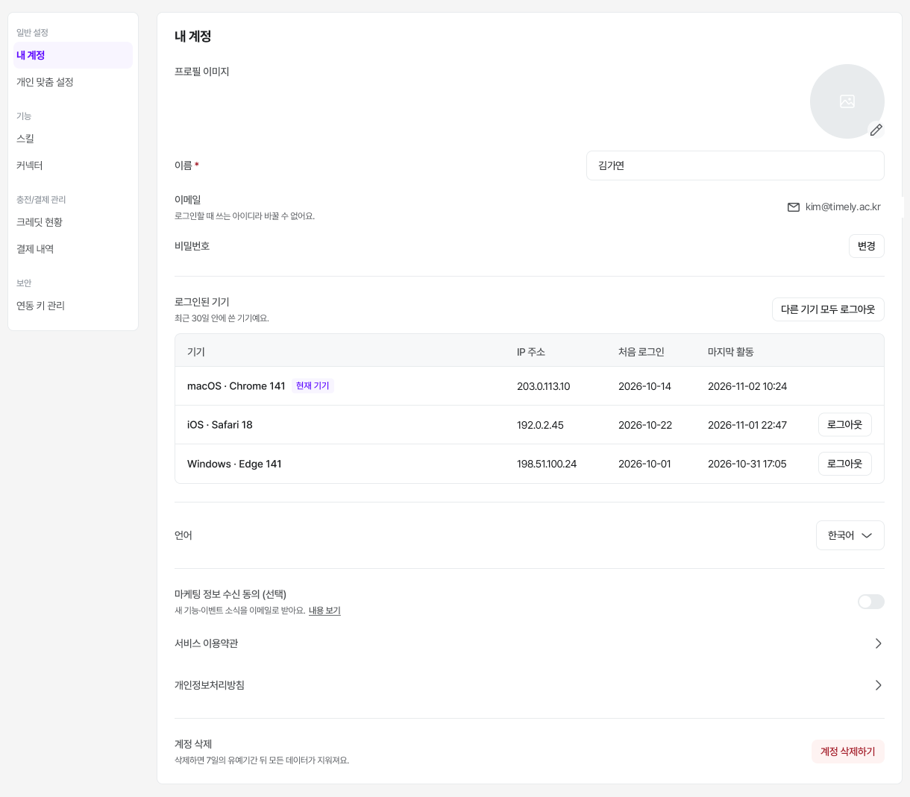
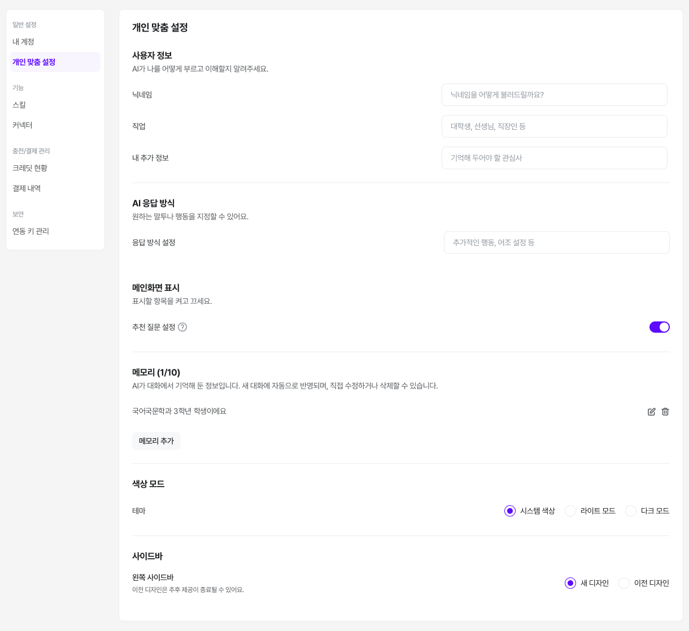
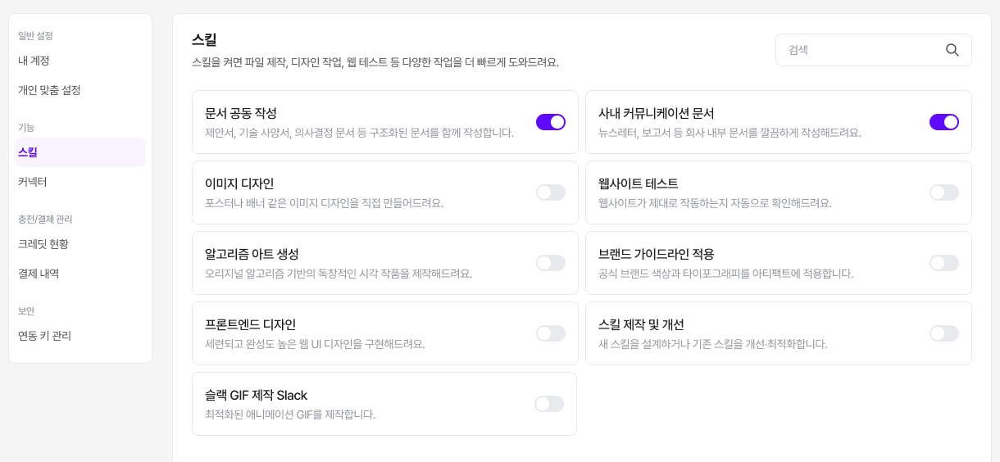
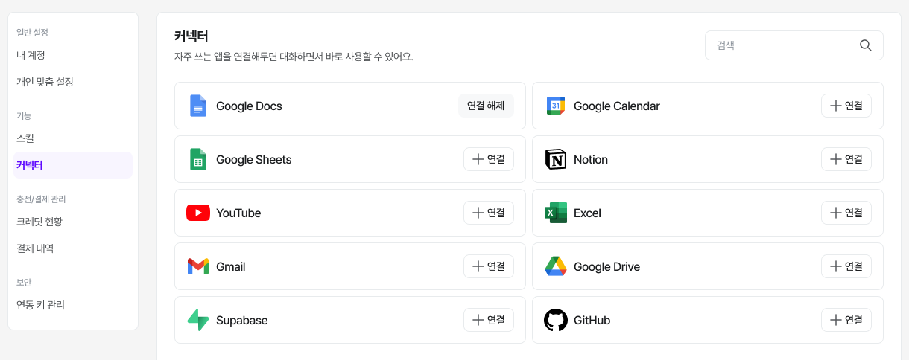
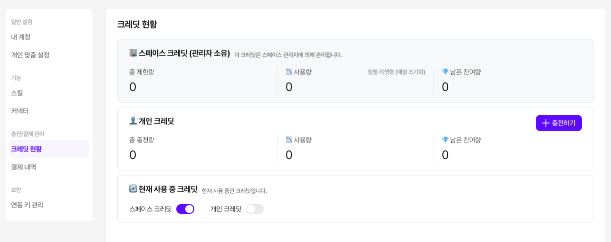
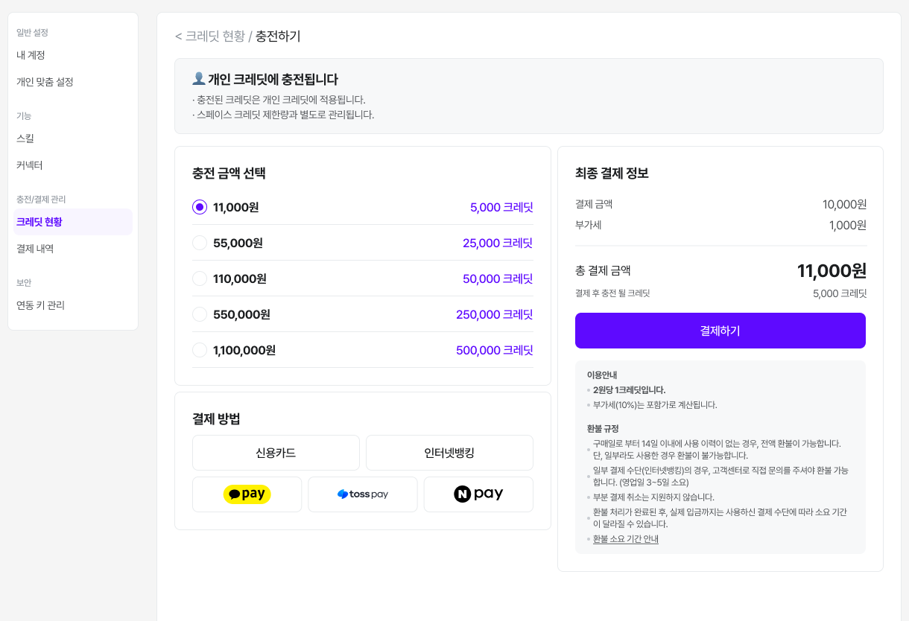
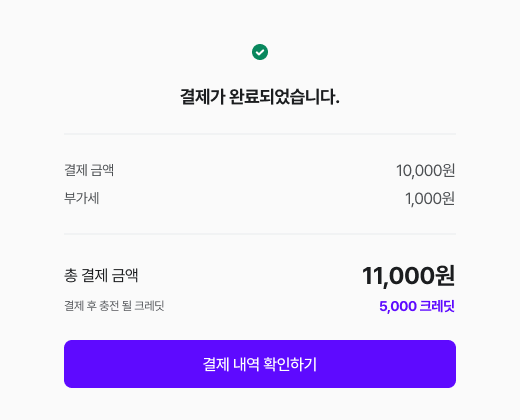
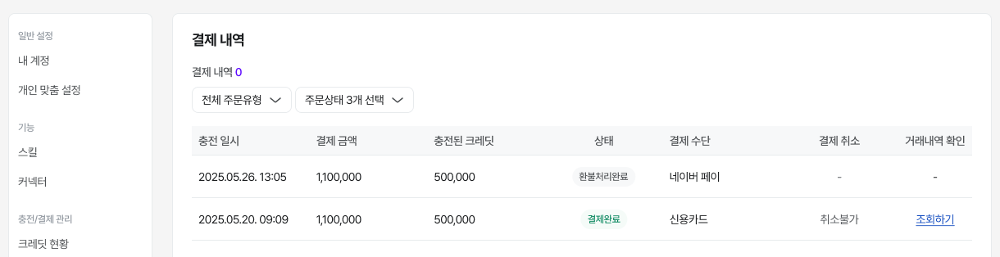
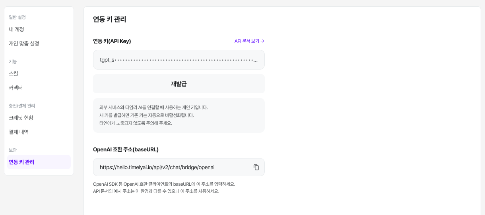

# 계정 설정

왼쪽 사이드바 맨 아래의 **프로필(내 이름)**을 누르고 **[내 계정]**을 선택하면 설정 화면이 열려요. 왼쪽 메뉴에서 바꾸고 싶은 항목을 골라요.

| 묶음 | 메뉴 | 할 수 있는 일 |
| --- | --- | --- |
| **일반 설정** | [내 계정](#1) | 프로필·비밀번호·로그인 기기·언어 관리 |
| | [개인 맞춤 설정](#1-1) | AI가 나에게 맞춰 답하도록 정보 입력 |
| **기능** | [스킬 · 커넥터](#features) | 채팅에서 쓸 스킬과 외부 앱 연결 |
| **충전/결제 관리** | [크레딧 현황](#2) | 남은 크레딧 확인, 개인 크레딧 충전 |
| | [결제 내역](#payments) | 충전 기록 확인과 결제 취소 |
| **보안** | [연동 키 관리](#3) | 외부 서비스 연결용 API 키 |

## 내 계정 {#1}

| 항목 | 설명 |
| --- | --- |
| **프로필 이미지 · 이름** | 연필 아이콘으로 이미지를 바꾸고, 이름을 고쳐 적어요 |
| **이메일** | 로그인할 때 쓰는 아이디라 바꿀 수 없어요 |
| **비밀번호** | **[변경]**을 눌러 현재 비밀번호와 새 비밀번호를 입력해요 |
| **로그인된 기기** | 최근 30일 안에 로그인한 기기예요. 모르는 기기가 있으면 **[로그아웃]**, 한꺼번에 정리하려면 **[다른 기기 모두 로그아웃]**을 눌러요 |
| **언어** | 화면에 표시되는 언어예요. 언어를 바꿔도 이미 만들어진 템플릿 이름은 바뀌지 않아요 |
| **마케팅 정보 수신 동의** | 선택 사항이라 언제든 켜고 끌 수 있어요 |
| **서비스 이용약관 · 개인정보처리방침** | 가입할 때 동의한 내용을 다시 볼 수 있어요 |

!!! warning "계정 삭제는 되돌릴 수 없어요"
    **[계정 삭제하기]**를 누르면 7일의 유예 기간이 지난 뒤 모든 데이터가 지워져요.

## 개인 맞춤 설정 {#1-1}

| 항목 | 설명 |
| --- | --- |
| **사용자 정보** | 닉네임 · 직업 · 내 추가 정보를 적어 두면 AI가 참고해서 답해요 |
| **AI 응답 방식** | 원하는 말투나 답변 방식을 적어요. 예) "핵심부터 짧게, 존댓말로" |
| **메인화면 표시** | 메인화면의 **추천 질문**을 켜고 꺼요 |
| **메모리** | AI가 대화에서 기억해 둔 정보예요. 새 대화에 자동으로 반영되며, 직접 추가 · 수정 · 삭제할 수 있어요 (최대 10개) |
| **색상 모드** | 시스템 색상 · 라이트 모드 · 다크 모드 중에서 골라요 |
| **사이드바** | 왼쪽 사이드바를 새 디자인 또는 이전 디자인으로 볼 수 있어요. 이전 디자인은 추후 제공이 종료될 수 있어요 |

> 💡 **스페이스 관리자가 추천 질문을 꺼 둔 경우에는 내가 다시 켤 수 없어요.**

## 스킬 · 커넥터 {#features}

채팅에서 쓸 기능을 미리 켜 두는 곳이에요. 채팅 입력창의 **[+] → [스킬] / [커넥터]**에서도 같은 화면을 열 수 있어요.

### 스킬 {#skills}

스킬을 켜면 파일 제작, 디자인 작업, 웹 테스트 같은 작업을 더 빠르게 도와줘요. 쓸 스킬의 스위치를 켜 두세요.

### 커넥터 {#connectors}

자주 쓰는 앱을 연결해 두면 대화하면서 바로 사용할 수 있어요. 앱 오른쪽의 **[+ 연결]**을 누르고, 끊을 때는 **[연결 해제]**를 눌러요.

## 크레딧 현황 {#2}

| 항목 | 설명 |
| --- | --- |
| **스페이스 크레딧** | 스페이스 관리자가 관리하는 크레딧이에요. 나에게 주어진 한도와 사용량, 남은 양을 보여 줘요 |
| **개인 크레딧** | 내가 직접 결제해서 충전한 크레딧이에요 |
| **현재 사용 중 크레딧** | 지금 어느 크레딧에서 차감할지 스위치로 골라요 |

> 💡 **스페이스 크레딧을 다 썼다면 개인 크레딧을 켜서 계속 이용할 수 있어요.**

### 개인 크레딧 충전 {#2-1}

개인 크레딧 오른쪽의 **[+ 충전하기]**를 눌러요.

1. **충전 금액**을 골라요. 2원당 1크레딧이고, 결제 금액에는 부가세(10%)가 포함돼요.
2. **결제 방법**을 골라요. 신용카드 · 인터넷뱅킹 · 간편결제 중에서 선택해요.
3. 오른쪽 **최종 결제 정보**를 확인하고 **[결제하기]**를 눌러요.

충전한 크레딧은 개인 크레딧에 들어가며, 스페이스 크레딧 한도와는 따로 관리돼요.

{ width="420" }

### 결제 내역과 취소 {#payments}

**[결제 내역]**에서 충전 기록과 상태를 확인하고, **[조회하기]**로 거래 내역을 볼 수 있어요.

!!! note "환불 규정"
    - 구매일로부터 **14일 이내이고 사용 이력이 없으면** 전액 환불돼요. 일부라도 사용했다면 환불할 수 없어요.
    - 부분 결제 취소는 지원하지 않아요.
    - 인터넷뱅킹처럼 일부 결제 수단은 고객센터로 직접 문의해야 환불돼요. (영업일 3~5일 소요)
    - 환불 처리가 끝난 뒤 실제 입금까지 걸리는 기간은 결제 수단에 따라 달라요.

## 연동 키 관리 {#3}

타임리 AI를 다른 프로그램이나 서비스에 연결할 때 쓰는 **개인 키(API Key)**를 확인하는 곳이에요.

| 항목 | 설명 |
| --- | --- |
| **연동 키(API Key)** | 외부 서비스와 타임리 AI를 연결할 때 쓰는 키예요. 오른쪽 **[API 문서 보기]**에서 사용 방법을 볼 수 있어요 |
| **[재발급]** | 새 키를 만들어요. 새 키를 발급하면 기존 키는 자동으로 쓸 수 없게 돼요 |
| **OpenAI 호환 주소(baseURL)** | OpenAI SDK 같은 OpenAI 호환 프로그램의 baseURL 칸에 넣는 주소예요. API 문서의 예시 주소와 다를 수 있으니 이 화면의 주소를 써 주세요 |

!!! warning "키는 다른 사람에게 보여 주지 마세요"
    키가 노출되면 다른 사람이 내 크레딧으로 AI를 쓸 수 있어요. 노출됐다면 바로 **[재발급]**해 주세요.

